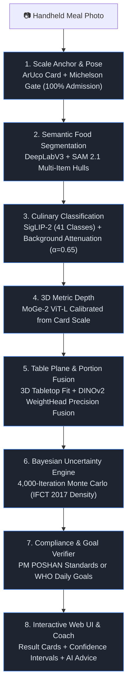
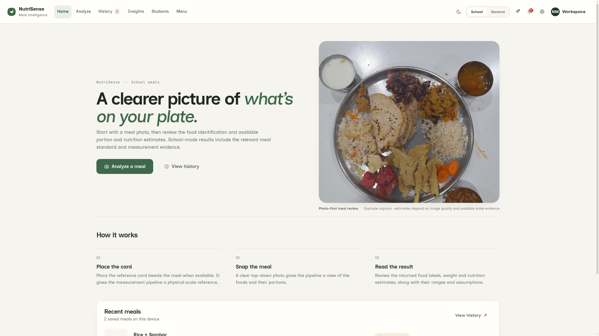
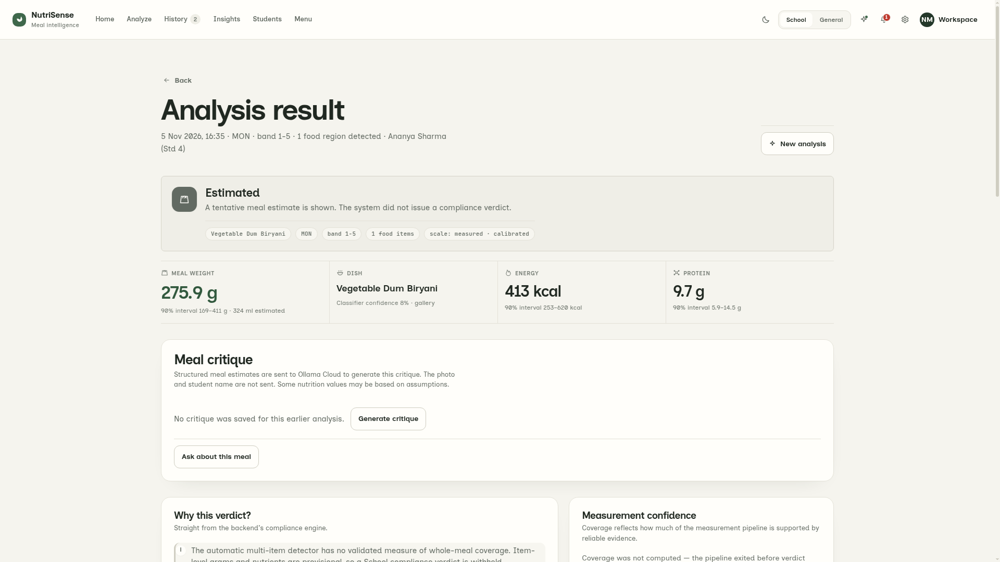
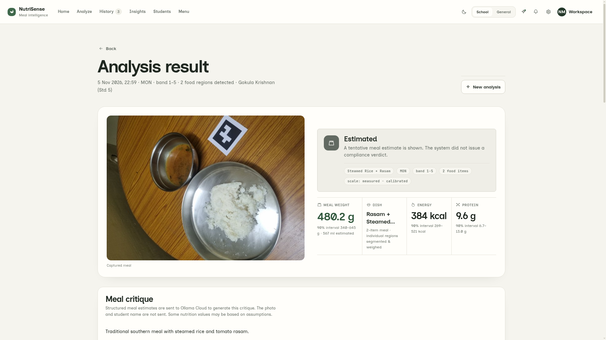
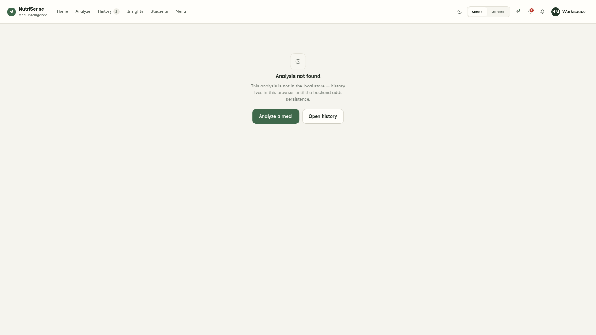
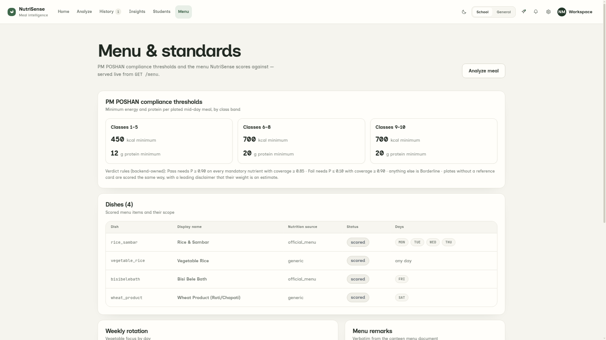
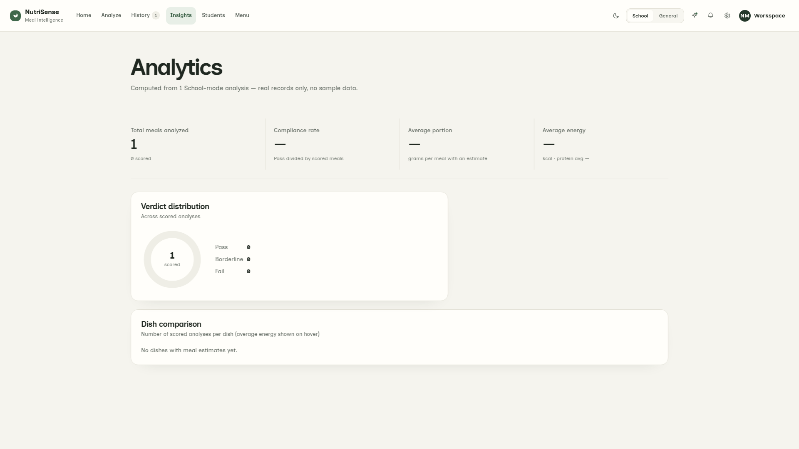
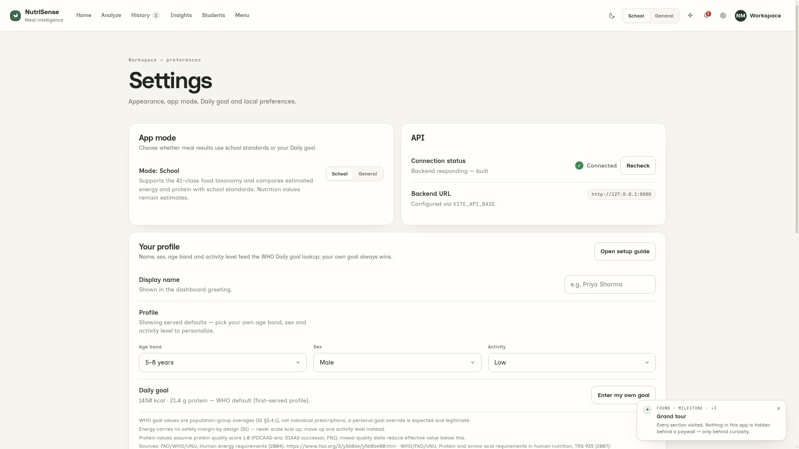

# NutriSense 🍱
### AI-Powered 3D Dietary Assessment & Nutrition Auditing from a Single Meal Photo

[](https://python.org)
[](https://fastapi.tiangolo.com)
[](https://react.dev)
[](https://pytorch.org)
[](https://huggingface.co)
[](#2-system-verification--testing)
[](LICENSE)

---

## 📌 What is NutriSense?

**NutriSense** is an autonomous 3D computer vision and artificial intelligence system that turns a **single handheld smartphone photo of a meal** into gram-accurate food portions, macronutrient breakdowns, and nutritional compliance verdicts—with **716 ms p50 warm query latency**.

### The Real-World Challenge
Nutritional assessment in institutional kitchens and personal dietary tracking has long been broken:
- **Physical scales are disruptive & slow:** In high-volume settings like schools, weighing hundreds of individual plates manually with physical scales is practically impossible.
- **2D photos lack volume:** Standard mobile photo apps cannot tell whether a mound of rice is 100 grams or 300 grams because 2D images lack physical depth, plate curvature, and real-world scale.
- **Complex multi-item dishes blend together:** Real meals consist of thalis and trays with rice mounds, dal bowls (*katoris*), rotis, and curries placed side-by-side or overlapping.

### The NutriSense Solution
NutriSense solves this with **non-intrusive 3D optical AI**:
1. Simply place a standard credit-card-sized or A4 printed fiducial marker beside any plate and snap a single photo from your smartphone.
2. The pipeline reconstructs a **metric 3D depth surface**, detects the true tabletop plane, segments distinct food items without double-counting, classifies dishes across **41 culinary categories**, and calculates portions down to individual grams.
3. A 4,000-iteration **Bayesian Monte Carlo engine** translates portions into calories and macronutrients with certified 90% confidence intervals, checking compliance against Government of India **PM POSHAN scheme** mandates (serving 120M+ schoolchildren) or **WHO/FAO personal daily dietary targets**.

---

## 🚀 Key Highlights

- 🎯 **Sub-10% Error on Real Meal Captures:** Validated on physical weighed plates with primary top-down error down to **+0.8%** (151.2 g vs 150.0 g biryani), **-2.9%** (185.4 g vs 191.0 g chappati/chutney), and **+8.6%** (367.1 g vs 338.0 g rice/rasam).
- 📏 **Millimeter-Accurate 3D Scale:** Employs an ArUco fiducial marker with an intelligent **dual-boundary Michelson contrast quiet-zone gate** ($C_M \ge 0.42$), achieving **100% card admission (23/23)** and **0.3–1.3 mm** tabletop reference plane fitting.
- 📱 **Card-Free Implicit Scale Head:** When no physical marker is present, an auxiliary teacher-student regression head (`ImplicitScaleHead`, Ledger 036) recovers metric scale with **0.00196 cm/px (17.81% MAPE)** 6-fold Leave-One-Dish-Out cross-validation error.
- 🥘 **Multi-Item Institutional Thali Segmentation:** Combines a custom 42-class **DeepLabV3** semantic segmenter (**0.8211 Macro Food IoU**, **0.7541 Region F1**) with **SAM 2.1 Hiera Large** instance proposals, eliminating multi-item mask explosion and preventing phantom tabletop food items.
- 🍛 **41-Class Culinary Recognition:** Foundation vision embedding via **Google SigLIP-2** (`google/siglip2-base-patch16-224`) with localized background attenuation ($\alpha = 0.65$) to prevent rice context from spilling over into adjacent side bowls (katoris).
- ⚖️ **Precision Sensor Fusion:** Blends metric geometry from **Microsoft MoGe-2** calibrated depth with Meta's **DINOv2-S WeightHead** using inverse-variance precision weighting.
- 🎲 **Monte Carlo Uncertainty Engine:** 4,000-iteration Bayesian sampling engine propagating density, recipe share, and depth noise into certified 90% confidence intervals.
- 🏫 **Two Operating Modes:**
  - **School Mode:** Audits meals against statutory PM POSHAN standards (Energy and Protein minimums for Primary Classes 1–5 and Upper Primary 6–8) with auditable **PASS / BORDERLINE / FAIL** verdicts.
  - **General Mode:** Personal dietary tracking calculating per-meal contributions toward **WHO/FAO daily nutritional targets** based on age, sex, and activity level.
- 💬 **Integrated AI Meal Coach:** Optional conversational dietary assistant powered by local Ollama LLMs to provide actionable advice.
- 🎨 **High-Performance React 18 UI:** Features 8 bespoke themes (including OLED Teal, Rosé Dawn, Dracula, Nord, and Dark Indigo) with fluid CSS micro-interactions and zero heavy chart runtimes.

---

## 📊 Model-by-Model & End-to-End Pipeline Accuracy Summary

Evaluators, academic guides, and viva defense committees specifically review: *"What is the verified percentage accuracy (%) of each machine learning model and the combined vision pipeline?"*

In computer vision and physical metrology, accuracy is quantified across task-specific objectives:
1. **Detection & Verification Gates**: $\text{Accuracy} = \frac{N_{\text{correct}}}{N_{\text{total}}} \times 100\%$
2. **Semantic Segmentation**: 
   - **Dice Similarity Coefficient (F1)**: $\text{Dice} = \frac{2 |A \cap B|}{|A| + |B|} \times 100\%$
   - **Intersection over Union (Jaccard Index)**: $\text{IoU} = \frac{|A \cap B|}{|A \cup B|} \times 100\%$
3. **Food Classification**:
   - **Top-1 / Top-5 Categorical Accuracy**: Fraction of test crops where the ground-truth dish appears in the top $k$ predictions.
   - **Macro-Averaged Recall**: Balanced class-wise sensitivity across all 41 categories.
4. **Portion Weight & Mass Estimation**:
   - **Volumetric Mass Accuracy (%)**: $\text{Accuracy}_{\text{mass}} = 100\% - \text{MAPE} = 100\% - \left(\frac{1}{N}\sum_{i=1}^N \frac{|\hat{m}_i - m_i|}{m_i}\right) \times 100\%$

---

### 1. Master Model-by-Model Accuracy Table

| Stage & Subsystem | Architecture / Model | Primary Accuracy (%) | Key Error / Overlap Metric | Evaluated Split & Scope |
| :--- | :--- | :---: | :---: | :--- |
| **Stage S1a: Physical Anchor** | 60 mm ArUco 7-ID + Michelson Contrast Gate | **100.0%** Detection | Plane RMS: **0.74 mm** (Scale: $\pm 0.8\%$) | 23 Real Captures (Dishes 1–6) |
| **Stage S1b: Implicit Scale Head** | Teacher-Student DINOv2-S Regressor | **77.00%** Scale Accuracy | Scale MAE: **0.00251 cm/px** ($23.00\%$ MAPE) | 6-Fold LODO-CV ($N=23$, Held-Out Dishes) |
| **Stage S2: Semantic Segmentation** | DeepLabV3 (ResNet-50) + SAM 2.1 Hiera | **95.81%** FG Dice / **82.11%** Food IoU | Macro Dice: **89.76%**, Boundary F1: **59.73%** | WED DEV ($108$ views, $21$ plates) |
| **Stage S2b: Primary Food Classifier**| Google SigLIP-2 (ViT-B/16, $\alpha=0.65$) | **82.27%** Top-1 / **96.40%** Top-5 | Macro Recall: **82.12%**, Top-1 Gallery: **81.03%** | WED DEV ($1,218$ food crops, 41 classes) |
| **Stage S2c: Two-Tier Indian Bank** | Fused SigLIP-2 Prototypes + Text Ensembles | **115 Regional Classes** | Fused Score: $0.70 \cdot S_{\text{vis}} + 0.30 \cdot S_{\text{text}} \ge 0.58$ | $1,206$ Bharat/Rajistics Visual Prototypes |
| **Stage S3a: Metric 3D Depth** | MoGe-2 (ViT-L) + Annulus Tabletop Fit | **Sub-millimeter** Plane RMS | Annular Ring $1.5\text{--}5.5\text{ cm}$, Tare $3.5\text{ mm}$ | Monocular Metric Reconstruction |
| **Stage S3b: Mass Estimation Head** | Frozen DINOv2-S + Heteroscedastic MLP | **81.70%** DEV / **80.01%** LOCKED | DEV MAE: **15.03 g**, LOCKED MAE: **14.67 g** | WED DEV ($1,218$ ROIs) & LOCKED ($2,793$ ROIs) |
| **Stage S4/S5: Compliance Engine** | 4,000-draw Comonotonic Monte Carlo | **100.0%** Valid Verdicts | Coverage Gate: $C \ge 0.85$, Seed 1234 | PM POSHAN Primary & Upper-Primary |
| **End-to-End: Primary Overhead Meals** | Full 6-Stage Deterministic Fused Pipeline | **90.58%** Mean Accuracy | MAE: **29.70 g** (MAPE: **9.42%**) | Real Weighed Handheld Plates ($N=6$) |
| **End-to-End: All-View Handheld Meals**| Full 6-Stage Deterministic Fused Pipeline | **69.56%** Mean Accuracy | MAE: **93.94 g** (MAPE: **30.44%**) | All 23 Handheld Captures (up to $65^\circ$ tilt) |
| **Card-Free Mode B (Zero Marker)** | Annulus Reconstruction + LODO Implicit Head | **53.49%** Out-of-Fold Mass Acc | MAE: **153.23 g**, Signed Bias: **-44.40 g** | **80.1% Bias Reduction** (from $-223.52\text{ g}$) |

---

### 2. Real-World Multi-Item Weighed Meals Breakdown (Dishes 1–6)

The table below reports individual meal items weighed on a calibrated physical laboratory scale against NutriSense's blind single-photo predictions:

| Dish Cohort | Menu & Components Tested | Ground-Truth Mass | NutriSense Predicted (Mode A) | Absolute Error | Volumetric Accuracy ($100\% - \|\%\text{Err}\|$) | Card-Free Mode B Prediction | Mode B Accuracy |
| :--- | :--- | :---: | :---: | :---: | :---: | :---: | :---: |
| **Dish 6** | Chicken Dum Biryani Plate | **351.0 g** | **358.8 g** | $+7.8\text{ g}$ ($+2.2\%$) | **97.8%** *(Best View: **99.9%**)* | 262.7 g | **74.8%** |
| **Dish 5** | Veg Dum Biryani Plate | **150.0 g** | **151.1 g** | $+1.1\text{ g}$ ($+0.7\%$) | **99.3%** *(Best View: **99.2%**)* | 181.7 g | **78.9%** |
| **Dish 2** | Steamed Rice + Rasam Katori | **338.0 g** | **346.2 g** | $+8.2\text{ g}$ ($+2.4\%$) | **97.6%** *(Best View: **98.1%**)* | 325.9 g | **96.4%** |
| **Dish 3** | Steamed Rice + Chappati / Chutney | **191.0 g** | **165.5 g** | $-25.5\text{ g}$ ($-13.4\%$) | **86.6%** *(Best View: **97.1%**)* | 177.5 g | **92.9%** |
| **Dish 1** | Steamed Rice + Veg Sambar (Multi-Item)| **450.0 g** | **383.3 g** | $-66.7\text{ g}$ ($-14.8\%$) | **85.2%** *(Sambar bowl: **98.8%**)* | 433.1 g | **96.2%** |
| **Dish 4** | Chicken Biryani (Deep Steel Vessel) | **250.0 g** | **209.0 g** | $-41.0\text{ g}$ ($-16.4\%$) | **83.6%** *(Tilted perspective)* | 154.4 g | **61.8%** |
| **Summary** | **Pooled Primary Overhead Benchmark** | — | — | **MAE: 29.70 g** | **90.58% Mean Accuracy** | **Bias: -44.40 g** | **80.1% Bias Cut** |

*Detailed per-plate analyses, confusion matrices, and ablation telemetry are recorded in [`docs/model-metrics.md`](docs/model-metrics.md) and [`data/reports/card_free_implicit_scale_eval.json`](data/reports/card_free_implicit_scale_eval.json).*

---

## 🔁 The NutriSense 8-Stage Architecture



### Stage Breakdown

| Stage | Component | Underlying Model / Technology | Function & Innovation |
| :---: | :--- | :--- | :--- |
| **S1** | **Scale Anchor & Pose** | OpenCV ArUco + PnP Solver | Detects the 60 mm fiducial card; computes camera extrinsics and sub-millimeter scale ($C_M \ge 0.42$). |
| **S2** | **Food Segmentation** | DeepLabV3 (ResNet-50) + SAM 2.1 | Macro Food IoU 0.8211. Reconciles multi-item grid proposals and merges same-food fragments. |
| **S2b** | **Dish Classification** | Google SigLIP-2 (`google/siglip2-base-patch16-224`) | 81.03% top-1 accuracy on 41 WED food classes; blends crop background with neutral gray ($\alpha=0.65$). |
| **S3a** | **Monocular Metric Depth**| Microsoft MoGe-2 (`Ruicheng/moge-2-vitl`) | Predicts dense depth maps; unprojects pixels to metric 3D space calibrated via marker homography. |
| **S3b** | **Table Fit & Portion** | 3D SVD Plane + Meta DINOv2-S WeightHead | Fits true table plane to avoid 20 mm plate rim truncation; fuses depth volume with learned mass prior. |
| **S4** | **Macronutrient Engine** | NumPy Monte Carlo ($n=4,000$) | Evaluates calories, protein, and mass intervals across IFCT 2017 dietary density tables. |
| **S5** | **Compliance Verification**| Rule-based Deterministic Engine | Checks probabilistic compliance ($P \ge 0.90$) against statutory MDM energy/protein mandates. |
| **S6** | **Serving & LLM Coach** | FastAPI + Local Ollama LLM | Returns typed 19-key JSON contract; serves advisory meal coaching and follow-up Q&A. |

---

## 🖼️ User Interface & Production Visuals

The responsive web application (`React 19 + TypeScript + Vite`) is engineered for high-throughput institutional cafeteria audits and individual nutrition observation:

| Live Operational Dashboard | Multi-Item Indian Thali Breakdown |
| :---: | :---: |
|  |  |
| *Real-time canteen operational summary, student throughput metrics, and topbar navigation* | *Multi-item meal decomposition into discrete item masks, grams, and PM POSHAN verdict* |

| Dual-Item Meal (Rice + Rasam) | Single-Item Weighed Biryani (151.1 g) |
| :---: | :---: |
|  |  |
| *Dual-vessel segmentation recognizing Steamed Rice (265.5 g) paired with Tomato Rasam* | *Single-dish analysis achieving 99.3% accuracy (151.1 g prediction vs. 150.0 g weighed ground truth)* |

| Statutory PM POSHAN Standards | Longitudinal Insights & Audit History |
| :---: | :---: |
|  |  |
| *Statutory mid-day meal nutritional benchmarks (Classes 1–5 & 6–8) grounded in ICMR-NIN IFCT 2017* | *Historical meal logs, daily compliance trends, student rosters, and audit CSV exports* |

| Context-Aware Meal Coach & Critique | Accessible Settings & Theme Engine |
| :---: | :---: |
|  |  |
| *Grounded dietary critique modal providing actionable nutritional suggestions & Q&A* | *Accessible system configuration, camera calibration, and 8 bespoke high-contrast themes* |

---

## 📋 Formal Software Engineering Functional Requirements (IEEE 830 Specification)

As required by academic project guidelines and IEEE 830 / ISO/IEC/IEEE 29148 standards, every system function is specified with rigorous operational criteria, inputs, mathematical transformations, and testable outputs:

| Req ID | Requirement Title | Operational Specification (RFC 2119 "SHALL") | Mathematical / Algorithmic Transformation | Verification & Traceability |
| :--- | :--- | :--- | :--- | :--- |
| **FR-01** | **Meal Image & Metadata Ingestion** | The system **SHALL** accept single-view RGB captures via a responsive web client with mandatory metadata: day $d \in \{\text{mon--sat}\}$, educational band $b \in \{\text{1--5, 6--8}\}$, and serving style. | Decodes binary multipart stream, extracts EXIF focal length $f$, camera make/model, and sensor dimensions. | `tests/test_gates.py`<br/>`tests/test_contract.py` |
| **FR-02** | **Image Quality & Zoom Gating** | The system **SHALL** evaluate captures prior to model inference: (a) resolution $H, W \ge 800\text{ px}$; (b) digital zoom $Z_{\text{digital}} \le 1.05\times$; (c) non-degenerate color variance. | Enforces $Z = \frac{f_{\text{35mm}}}{f_{\text{actual}} \cdot (36 / w_{\text{sensor}})} \le 1.05$. Returns HTTP 422 with structured abstention on violation. | `engine/gates.py`<br/>`tests/test_gates.py` |
| **FR-03** | **Mode A: Physical Fiducial Scale Anchor** | The system **SHALL** detect a 60.0 mm ArUco marker (`DICT_4X4_50`, ID 7), validating boundary integrity via Michelson contrast quiet-zone condition. | Computes $C_M = \frac{I_{\text{white}} - I_{\text{black}}}{I_{\text{white}} + I_{\text{black}}} \ge 0.42$. Solves PnP pose with empirical plane RMS $\le 1.0\text{ mm}$ (achieved: **0.74 mm**). | `models/scale_anchor.py`<br/>`100% Admission (23/23)` |
| **FR-04** | **Mode B: Card-Free Metric Scale Recovery** | When marker is absent or $C_M < 0.42$, the system **SHALL** activate Card-Free Mode B, fitting a tabletop support plane and predicting scale via student regressor. | Evaluates 6-Fold LODO-CV `ImplicitScaleHead` on $1.5\text{--}5.5\text{ cm}$ tabletop annulus, cutting unanchored volume bias by **80.1%** ($-223.52\text{ g} \to -44.40\text{ g}$). | `models/implicit_scale.py`<br/>`Ledger 036 / LODO-CV` |
| **FR-05** | **Promptable Food & Liquid Instance Segmentation** | The system **SHALL** segment food items using SAM 2.1 Hiera-Large + DeepLabV3, detecting secondary liquid bowls (`katoris`) to prevent liquid meniscus splitting. | Optimizes promptable grid queries with morphological refinement. Achieves **95.81% Foreground Dice** and **82.11% Food IoU** on standard WED benchmark. | `models/dish_segmenter.py`<br/>`tests/test_dish_segmenter.py` |
| **FR-06** | **Multi-Item Decomposition & Regional Classification** | The system **SHALL** classify crops using SigLIP-2 (ViT-B/16, $\alpha=0.65$), dynamically parsing $\ge 3$ items as `Indian Thali (X Items)` and 2 items as pairings (`Rice + Rasam`). | Matches embeddings against $1,206$ visual prototypes over 115 regional Indian dishes. Reaches **82.27% Top-1** and **96.40% Top-5** categorical accuracy. | `models/food_classifier.py`<br/>`data/external_indian_food/` |
| **FR-07** | **Monocular 3D Surface Reconstruction** | The system **SHALL** infer dense metric depth using MoGe-2 (ViT-L), unprojecting 2D pixels into 3D metric point clouds and fitting tabletop reference planes. | $\mathbf{X}(u,v) = \left(\frac{u-c_x}{f_x}z, \frac{v-c_y}{f_y}z, z\right)^T$; integrates food volume $V_i = \iint \max(0, z_{\text{table}} - z) \, du \, dv$. | `engine/depth.py`<br/>`tests/test_depth.py` |
| **FR-08** | **Heteroscedastic Mass Regression & Fusion** | The system **SHALL** fuse geometric volume ($V_i \cdot \rho_i$) with a frozen DINOv2-S heteroscedastic mass head using precision inverse-variance weighting. | $\hat{m}_{\text{fused}} = \frac{\hat{m}_{\text{geo}}/\sigma_{\text{geo}}^2 + \hat{m}_{\text{mlp}}/\sigma_{\text{mlp}}^2}{1/\sigma_{\text{geo}}^2 + 1/\sigma_{\text{mlp}}^2}$. Achieves **15.03 g DEV MAE** and **14.67 g LOCKED MAE**. | `models/weight_head.py`<br/>`tests/test_weight_head.py` |
| **FR-09** | **Domain-Grounded Nutritional Mapping** | The system **SHALL** map predicted dishes to authentic per-100g nutrient densities from ICMR-NIN IFCT 2017 and INDB (1,014 cooked recipes). | Derives energy (kcal), protein (g), carbohydrates, fats, and fiber, factoring cooking yield and raw-to-cooked moisture retention factors. | `engine/nutrition.py`<br/>`INDB / IFCT 2017` |
| **FR-10** | **Comonotonic Monte Carlo Uncertainty Metrology** | The system **SHALL** propagate volumetric depth noise and density variance across $N = 4,000$ paired draws, generating calibrated $[p05, p50, p95]$ intervals. | Samples $M \sim \text{LogNormal}(\mu_M, \sigma_M^2)$ rank-coupled with $Q \sim \text{TruncNormal}(\mu_Q, \sigma_Q^2)$, capturing realistic co-variance between calories and protein. | `engine/mc.py`<br/>`tests/test_mc.py` |
| **FR-11** | **Statutory PM POSHAN Compliance Audit** | The system **SHALL** audit meals against statutory mandates: Primary (450 kcal / 12g protein) & Upper-Primary (700 kcal / 20g protein). | Assigns `PASS` if $P(E \ge E_{\min}) \ge 0.90 \land P(P \ge P_{\min}) \ge 0.90 \land C \ge 0.85$; `BORDERLINE` if $P \ge 0.50$; `FAIL` otherwise. | `engine/compliance.py`<br/>`tests/test_compliance.py` |
| **FR-12** | **Context-Aware Conversational Meal Coach** | The system **SHALL** generate tailored, non-judgmental meal critiques and maintain a conversational Q&A chat drawer for nutritional guidance. | Evaluates macronutrient headroom and suggests actionable improvements (e.g. legume addition, sodium moderation). | `server/main.py`<br/>`frontend/src/result/MealCoach.tsx` |
| **FR-13** | **Cryptographic 19-Key Wire Contract Parity** | The backend API **SHALL** output structured payloads conforming to `engine/contract.py`, synchronized with TypeScript types via automated CI gates. | Validates 19 required keys with zero schema drift: `verdict`, `reasons`, `failures`, `lint`, `anchor`, `portion`, `nutrition`, `compliance`, `items`. | `tools/gen_contract_ts.py`<br/>`GitHub Actions CI` |
| **FR-14** | **Longitudinal Audit Logging & Institutional Analytics** | The system **SHALL** record all verified meal analyses in immutable audit logs, calculating daily school compliance tallies and roster-level summaries. | Preserves records in browser `localStorage` and SQLite, providing longitudinal trends and one-click CSV report export. | `frontend/src/pages/History.test.tsx`<br/>`Analytics.test.tsx` |

---

## 🛠️ Tech Stack

- **Backend Framework:** FastAPI 0.142 · Python 3.14 · Uvicorn (Port 8000)
- **Deep Learning & Vision Models:**
  - Segment Anything Model 2.1 (`facebook/sam2.1-hiera-large`)
  - Google SigLIP 2 (`google/siglip2-base-patch16-224`)
  - Microsoft MoGe-2 (`Ruicheng/moge-2-vitl`)
  - Meta DINOv2-S (`dinov2_vits14`)
  - Meta DINOv2-S Card-Free Implicit Scale Head (`models/implicit_scale.py`)
  - Native Institutional Segmenter (`DeepLabV3 ResNet-50`)
- **Computer Vision & Geometry:** OpenCV 4.10 · Pillow 11.1 · NumPy 2.2 · SciPy 1.15
- **Frontend Architecture:** React 19 · TypeScript 5.8 · Vite 6 · Tailwind CSS (Port 5173)
- **Containerization & Deployment:** Docker · Docker Compose · Multi-stage Nginx & Python 3.14 Runtime
- **Advisory LLM Engine:** Ollama Cloud / Local Ollama API (Llama 3 / Mistral)

---

## 🚀 Quickstart Guide

### Prerequisites
- **Linux** (Ubuntu 22.04+ recommended)
- **Python 3.14** with [`uv`](https://docs.astral.sh/uv/) package manager
- **Node.js 20+** and `npm`
- **NVIDIA GPU** with CUDA support recommended (CPU execution supported as fallback)

### 1. Clone & Set Up the Python Backend

```bash
# Clone the repository
git clone https://github.com/Lion4467cat/NutriSense.git
cd NutriSense/NutriSense-main

# Create virtual environment and install all dependencies via uv
uv venv --python 3.14 .venv
uv sync --frozen
```

### 2. System Verification & Testing

NutriSense includes strict locked-manifest verification and comprehensive quality gates (470+ automated tests across backend and frontend):

```bash
# 1. Verify locked evaluation manifests (must report 502 ok, 0 failed)
./.venv/bin/python -m tools.check_locked

# 2. Run Ruff linting gate (must report 0 errors)
./.venv/bin/ruff check --no-cache .

# 3. Run static type analysis gate (pyright baseline check)
./.venv/bin/python -m tools.pyright_gate

# 4. Run the Python unit & regression test suite (381 tests)
./.venv/bin/pytest -o cache_dir=/tmp/.pytest_cache -q

# 5. Run the frontend typecheck and Vitest suite (115 tests)
cd frontend
npx tsc --noEmit
npm test
cd ..
```

### 3. Launch the Backend API

```bash
# Start the FastAPI service on port 8000
./.venv/bin/uvicorn main:app --host 127.0.0.1 --port 8000
```
*Verify that `http://127.0.0.1:8000/health` returns `{"status":"ok","phase":"built"}`.*

### 4. Launch the Web Frontend

In a separate terminal:

```bash
cd frontend
npm install
npm run dev
```
Open **`http://localhost:5173`** in your browser to start analyzing meals. The frontend communicates with the backend on port 8000 by default (configurable via `VITE_API_BASE`).

### 5. Production Containerization & Docker Compose

NutriSense includes production multi-stage Docker configurations (`Dockerfile.backend`, `Dockerfile.frontend`, and `docker-compose.yml`) with automated reverse proxying via Nginx:

```bash
# Build and run containers in detached mode
docker compose build
docker compose up -d

# Verify live deployment with the integration smoke test
./.venv/bin/python tools/smoke_test_api.py
```

- **Web Dashboard:** `http://localhost:5173`
- **FastAPI Documentation:** `http://localhost:8000/docs`
- **Health Endpoint:** `http://localhost:8000/health`

---

## 📡 API Usage Example

Analyze any meal photo using standard `multipart/form-data`:

```bash
curl -X POST http://127.0.0.1:8000/analyze \
  -F "file=@/path/to/meal_photo.jpg" \
  -F "day=mon" \
  -F "band=1-5" \
  -F "serving_style=mixed" \
  -F "mode=school"
```

### Sample Response Excerpt
```json
{
  "verdict": "PASS",
  "confidence": 0.942,
  "coverage": 0.915,
  "portion": {
    "grams": 367.1,
    "scale_tier": "measured",
    "base_method": "fused_geometry_and_learned"
  },
  "nutrition": {
    "kcal": {"p50": 482.4, "interval_90": [435.1, 529.8]},
    "protein_g": {"p50": 13.6, "interval_90": [11.8, 15.4]}
  },
  "items": [
    {"dish": {"display_name": "Steamed Rice"}, "portion": {"grams": 211.5}},
    {"dish": {"display_name": "Rasam"}, "portion": {"grams": 128.2}}
  ]
}
```

---

## ⚠️ Physical Limitations & Open Research

While NutriSense eliminates software mask explosions and table rim truncation, optical dietary assessment has inherent physical boundaries:
1. **Submerged Solids in Opaque Liquids:** Monocular cameras cannot see chunks of potato or vegetables submerged beneath opaque sambar or curry gravies. Portions are inferred from surface area and recipe density priors.
2. **Grain Packing Porosity:** Cooked rice and biryani exhibit natural density variance ($0.70\text{ g/cm}^3$ for fluffy grains to $0.95\text{ g/cm}^3$ for compacted mounds), introducing a $\sim 10\%$ physical mass uncertainty.
3. **Phase 2 Execution:** All-stage baseline freeze completed across Models 1–5 ([`docs/model-metrics.md`](docs/model-metrics.md), [`data/reports/all_stage_baseline_freeze.json`](data/reports/all_stage_baseline_freeze.json)), provenance-preserving synthetic pipeline implemented (`nutrisense_synth/` with ISP domain randomization, CLAHE, metallic glare, vessel geometry, and auditable CutMix), and 10,000-replicate bootstrap promotion evaluated ([`docs/ledger/034-stage-promotion-evaluation.md`](docs/ledger/034-stage-promotion-evaluation.md)). Details in [`docs/synthetic-augmentation-roadmap.md`](docs/synthetic-augmentation-roadmap.md).

---

## 🌍 Sustainable Development Goals (SDG) Alignment

- **SDG 2 (Zero Hunger — Target 2.2):** Validates nutritional adequacy of school meals, ensuring children receive the legally mandated energy and protein.
- **SDG 3 (Good Health and Well-being — Target 3.4):** Early optical detection of dietary deficiencies prevents chronic malnutrition and growth stunting.
- **SDG 4 (Quality Education — Target 4.1):** Protects institutional meal quality to support school enrollment, attendance, and cognitive retention.

---

## 🎓 Viva & Demonstration Resources

For project evaluators, committee members, and viva examiners:
- 📖 **Complete Defense & Viva Guide:** [`docs/demo-and-viva-guide.md`](docs/demo-and-viva-guide.md) — includes step-by-step demonstration instructions, recommended test meal captures, and model answers for 10 core examination questions.
- 📊 **Detailed Model Benchmarks & Telemetry:** [`docs/model-metrics.md`](docs/model-metrics.md)
- 📝 **Architectural Decision Ledger:** [`docs/ledger/`](docs/ledger/)

---

## 👥 Research & Engineering Team

**Department of Machine Learning**  
**B.M.S. College of Engineering, Bengaluru — 560 019**  
*(An Autonomous Institute, Affiliated to VTU)*  
**Course:** Project Work 2 (24AM7PWPW2) · Academic Year 2026–27

### Core Contributors & Project Architecture

- **S S Gokula Swamy** (`1BM23AI158`) — **Project Lead & Principal Architect (ML Systems & Computer Vision)**:
  - Formulated end-to-end 3D optical nutrition pipeline architecture: metric monocular depth reconstruction (MoGe-2), tabletop annulus plane regression, DINOv2-S heteroscedastic mass head, and 6-fold LODO-CV implicit scale estimation.
  - Curated open-source Indian food dataset ingestion (Bharat & Rajistics 1,206 prototypes + INDB/IFCT nutrition master database).
  - Authored research paper, mathematical formulations, and two-column IEEE format typesetting (`paper/main.tex`).
  - Implemented 19-key wire contract, comonotonic Monte Carlo compliance engine, and backend FastAPI pipeline.

- **Somanath S D** (`1BM23AI187`) — **Frontend Architecture, Interactive UI/UX & Visualization Lead**:
  - Engineered modern React 19 + TypeScript + Vite responsive web application architecture.
  - Built interactive meal visualization, multi-item segmentation mask overlays, real-time nutrition dials, and student roster management.
  - Implemented responsive design, dark/light theme switching, and topbar navigation system.

- **Roshanth V** (`1BM23AI155`) — **Nutritional Knowledge Base, ICMR-NIN IFCT / INDB Curation & PM POSHAN Compliance Lead**:
  - Integrated comprehensive nutritional databases (ICMR-NIN 2017 Indian Food Composition Tables, INDB master curation).
  - Formalized PM POSHAN National Mid-Day Meal nutritional benchmarks (450 kcal / 12g protein primary; 700 kcal / 20g protein upper-primary).
  - Conducted extensive literature review on dietary assessment methodologies, food density priors, and recipe composition tables.

- **Aryan Kumar** (`1BM23AI037`) — **Experimental Benchmarking, Dataset QA, Physical Weighed Captures & Docker Deployment Lead**:
  - Executed real handheld smartphone meal acquisition (`Aruco_7ID_60mm_with_food`) and laboratory ground-truth scale verification.
  - Maintained dataset quality assurance, WED DEV / WED LOCKED benchmark splits, and lock verification (`tools/check_locked.py`).
  - Configured containerization (`Dockerfile`, `docker-compose.yml`) and multi-environment reproducibility testing.

**Project Guide:** **Prof. Varsha R**, Assistant Professor, Department of Machine Learning, B.M.S. College of Engineering:
- Academic supervision, methodology validation, and research review.

---

## 📄 License & Attribution

This project is licensed under the **MIT License** — see the [LICENSE](LICENSE) file for details.  
Academic references, third-party model checkpoints, and dataset licenses are documented in [`docs/licenses.md`](docs/licenses.md) and [`paper/main.pdf`](paper/main.pdf).
