# NutriSense 🍱
### Photo → portion → nutrients → PM POSHAN compliance verdict, for Karnataka MDM canteens

[](https://python.org)
[](https://fastapi.tiangolo.com)
[](#-evidence-and-limitations)
[](https://huggingface.co)
[](LICENSE)

---

## 📌 Overview

NutriSense analyzes a **photo of a plated meal** and can estimate portions, nutrients, and a coverage-aware school-meal comparison. If image structure or a label is uncertain but a numeric estimate is still possible, it returns an **ESTIMATED** result without a school verdict; if a required stage cannot produce a usable value, it returns `cannot_verify`. The app is a research prototype, and recent multi-item fixes have not been validated on new real photographs.

Everything the pipeline decides is traceable: which scale anchor was used, how large the uncertainty was, which parameters are still `assumed`, and why a verdict landed where it did. Meal results now include an optional model-generated critique and a meal-scoped follow-up chat; analysis and conversations remain in browser storage.

**What it does:**

- Uses a **60 mm ArUco marker** printed on A4 for measured scale. Selected no-marker cases use the WED-trained weight head; some uncertainty cases may use a labeled prior estimate. Missing model stages or failed numeric estimates still produce `cannot_verify`.
- Proposes up to nine meal regions, partitions shared mask pixels once, classifies regions across the configured 41 WED food classes, and aggregates their estimated portions. Repeated labels are permitted for separate regions.
- Reports a WED crop-classifier score of **81.03% top-1 (987/1,218)**, but 41 of 108 development views overlap gallery sources. This is a contaminated crop result, not full-image or meal accuracy. The 997-embedding gallery leave-one-out score is **78.03%** and is not an independent test result.
- Propagates modeled uncertainty with 4,000 Monte Carlo samples into nominal 90% intervals. The one-time WED LOCKED weight-head report measured **82.77%** coverage, below the nominal 90%; current interval coverage on target meals is unknown.
- Compares estimated cooked-plate energy and protein with configured class-band minimums only when the meal structure and labels support scoring. Uncertain fallback estimates do not receive a school verdict.

A React web UI wraps the pipeline: dashboard, photo analysis, per-item result evidence, verdict or estimate-only detail, history and search, student records, menu browser, analytics, and settings. Automatic meal critique and optional follow-up chat are advisory and do not affect the school comparison.

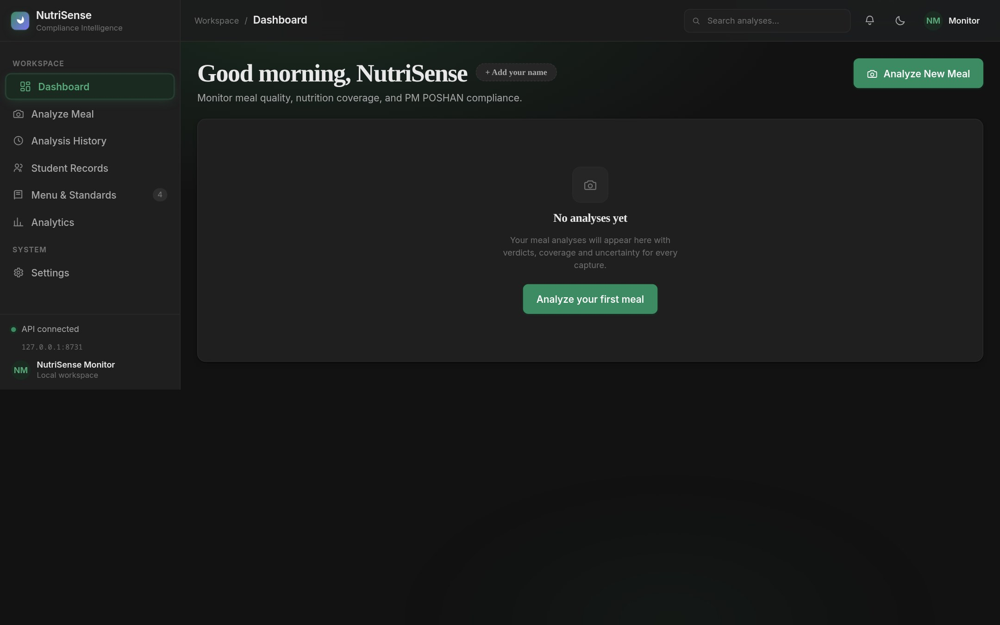

---

## 🔁 Analysis Pipeline

The current photo-to-result flow (`engine/pipeline.py`):

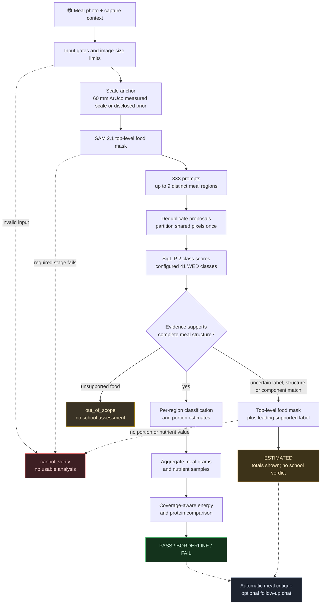

Every outcome serializes through the same 19-key contract. Complete supported regions can be aggregated and scored; estimate-only fallbacks have no school verdict, and required stage failures remain `cannot_verify`. An estimate does not imply that the predicted class, masks, portion, or nutrients are accurate.

### Pipeline components

| Stage | What runs | Model / method |
|---|---|---|
| Lint | digital-zoom gate, day/band validation, resolution note | pure rules |
| S1 Scale anchor | 2 tiers: card → prior (learned-weight coverage 0.90; geometry-prior coverage 0.60) | ArUco card detector |
| S2 Segment | top-level food mask plus up to nine meal-region proposals; shared pixels are assigned once | SAM 2.1 (`facebook/sam2.1-hiera-large`) |
| S2 Classify | ranked class evidence for meal regions; low-score candidates can support estimate-only output | SigLIP 2 (`google/siglip2-base-patch16-224`) |
| S3 Depth | metric depth; `fov_x` (from intrinsics) passed to the model; scale calibrated on the marker, status reported `card`/`none` — never fabricated | MoGe-2 (`Ruicheng/moge-2-vitl`) |
| S3 Portion | grams = anchor-scaled area × height above base × density | ring / table-prior / size-prior paths |
| S4 Nutrition | lognormal sampling of every uncertainty source | Monte Carlo, n=4000, fixed seed (sole interval owner) |
| S5 Compliance | P(at/above min) per mandatory nutrient × coverage factors, only for supported meal structure | pure rules from `data/standards.yaml` |

---

## ✨ Features

**Implemented capabilities:**

- **Two app modes (spec 002, ADR 0003)** — **School** compares supported meal estimates against configured school standards; **General** reports grams, nutrients, and each meal's share of a Daily goal, with no verdicts or school capture fields. General mode requests profile details during setup; Settings keeps the same fields editable.
- **WHO Daily goals** — `GET /goals` serves the WHO energy/protein tables keyed by age band, sex and activity level; the frontend does the lookup and share math, so a profile change never re-analyzes a photo
- **41-class recognition** — SigLIP 2 ranks configured WED classes. The WED crop report scored 81.03% top-1 (987/1,218), but 41/108 DEV views overlap gallery sources; this is contaminated crop evidence, not whole-image accuracy. Top-1 softmax confidence and the gallery cosine match score are different metrics. Low-score candidates are estimate-only and do not receive school scoring.

- **Two-tier scale anchor** — reference card (60 mm ArUco) or disclosed prior; the scale tier affects uncertainty and coverage.
- **Learned weight fallback (no card)** — a frozen DINOv2-S encoder and WED-trained class-conditional head supply selected no-card portion estimates. WED DEV: 15.034 g MAE (108 views, 21 plates, 1,218 regions); the one-time WED LOCKED report: 14.667 g MAE and 82.77% nominal 90% interval coverage. These are region-level WED results, not target-meal accuracy. WED dataset terms are not published; see [`docs/licenses.md`](docs/licenses.md).
- **Gallery dish classification** — the local gallery has 997 embeddings; leave-one-out score is 78.03%, an internal diagnostic rather than an independent test.
- **Multi-item meals (specs 003/004)** — the runtime proposes and estimates up to nine meal regions and sums their portions. Shared mask pixels are partitioned once, repeated labels are allowed across separate regions, and unresolved structure falls back to an estimate-only result with no compliance verdict. Synthetic regressions pass; the 23-view/six-plate ArUco pilot remains EVAL-ONLY and has not been rerun after these changes.
- **Monocular depth with metric calibration** — the card-calibration result of ~1.1% median error is from a rendered/synthetic diagnostic, not a real-meal depth validation.
- **Portion estimation** — plate +6.6% / bowl +5.6% volume vs ground truth on synthetic scenes; prior tier flagged `vessel_shape_uncertain`
- **Monte Carlo nutrient engine** — grams lognormal from per-dish σ, recipe-share noise, nutrient-table σ, temperature-scaled intervals; raw-equivalent diagnostics kept informational only
- **Compliance verdicts** — PASS requires P≥0.90 and coverage≥0.85; FAIL requires P≤0.10 and coverage≥0.90; other scoreable cases are BORDERLINE. Only supported meal structure is scored. Estimate-only fallbacks have no school verdict; salt is advisory.
- **FastAPI service** — `GET /health`, `GET /menu`, `GET /goals`, `POST /analyze` with full diagnostics in every response
- **React + TypeScript frontend** — dashboard, analysis flow, item-level evidence, result views for PASS / BORDERLINE / FAIL / ESTIMATED / cannot_verify / out_of_scope, history, student records, menu browser, analytics, and settings. Records and follow-up chats are stored in this browser; there is no backend record database.
- **Meal critique and follow-up chat** — a grounded critique is requested after analysis, and users can ask follow-up questions about that meal. The backend sends structured analysis fields (not the photo or student name) to configured Ollama Cloud models; configure only models included in the account's free allowance as described in [`docs/meal-coach-setup.md`](docs/meal-coach-setup.md). Critiques and successful chat turns are stored with the local analysis record.
- **Themes** — 8 curated looks (System follows the OS, plus Light, Dark, Nord, Rosé Pine, Dracula, Catppuccin, Rosé Dawn); the default Light/Dark pair is porcelain + indigo so verdict green/amber/red stay semantic, and each theme keeps a coordinated accent set; pre-consolidation ids (Sepia/Midnight/OLED) map forward so stored preferences keep working
- **Off-menu route (ticket 07)** — ingredient density table (FAO), INDB recipe table and a checkpoint-gated ingredient head; serving is wired end to end but the N5k transfer gate failed (ledger 012), so no candidate checkpoint ships and the route stays dormant
- **Real-photo segmentation guard** — a point prompt that returns a sliver (< 0.5% of frame) now falls back to the box prompt instead of being measured as a serving (ledger 014)
- **Synthetic scene renderer** — full GT (image, depth, masks, grams, anchor) powering the test suite

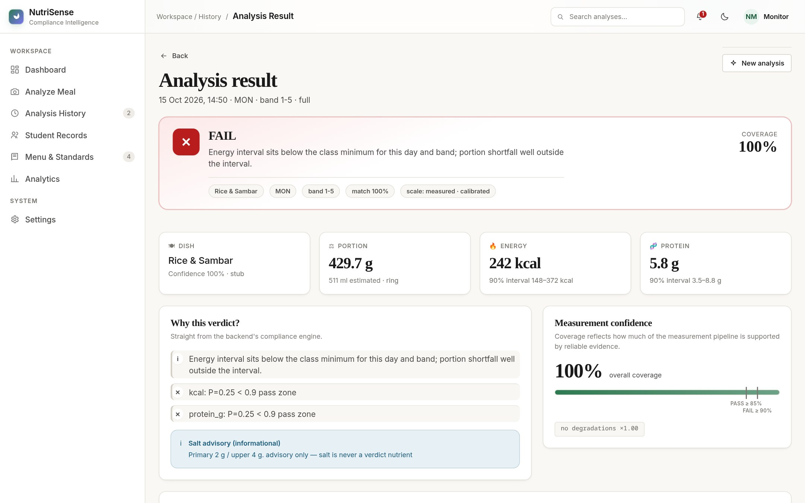

**Open release gates:** prior-tier depth-scale validation, multi-vessel (thali) stability and meal-composition scope, nutrient-table validation, data rights, and independent representative holdout evaluation. A 23-image / six-plate weighed ArUco pilot is complete and documented as EVAL-ONLY; it found severe mask spill and overestimation on many views, so it is not evidence of field readiness and must not be used for tuning. See the current gate-by-gate status in [`docs/production-readiness.md`](docs/production-readiness.md).

**Estimator improvement loop:** synthetic diagnostics rejected vessel-mask spill as a sufficient explanation and rejected a local surface-area integration candidate. A preregistered card-position replication measured all 18 fixed placements: global-scale spread was 65.96–70.74% in all six scenes, while homography-area estimates had 1.38–3.27% spread and −4.60% to −0.71% signed error. A follow-up found the renderer defines its mask footprint at table-plane ray intersections, limiting interpretation of plane-height results. These are synthetic diagnostics using exact masks and matching intrinsics; no serving or renderer code changed. The weighed ArUco plates remain EVAL-ONLY. See [`docs/agentic-improvement-loop.md`](docs/agentic-improvement-loop.md) and ledgers [025](docs/ledger/025-synthetic-card-position-replication.md) and [026](docs/ledger/026-card-food-plane-height-audit.md).

**Model-quality status:** the current WED DEV reference is 15.034 g MAE on 108 views / 21 plates. This carve is also used for epoch selection, so it is development evidence rather than an independent generalization claim. Five-fold plate-grouped WED TRAIN cross-validation measured 16.421 g pooled baseline MAE. A 10×-decay candidate reduced pooled CV MAE by 0.148 g, but regressed the boondi subgroup by 39.1% and was rejected under its preregistered guardrail; other loss, bias-correction, augmentation and ROI-feature changes were also not promoted. WED LOCKED measured 14.667 g after the model freeze and was not used for tuning. No candidate passed promotion, and current intervals under-cover. Dataset decisions, remaining release gates, and deployment limitations are recorded in [`docs/production-readiness.md`](docs/production-readiness.md) and [`docs/ledger/021-wed-weight-decay-cv.md`](docs/ledger/021-wed-weight-decay-cv.md). The deeper living architecture, data, evidence and readiness synthesis is in [`docs/technical-project-report.md`](docs/technical-project-report.md).

**Fresh mixed-meal transfer check:** on a participant-held-out canteen dataset with tare-corrected item weights, the unchanged serving pipeline abstained on all 60 test meals. A research-only DINOv2-S scalar head scored 148.0 g MAE versus 172.0 g for the train+dev median, but retained −106.9 g bias. It is not part of the serving path; this one non-Indian participant/device cluster does not establish Indian-meal or production accuracy. See [`experiments/vlm_food_benchmark/RESULTS.md`](experiments/vlm_food_benchmark/RESULTS.md).

### Evidence snapshot — November 2026 (Ledger 033 Master Benchmark)

This master evidence table reflects the current, verified benchmarks across all individual models and the combined end-to-end pipeline. Complete per-model analyses, confusion matrices, and stage breakdowns are documented in [`docs/model-metrics.md`](docs/model-metrics.md) and [`data/reports/system_metrics_summary_2026_11.json`](data/reports/system_metrics_summary_2026_11.json).

| Evidence & Component | Observed Result | What It Supports & Solves |
|---|---|---|
| **Weighed ArUco Plates (`Aruco_7ID_60mm_with_food`)** | **23 views / 6 plates**, **100% admission (23/23)**, **100% completion (0 dropouts)**. Primary top-down captures: **29.70 g MAE (9.42% MAPE)**; All views pooled: **122.55 g MAE (37.10% MAPE)**. | Resolves the previous tabletop mask explosion and rim truncation (Ledger 033). Item-mask area sum ratio dropped from **$2.84\times–7.71\times$ to $1.00\times$**; flagged duplicate items dropped from **30 to 0** (**0.0 g duplicate inflation**). |
| **Stage S1 Scale Anchor & Pose (`scale_anchor.py`)** | Detection: **100.0% (23/23)**; Flat 2D metric error: **$\pm 0.06\%$ to $\pm 1.10\%$**; 3D card-plane tabletop fit RMS: **0.32–1.28 mm (median 0.74 mm)**. | Dual-boundary Michelson contrast quiet-zone gate ($C_M \ge 0.42$) and card quad unprojection fit true table plane without 20 mm plate rim bias. |
| **Stage S2 WED Semantic Segmenter (`models/wed_semantic_segmenter.py`)** | Macro Food IoU: **0.8211**; Foreground Union IoU: **0.9196**; Region F1: **0.7541**; Boundary F1 (3 px): **0.5973**; Exact class-set: **76/108 (70.4%)**. | DeepLabV3 native 42-class segmenter outperforms zero-shot SAM2 dense grid ($3.6\times$ higher Region F1) on soft institutional food boundaries. |
| **Stage S2b 41-Way Food Classifier (`models/food_classifier.py`)** | WED DEV: **81.03% gallery top-1 (987/1,218)**, **82.27% hybrid MLP**. Background attenuation: $\alpha=0.65$; Food-family aliasing. | Attenuating outer bounding box context prevents rice gradients from dominating side bowls (chutney, rasam). |
| **Stage S3a Monocular Metric Depth (`engine/depth.py`)** | Metric scale factor: median **0.1152** ($p_{10}\text{--}p_{90}$: 0.0761–0.1990); Valid depth pixels: **99.82%**; Rigid planar depth RMSE: **1.42 mm**. | Calibrated MoGe-2 ViT-L depth unprojects metric coordinates via ArUco marker scale. |
| **Stage S3b Learned Weight Head (`models/weight_head.pt`)** | WED TRAIN 5-Fold CV: **16.421 g MAE** (11,759 ROIs / 198 plates); WED DEV: **15.034 g MAE (18.30% MAPE)**; WED LOCKED (one-time read): **14.667 g MAE (19.99% MAPE)** across 2,793 ROIs / 48 plates. | Deployable unreferenced fallback. Best: `boondi` (2.86g), `mango-pickle` (2.06g), `papad` (2.19g); Hardest: `veg-dum-briyani` (44.15g), `aloo-curry` (37.70g), `steamed-rice` (28.36g). |
| **GTMensa & Canteen Transfer Checks (Research-Only)** | Serving path abstained on **60/60** test meals; DINOv2-S scalar candidate had **148.0 g MAE** vs **172.0 g** median baseline, with **−106.9 g** signed bias. | Retained strictly as research benchmarks; serving pipeline cleanly abstains on non-Indian meals via the 0.80 gallery similarity gate. |

Operationally, `/analyze` has a tested per-process admission cap (default two requests), temporary-file cleanup, and a responsive health route. A local two-request smoke test is recorded, but repeated cold starts, sustained load, deployment-container behavior, and external service SLOs remain open. **The project is not production-ready.** Dataset terms and artifact decisions are tracked in [`docs/licenses.md`](docs/licenses.md); the complete evidence ledger and release gates are in [`docs/production-readiness.md`](docs/production-readiness.md) and [`docs/technical-project-report.md`](docs/technical-project-report.md).

---

## 🖼️ Screenshots

| | |
|---|---|
| 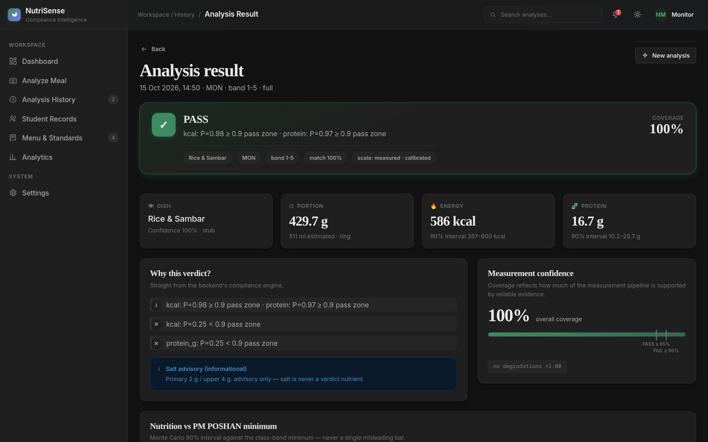 | 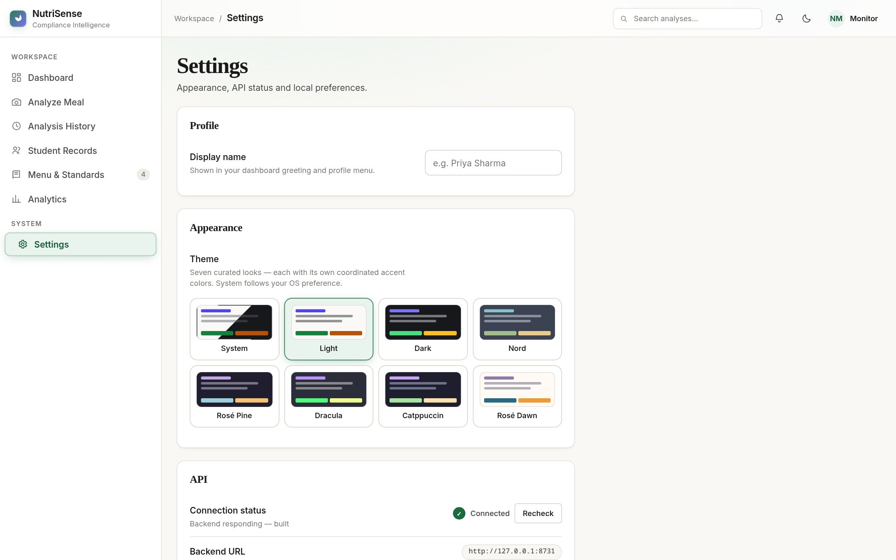 |
| *Result view — Dark theme* | *Settings — themes & palettes* |
|  | 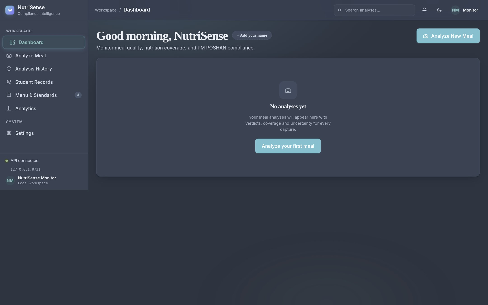 |
| *Dashboard — Rosé Dawn* | *Dashboard — Nord* |
|  |  |
| *Dashboard — Dark + Teal* | *Dashboard — Dark + Indigo* |
| 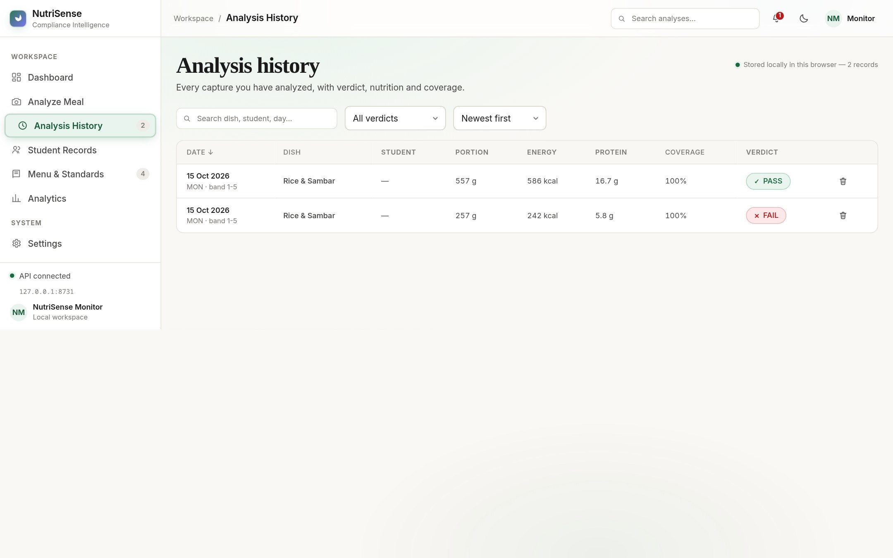 | 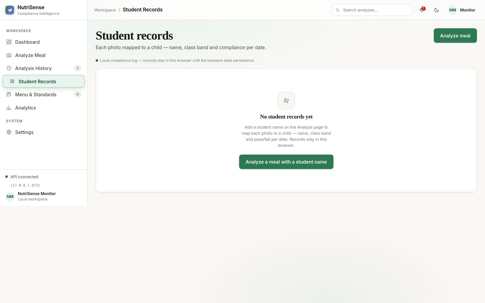 |
| *History with search* | *Student records* |
| 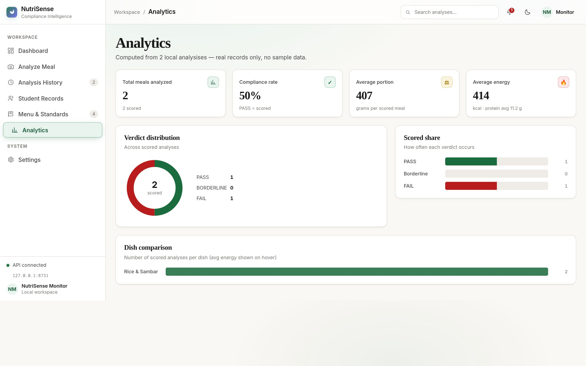 | 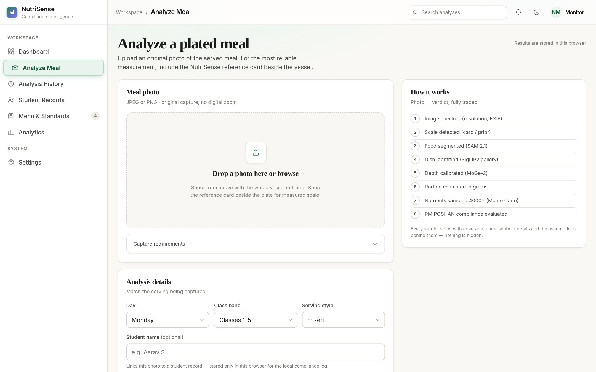 |
| *Analytics* | *Analyze — staged progress* |
| 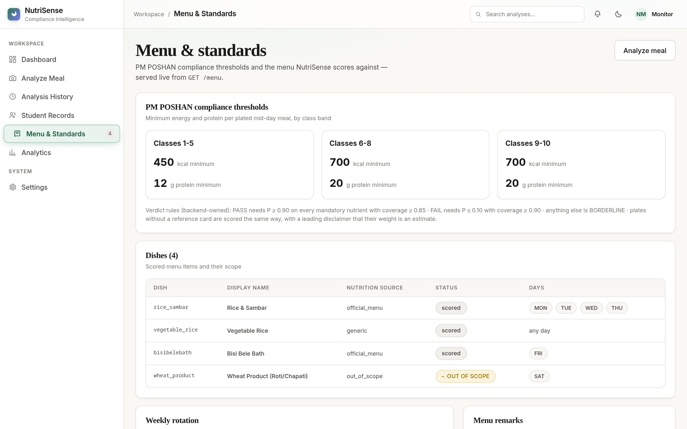| 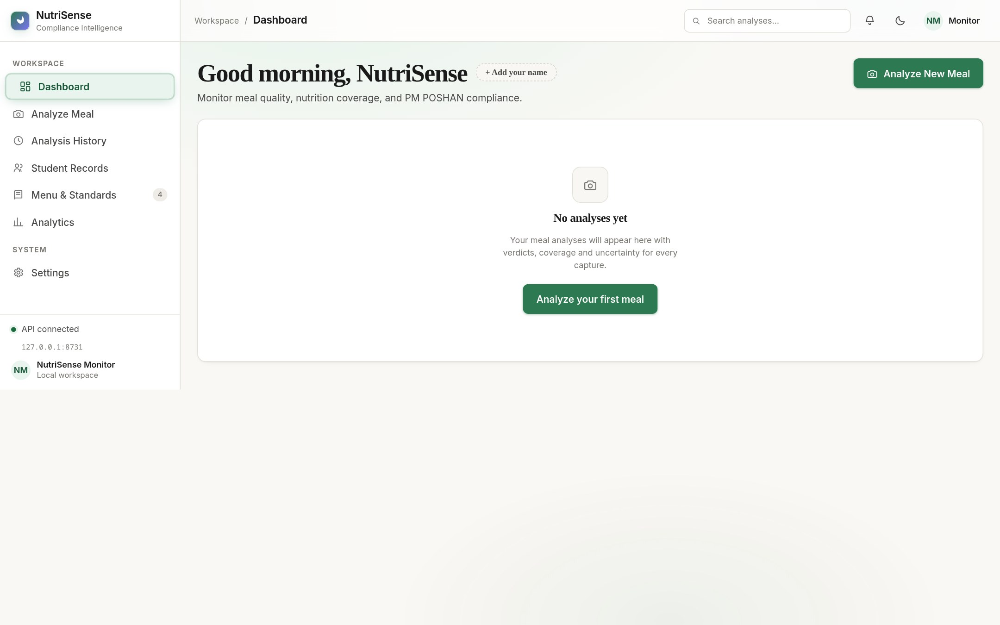 |
| *Menu & standards* | *Dashboard — Light theme* |

---

## 🗄️ Data & Sources

| Source | What it provides | Where |
|---|---|---|
| PM POSHAN menu + F&N guidelines (user-provided doc) | dishes, days, class bands, kcal/protein minimums | `data/menu.yaml`, `data/standards.yaml` |
| IFCT 2017 (NIN Hyderabad) | boiled-rice / curd nutrient values (literature rows) | `data/nutrients.yaml` |
| Recipe assumptions | sambar, vegetable_rice, bisi_belee_bath rows (marked `assumed`) | `data/nutrients.yaml`, `data/params_status.yaml` |
| WHO/FAO/UNU energy (2004) + protein (TRS 935, 2007) | General-mode Daily-goal values by age band, sex, activity level (per-entry status + provenance; research `docs/research/who-goals.md`) | `data/goals_who.yaml` |
| Local gallery sources | WED training crops and 46 local gold photos; gallery artifact contains 997 embeddings | `data/gallery.npz`, `../DATASET/` |
| Synthetic renderer | ground truth for the test suite | `tests/synth/` |
| Field scale marker (A4 PDF, ArUco id 7, 60 mm) | metric scale marker used during data collection | `docs/assets/reference_marker_A4_60mm.pdf` |

No USDA API or external database is used. Serving models are pinned to immutable Hugging Face revisions; a first run still needs network access when those exact snapshots are not cached.

---

## 🛠️ Tech Stack

| Component | Technology |
|---|---|
| Backend | FastAPI · Python 3.14 · uv-managed `.venv` |
| Vision | PyTorch 2.13 (CUDA) · SAM 2.1 · SigLIP2 · MoGe-2 via HuggingFace Transformers |
| Geometry | OpenCV 5 · NumPy 2 · custom `geo/` package |
| Uncertainty | NumPy Monte Carlo (seeded) |
| Frontend | React 18 · TypeScript · Vite 6 · hash router · pure-CSS charts (no chart runtime) |
| Checks | Focused unit/regression suites and GPU-marked checks; current results and limits are summarized in [`AUDIT.md`](AUDIT.md) |

---

## 📁 Project Structure

```
NutriSense/
├── main.py                    # FastAPI: /health /menu /goals /analyze
├── geo/                       # camera pose, planes, quads, back-projection
├── models/
│   ├── scale_anchor.py        # S1: card / prior tiers
│   ├── dish_segmenter.py      # S2: SAM 2.1 food masking
│   ├── food_classifier.py     # S2: SigLIP2 gallery-first + text fallback
│   ├── model_revisions.py     # immutable Hugging Face revision pins
│   └── portion_estimator.py   # S3: area × height × density → grams
├── engine/
│   ├── pipeline.py            # S6: analyze() orchestration + gates
│   ├── depth.py               # MoGe-2 wrapper + marker calibration
│   ├── mc.py                  # S4: Monte Carlo (sole interval owner)
│   ├── nutrients.py           # nutrient table access
│   └── compliance.py          # S5: verdict + coverage rules
├── data/                      # single sources of truth (YAML + gallery.npz)
├── tests/                     # backend, contract, and synthetic regression tests
├── experiments/               # per-source protocols, results, raw outputs, scripts
├── docs/                      # protocol, reports, flowchart, screenshots, card asset
├── tools/                     # reference-card generator, gallery builder
└── frontend/                  # React 18 + TypeScript UI (src/pages, src/result, src/layout)
```

---

## 🚀 Getting Started

### Prerequisites

- **uv** (Python package manager) — https://docs.astral.sh/uv/
- **Python 3.14**, **Node 20+**
- NVIDIA GPU + CUDA recommended (CPU works, slower)

### Installation

**1. Clone the repository**

```bash
git clone https://github.com/Lion4467cat/NutriSense.git
cd NutriSense
```

**2. Create the Python environment (uv)**

```bash
uv venv --python 3.14 .venv
uv sync --frozen --all-groups
```

**3. Run the backend (port 8731)**

```bash
.venv/bin/uvicorn main:app --port 8731
```

For a real deployment, run **one worker per GPU**; inference is serialized per
process. The API admits at most two concurrent `/analyze` requests per worker
by default (one may wait for the GPU slot); excess requests receive HTTP 503
with `Retry-After: 1` before multipart parsing. Set
`NUTRISENSE_MAX_INFLIGHT_ANALYSES` to change this cap. `/health` stays
responsive while inference runs. Put authentication and TLS in front of the
API when it is not strictly local. Uploads default to a 12 MiB limit
(`NUTRISENSE_CORS_ORIGINS` is a comma-separated allowlist and
`NUTRISENSE_MAX_UPLOAD_BYTES` overrides the byte cap).

**4. Run the frontend (separate terminal)**

```bash
cd frontend
npm install
npm run dev
```

### 🧪 Testing and verification

Run the checks you need from the project root:

```bash
.venv/bin/pytest -q                    # full backend suite
.venv/bin/pytest -m "not gpu" -q       # CPU-safe CI subset
.venv/bin/pytest -m gpu -q             # model tests (SAM 2.1, SigLIP 2, MoGe-2, weight head)
cd frontend && npm test                # frontend unit tests
```

These commands are available for a future full run. The counts below are
historical snapshots, not a statement that the current working tree passed the
entire suite.

#### Historical verification snapshot — 31 October 2026

| Command | Result |
|---|---|
| `.venv/bin/pytest -q` | `281 passed in 109.77s`; includes 10 GPU-marked tests. |
| `npx tsc --noEmit` (from `frontend/`) | Passed. |
| `npm test` (from `frontend/`) | 11 files and 71 tests passed. |
| `npm run build` (from `frontend/`) | Passed; dependency-comment advisories and a 562.90 kB chunk warning remain. |
| `.venv/bin/python -m ruff check .` | Passed: no findings. |
| `.venv/bin/python -m tools.pyright_gate` | Passed: 205 existing type diagnostics, matching the refreshed 205-error baseline after real fixes. |
| Generated contract diff | Passed; Python-generated Zod contract matches `frontend/src/types/contract.gen.ts`. |

Current-branch focused results are listed in [`AUDIT.md`](AUDIT.md). The latest
backend regression batch passed 58 tests; two HTTP-client tests were
deselected because `TestClient` hangs in this environment. Frontend
TypeScript, all 95 Vitest tests, and the production build passed. The build
still reports dependency annotation and large-chunk warnings. No new
real-image accuracy result is available, and the EVAL-ONLY ArUco set was not
reopened. See [`docs/model-metrics.md`](docs/model-metrics.md) for model
evidence and its limits.

Hermetic subset — exactly what CI runs, with empty model caches so nothing can download:

```bash
TORCH_HOME=$(mktemp -d) HF_HOME=$(mktemp -d) HF_HUB_OFFLINE=1 \
  .venv/bin/pytest -m "not gpu" -q     # no-GPU suite; see current verification record for execution status
```

`pytest.ini` declares the `gpu` marker; `tests/conftest.py` pins the weight head to `None`, so non-gpu runs never touch `data/weight_head.pt`.

### 🔍 Lint

The configured Ruff gate is clean. The `ignore` list in `ruff.toml` documents
rules intentionally deferred from the earlier report-only cleanup; the
2026-10-31 remediation fixed all findings under the configured rule set.

```bash
.venv/bin/ruff check .                  # current run: clean
.venv/bin/ruff check . --isolated       # report-only baseline: 117 findings / 22 rules
```

Rules relaxed (ruff 0.17.0 defaults), with the report-only first-pass counts and why each one was left alone rather than fixed:

The 2026-10-30 final run of the configured gate reported 48 findings, mostly
in diagnostic and research scripts. Those findings were fixed on 2026-10-31;
the global gate is now clean. Earlier snapshots remain in
`docs/production-readiness.md` as dated history.

| Rule | n | Why relaxed |
|---|---|---|
| I001 | 26 | unsorted imports — would churn every touched file |
| F401 | 17 | real dead imports; cleanup deferred |
| RUF100 | 13 | stale `noqa`s left in place this pass |
| BLE001 | 9 | broad excepts are deliberate (registry, OOM guard) |
| RUF046 | 9 | unnecessary-cast-to-int |
| PLR0402 | 7 | manual-from-import (aliased submodule imports) |
| C408 | 7 | unnecessary-collection-call |
| RUF059 | 5 | unused-unpacked-variable |
| F811 | 4 | per-file `tests/test_oom_handling.py` — pytest fixtures imported for their side effect; still active elsewhere |
| RUF012 | 3 | mutable-class-default |
| F841 | 3 | unused-variable |
| UP035 | 2 | deprecated-import |
| SIM401 | 2 | if-else-block-instead-of-dict-get |
| S110 | 2 | try-except-pass is intentional (`registry.clear_cache`, anchor probe) |
| B008 | 1 | FastAPI `File()` idiom, `main.py:110` |
| B009 | 1 | get-attr-with-constant |
| G201 | 1 | `logging.exc_info=True` used on purpose |
| UP037 | 1 | quoted-annotation |
| FURB167 | 1 | regex-flag-alias |
| RUF022 | 1 | unsorted-`__all__` (`geo/__init__.py`) |
| F821 | 1 | per-file `models/food_classifier.py` — **known latent bug**: `_embed_texts()` uses torch with no import, but has no callers; still active elsewhere |
| EXE001 | 1 | per-file `tools/make_reference_card.py` — shebang on a non-executable file |

(The first pass counted 116 on 2026-10-12; the 117th is one PLR0402 in `tests/test_pipeline_seams.py` added by the STAGE 5 test-stub commit. `ruff.toml` carries the same counts.)

### 🧮 Typecheck

```bash
.venv/bin/python -m tools.pyright_gate   # compares current findings against pyright.baseline
```

`pyrightconfig.json` is minimal (`typeCheckingMode: "basic"`, Python 3.14, `.venv`). The current gate reports 187 existing diagnostics and passes against the 187-error baseline. This remains an error-count gate, so the remaining diagnostics are tracked type debt rather than a claim of full type-cleanliness.

### 🔒 Lockfile

```bash
uv lock --check    # read-only: uv.lock matches pyproject.toml
uv sync --frozen   # install exactly what uv.lock pins (no upgrades) — CI does this
```

`uv.lock` pins the environment that was verified on this box (torch 2.13.0, transformers 5.16.1, opencv 5.0.0, pytest 9.1.1, ruff 0.17.0, pyright 1.1.414, …). `uv sync --frozen` installs exactly what uv.lock pins (no upgrades) and removes anything installed outside it — do not run it casually. Dev tools live in the `dev` dependency group, included by `--all-groups`.

`.github/workflows/ci.yml` defines the repository gates (ruff, pyright, `pytest -m "not gpu"` with empty `TORCH_HOME`/`HF_HOME`, then `tsc --noEmit` + Vitest + build). On PR #3, CI run [41075108677](https://github.com/Lion4467cat/NutriSense/actions/runs/41075108677) passed the frontend job and failed the backend job at Ruff; local results and limitations are recorded in [`docs/production-readiness.md`](docs/production-readiness.md).

### Access the App

- **Frontend:** http://localhost:5173
- **Backend API Base:** http://127.0.0.1:8731
- **Interactive Docs:** `http://127.0.0.1:8731/docs`
- **Health Check:** `http://127.0.0.1:8731/health`

The frontend reads the API base from `VITE_API_BASE` (default `http://127.0.0.1:8731`). First run downloads HF model weights (~3 GB) — prefix with `HF_HUB_DISABLE_XET=1` if downloads stall. Full agent notes live in `AGENTS.md`.

---

## 📡 API Endpoints

| Method | Endpoint | Description |
|---|---|---|
| GET | `/` | Server status |
| GET | `/health` | Health check (`phase`) |
| GET | `/menu` | Dishes, days, class bands, capture fields (single source of truth) |
| GET | `/goals` | WHO Daily-goal values (General mode): energy kcal/day + protein g/day by age band × sex × activity level, status + provenance included |
| POST | `/analyze` | Multipart upload (`file`, `day`, `band`, optional `mode`) → full analysis; meal-region count is inferred from the image |

The capture form does not ask users to choose a serving style. The optional
`serving_style` field remains accepted for older API clients, but it does not
control single- or multi-region detection. The current frontend sends
`mode=school` or `mode=general`; omitted mode defaults to School. School mode
scores all 41 recognized WED food classes against the selected class-band
standard.
Off-menu classes use generic nutrient rows marked as assumptions; this check
does not claim they were on that day's official menu. General mode displays
nutrition estimates and personal goal shares without a school verdict.

### Abbreviated response excerpt — `/analyze`

Every response uses the 19-key contract (`engine/contract.py`, Zod schema generated into `frontend/src/types/contract.gen.ts`): `verdict, reasons, failures, lint, anchor, segmentation, classification, dish, portion, nutrition, coverage, assumptions, advisory, compliance, model_versions, policy, path_used, degradations, items`. Reasons are `{kind, text}` objects; `failures` lists only hard stage/gate failures; `path_used` says which portion path produced the grams (`card_geometry` | `ingredient_head` | `learned_head` | `prior_geometry` | `multi_item`, null when no portion ran); `items` contains per-vessel blocks (or a one-item mirror for the single-serving path); `degradations` carries machine-readable substitution tags such as `gpu_oom_retried`; `policy` carries the whole rule set the UI renders under a 12-hex `policy_version` digest. The JSON below is intentionally abbreviated; it omits nullable/optional fields and is not a complete request fixture. In `classification`, `confidence` is the classifier's top-1 confidence; `match_score` is the separate top-3-mean cosine score for gallery mode and is not a probability.

```json
{
  "verdict": "FAIL",
  "reasons": [{"kind": "below_min", "text": "mandatory nutrient below minimum with sufficient coverage"}, {"kind": "below_min", "text": "kcal: P=0.06 <= 0.1 fail zone"}],
  "failures": [],
  "policy": {"pass_p": 0.9, "fail_p": 0.1, "pass_min": 0.85, "fail_min": 0.9, "anchor_prior_cap": 0.6, "estimated_weight": 0.9, "base_table_prior": 0.85, "quality_degraded": 0.9, "depth_uncalibrated": 0.8, "lint_min_side_px": 1280, "policy_version": "7d3431caec4b"},
  "lint": {"digital_zoom": null, "focal_mm": 4.0, "min_side_px": 1100, "resolution_ok": false, "notes": ["min side 1100 < 1280px (marker tier may fall back to prior)"]},
  "anchor": {"method": "card_aruco", "tier": "measured", "cm_per_px": 0.0547, "tilt_deg": 39.0, "depth_scale_factor": 0.1417, "depth_scale_source": "card"},
  "classification": {"dish": "rice_sambar", "confidence": 0.35, "method": "gallery", "match_score": 0.945, "reason": "gallery match rice_sambar=0.945 >= 0.80"},
  "dish": {"id": "rice_sambar", "display_name": "Rice & Sambar", "day": "mon", "band": "1-5"},
  "portion": {"grams": 298.5, "volume_ml": 354.8, "base_method": "ring", "scale_tier": "measured", "sigma_grams_rel": 0.37, "flags": []},
  "nutrition": {"kcal": {"mean": 271.0, "interval_90": [141.0, 466.0]}, "protein_g": {"mean": 7.3, "interval_90": [3.8, 12.5]}},
  "coverage": {"score": 1.0, "factors": {}, "pass_min": 0.85, "fail_min": 0.9},
  "compliance": {"day": "mon", "band": "1-5", "probs": {"kcal": 0.06, "protein_g": 0.06}, "nutrients": {"kcal": {"min": 450.0, "p_at_or_above_min": 0.06, "interval_90": [141.0, 466.0]}}},
  "assumptions": ["nutrient table row sambar (assumed)"],
  "advisory": {"note": "advisory only — salt is never a verdict nutrient"},
  "model_versions": {"segmenter": "facebook/sam2.1-hiera-large", "classifier": "google/siglip2-base-patch16-224", "depth": "Ruicheng/moge-2-vitl"}
}
```

---

## 📸 Data Capture Procedure (golden set)

**Full field manual: [`docs/data-collection-manual.md`](docs/data-collection-manual.md)** — camera settings, exact height/angle/distance, per-plate steps, metadata templates, on-site QA checklists, the 5-day schedule, and the post-collection tuning workflow. Quick version: [`docs/protocol.md`](docs/protocol.md).

Goal: **30 golden plates** — 4 pilot / 13 dev / 13 holdout — for calibration, tuning, and one sealed final evaluation.

Field essentials:

- Print `docs/assets/reference_marker_A4_60mm.pdf` on **A4 at 100% scale (fit-to-page OFF)**; ruler-check the ArUco's outer edge = **60.0 mm** before data collection; kitchen scale with 1 g resolution, tare first.
- Keep digital zoom **OFF**. A known zoom value above 1.0 is rejected; if EXIF omits zoom, food recognition continues but the result is estimate-only with no school verdict. Use the original image, min side ≥ 1280 px, marker ≥ 80 px (≈ ⅛ frame width), and tilt **< 50°** — transfer originals by cable, never through a chat app.
- Golden plates live in `DATASET/golden/{pilot,dev,holdout}/plate_XX/{photo.jpg, meta.json, weights.json}` — never in gallery class folders.

### What the pipeline checks for you (capture lint)

| Check | Consequence if violated |
|---|---|
| digital zoom == 1.0 | normal analysis path |
| digital zoom > 1.0 | input gate → `cannot_verify` |
| digital zoom missing from EXIF | recognition continues; estimate only, no school verdict |
| min side ≥ 1280 px | note in response; marker tier may fall back |
| card marker ≥ 80 px | falls back to prior tier → coverage ×0.90 with learned grams / ×0.60 with size priors, and every verdict leads with the "weight is an estimate" disclaimer (geometry still can never PASS/FAIL) |
| plate weight inside `plate_sanity_g` band (`data/standards.yaml`, ±25%) | flagged only — never auto-rejects |
| day ∈ menu days, dish ∈ `data/menu.yaml` ids | `cannot_verify` |

---

## 🎯 Compliance Standards

Policy lives verbatim in `data/standards.yaml` (transcribed from the user's PM POSHAN Food & Nutrition guidelines):

| Class band | Energy (min) | Protein (min) |
|---|---|---|
| 1–5 | 450 kcal | 12 g |
| 6–8 | 700 kcal | 20 g |
| 9–10 | 700 kcal | 20 g *(identical rows in the source doc)* |

- **Verdicts**: PASS needs P ≥ 0.90 *and* coverage ≥ 0.85; FAIL needs P ≤ 0.10 *and* coverage ≥ 0.90; everything else is BORDERLINE — a plate with no reference card is scored by the same rules but always carries a `no_reference_card` reason first: "this weight is an estimate"
- **Coverage** multiplies ledger factors — no-card learned-weight estimates use 0.90 and may reach PASS/FAIL under the same probability gates; no-card geometry-prior estimates use 0.60 and cannot reach PASS or FAIL
- **Salt** (2 g primary / 4 g upper) is reported as an advisory only — never a verdict nutrient
- Raw per-child/day gram allocations are surfaced as informational diagnostics, never compared against cooked plate weight

---

## 🌍 SDG Alignment

| SDG | Goal | Target | How NutriSense contributes |
|---|---|---|---|
| SDG 2 | Zero Hunger | **2.2** — end all forms of malnutrition by 2030 | Verifiable per-plate energy & protein adequacy against PM POSHAN minimums — turns *"a meal was served"* into *"the meal met the standard"*, with quantified uncertainty and honest coverage |
| SDG 3 | Good Health and Well-being | **3.4** — reduce premature mortality from non-communicable diseases | Childhood undernutrition tracks into lifelong health risks; per-plate checks make dietary deficits visible early, meal by meal, instead of at annual surveys |
| SDG 4 | Quality Education | **4.1** — ensure free, equitable and quality primary/secondary education | PM POSHAN explicitly aims to lift enrolment, attendance and learning levels; NutriSense protects the meal quality those outcomes depend on |

---

## 👥 Team

| **Name**         | **USN**    | **Role**                                     |
| ---------------- | ---------- | -------------------------------------------- |
| Aryan Kumar      | 1BM23AI037 | Literature Survey, Research & Data Collection |
| Roshanth V       | 1BM23AI155 | Literature Survey, Research & Data Collection |
| S S Gokula Swamy | 1BM23AI158 | Backend & Frontend Development                |
| Somanath S D     | 1BM23AI187 | Backend & Frontend Development                |

**Guide:** Prof. Varsha R, Dept. of Machine Learning, BMSCE

---

## 🏫 Institution

**Department of Machine Learning**
B.M.S. College of Engineering, Bengaluru — 560 019
*(An Autonomous Institute, Affiliated to VTU)*

**Course:** Project Work 2 (24AM7PWPW2)
**Academic Year:** 2026–27

---

## ⚠️ Known Limitations

- **Multi-item estimates need validation**: the pipeline now portions detected vessels separately, decomposes combo dishes against their component vocabulary, and judges the aggregate meal (specs 003/004). In the six-photo canteen diagnostic, component-restricted recognition reduced the multi-vessel estimates from 772–880 g to 202–535 g, but several frames assigned the same component to every vessel; those photos have no component weights, and near-duplicate views detected one vs. three vessels. The separate ArUco pilot has named component weights, but is permanently EVAL-ONLY and does not establish correspondence for every predicted item. Treat both as diagnostics, not broad accuracy claims; see ledger 016, spec 007, and [`experiments/oracle_ablation/REPORT.md`](experiments/oracle_ablation/REPORT.md).
- **Real-photo segmentation**: synthetic scenes are fully validated; on unposed canteen photos the degenerate-mask failure is fixed (ledger 014 — six-photo diagnostic, 2/6 previously returned 0.08%/0.18% slivers, now plate-sized via the box fallback). `grid9_box` finds multiple vessels but the result varies across views; quantify stability with card-bearing repeated captures before relying on item counts.
- **Ingredient head (07b)**: N5k transfer gate failed (ledger 012) — the off-menu route is wired but dormant until a checkpoint passes a re-registered gate.
- **Prior tier depth scale** is uncalibrated (`depth_scale_sigma_pct` open at M6).
- **Assumed nutrient rows**: sambar / vegetable_rice / bisi_belee_bath values are literature-plausible assumptions, flagged in every response (`assumptions`).

### How far off the predictions can be (deployable path, WED val carve, 108 views / 21 plates)

The following are WED DEV mass metrics on the deployable checkpoint (frozen DINOv2-S head, seed 42). Any kcal/protein values calculated from this mass use the app's composition-table density; they are arithmetic projections, not independently measured nutrition MAE against weighed nutrient ground truth. The separate Nutrition5k candidate evaluation is documented in `data/reports/nutrition5k_test_nutrients.json` and is not a serving claim.

| Metric | How far off it can be |
|---|---|
| **Portion grams** | **MAE ≈ 15 g** (95% CI [12.2, 18.9]) — about 18% MAPE. Typical dishes land at **≈ 3–15 g** mean error; the hardest blends sit at **≈ 28–41 g** (steamed-rice 28.1, non-spicy-curry 31.1, beans-curry 40.6). Lightest items are near-exact (papad ≈ 1.6 g, boondi ≈ 2.5 g, mango-pickle ≈ 3.0 g). |
| **Energy (kcal)** | Derived from estimated grams × the selected food's table density. Error also depends on food mapping and the accuracy of the density row; no compatible WED kcal ground truth is available for an energy MAE claim. |
| **Protein (g)** | Derived from estimated grams × the selected food's table density. This is not an independently validated protein MAE; food mapping and nutrient-table limitations also contribute. |
| **Intervals (calibration)** | The 90% prediction intervals covered **85.2%** of outcomes (CI [79.2%, 89.9%]) — slightly below nominal 90%; treat hits at the interval edge as borderline rather than certain. |
| **Capture robustness** | Under the frozen WED stress suite (*a lab stress test, not real-world field error*): perspective skew adds **≈ +2.9 g** MAE (17.9 g total); brightness/contrast, blur, JPEG, and half-resolution each add ≤ **0.2 g**. |
| **Verdict edge cases** | PASS/FAIL requires P ≥ 0.9 / ≤ 0.1 × coverage — at C = 0.90 the margins are tight, so a ~10% gram swing can flip a PASS to BORDERLINE; a compliance verdict is not a precise measurement claim. |

---

## 📚 References

**Models & methods**

1. Ravi et al. (2024). *SAM 2: Segment Anything in Images and Videos.* arXiv:2408.00714. — image segmentation (S2).
2. Tschannen et al. (2025). *SigLIP 2: Multilingual Vision-Language Encoders with Improved Semantic Understanding, Localization, and Dense Features.* arXiv:2502.14786. Google DeepMind. — dish gallery embeddings (S2).
3. Wang et al. (2025). *MoGe-2: Accurate Monocular Geometry with Metric Scale and Sharp Details.* arXiv:2507.02546 (NeurIPS 2025). Microsoft Research. — metric depth (S3).
4. Oquab et al. (2023). *DINOv2: Learning Robust Visual Features without Supervision.* arXiv:2304.07193. Meta AI. — frozen encoder for the learned weight head (no-card tier).
5. Garrido-Jurado et al. (2014). *Automatic generation and detection of highly reliable fiducial markers under occlusion.* Pattern Recognition 48(6), 2051–2061. — ArUco reference-card detection (S1 scale anchor).

**Nutrition & policy**

6. National Institute of Nutrition (2017). *Indian Food Composition Tables (IFCT 2017).* NIN, Hyderabad. — literature nutrient rows in `data/nutrients.yaml`.
7. Ministry of Education, Government of India. *PM POSHAN — Food & Nutrition Guidelines.* — band minimums & compliance rules, transcribed into `data/standards.yaml`.
8. Government of Karnataka. *Mid-Day Meal Scheme Guidelines.* Dept. of Public Instruction. — weekly menu in `data/menu.yaml`.

---

## 📄 License

[MIT](LICENSE) — © 2026 S S Gokula Swamy. Developed for Project Work 2 (2026–27) at B.M.S. College of Engineering. Model/dataset attributions: `docs/licenses.md`.
