# NutriSense 🍱
### Photo → portion → nutrients → PM POSHAN compliance verdict, for Karnataka MDM canteens

[](https://python.org)
[](https://fastapi.tiangolo.com)
[](#-testing)
[](https://huggingface.co)
[](LICENSE)

---

## 📌 Overview

NutriSense turns a single **photo of a plated mid-day meal** into a compliance verdict against the **PM POSHAN (MDM) food & nutrition guidelines**. One capture → dish identification → portion in grams → Monte Carlo nutrient intervals → **PASS / BORDERLINE / FAIL** with honest coverage and assumptions — and when the photo has no reference card, the result carries an explicit disclaimer that the weight is an estimate.

Everything the pipeline decides is traceable: which scale anchor was used, how large the uncertainty was, which parameters are still `assumed`, and why a verdict landed where it did. No attendance tracking, no chatbot, no database — v5 is deliberately a single, testable photo-analysis pipeline.

**What it does:**

- Measures portion size from one photo using the **60 mm ArUco marker** printed on A4 as metric scale. Without the marker, mapped dishes use the WED-trained learned-weight head (with an estimate disclaimer); unmapped dishes use uncertain size-prior geometry, which cannot issue PASS/FAIL. A missing or failing learned head for a mapped dish returns `cannot_verify`.
- Identifies the dish from a 41-class WED gallery plus 46 gold photos (SigLIP2), abstaining rather than guessing
- Estimates volume from monocular depth (MoGe-2, calibrated against the card to ~1.1% median error)
- Propagates every uncertainty through a Monte Carlo engine (4000 samples) into 90% intervals
- Scores energy & protein probabilities against the class-band minimums, gated by a **coverage** score

A React web UI wraps the pipeline: dashboard, photo analysis with honest staged progress, result detail (verdict reasons, coverage, 90% intervals), history + search, student records, menu browser, analytics, and settings.

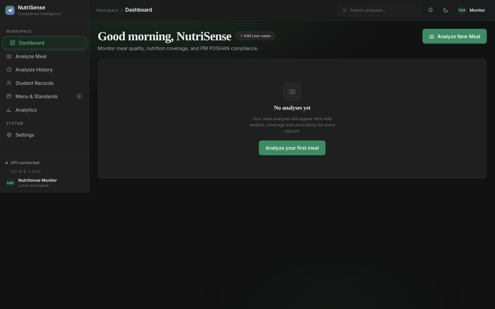

---

## 🔁 Analysis Pipeline

The actual photo → verdict flow as built (`engine/pipeline.py`):

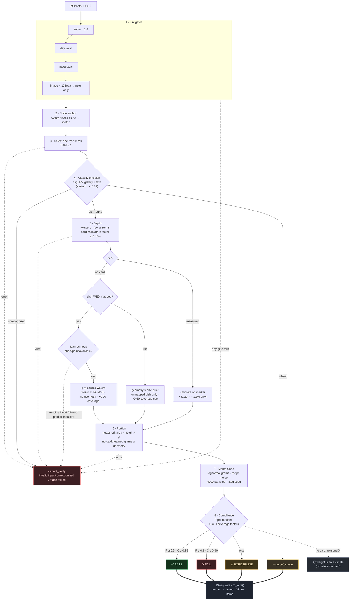

Every exit — gate, stage failure, abstention, out-of-scope result, or verdict — serializes through the same 19-key envelope (`to_wire()`); `failures[]` rides along with `verdict`/`reasons` (the C6 hardening), and `items` reports per-vessel results when available. A measured anchor that declines depth calibration multiplies coverage by `coverage_depth_uncalibrated` (0.80), so it cannot issue PASS. A prior-tier (no-card) plate is scored in the same zones as any other, but every verdict leads its reasons with `no_reference_card` — "this weight is an estimate" — and coverage is reduced (×0.90 for learned-weight grams, ×0.60 for size-prior geometry, which cannot PASS/FAIL). On a WED-mapped dish, an absent or failing learned head returns `cannot_verify`; only an unmapped dish uses size-prior geometry.

### Pipeline components

| Stage | What runs | Model / method |
|---|---|---|
| Lint | digital-zoom gate, day/band validation, resolution note | pure rules |
| S1 Scale anchor | 2 tiers: card → prior (prior caps coverage at 0.60) | ArUco card detector |
| S2 Segment | food mask plus grid9 vessel candidates for eligible menu meals | SAM 2.1 (`facebook/sam2.1-hiera-large`) |
| S2 Classify | gallery-first dish match with open-set abstain; text fallback | SigLIP2 (`google/siglip2-base-patch16-224`) |
| S3 Depth | metric depth; `fov_x` (from intrinsics) passed to the model; scale calibrated on the marker, status reported `card`/`none` — never fabricated | MoGe-2 (`Ruicheng/moge-2-vitl`) |
| S3 Portion | grams = anchor-scaled area × height above base × density | ring / table-prior / size-prior paths |
| S4 Nutrition | lognormal sampling of every uncertainty source | Monte Carlo, n=4000, fixed seed (sole interval owner) |
| S5 Compliance | P(at/above min) per mandatory nutrient × coverage factors (anchor-prior, table-prior, quality, depth-uncalibrated) | pure rules from `data/standards.yaml` |

---

## ✨ Features

**Implemented capabilities:**

- **Two app modes (spec 002, ADR 0003)** — **School** keeps the verdict-centric PM POSHAN flow unchanged; **General** reports grams, nutrients and each meal's share of a Daily goal, with no verdicts and no school capture fields. Switching to General asks for profile details (name, sex, age band, activity level) in a setup popup every time until it has been completed, and Settings keeps the same fields editable
- **WHO Daily goals** — `GET /goals` serves the WHO energy/protein tables keyed by age band, sex and activity level; the frontend does the lookup and share math, so a profile change never re-analyzes a photo
- **41-class recognition** — the WED 41-class gallery replaced the 2-class menu-only gallery (DEV held-out 0.8103 top-1, ledger 003/008/009); the abstain threshold still gates servings

- **Two-tier scale anchor** — reference card (60 mm ArUco) or size prior; tier is always reported and gates coverage (no card → leading estimate disclaimer; learned grams ×0.90, geometry ×0.60)
- **Learned weight fallback (no card)** — WED-trained WeightNet-style head (`models/weight_head.py`, frozen DINOv2-S encoder + ROI-align + class-conditional gram regression, port of the ICVGIP 2025 Indian Thali baseline, trained by us on the public WED dataset) replaces prior-tier geometry; per-class σ feeds the same MC engine; an absent or failing head on a WED-mapped dish cannot verify (`weight_head_unavailable`, no grams) — geometry is never silently substituted; unmapped dishes keep geometry (ADR 0002; the deployed checkpoint uses the DINOv2-S encoder from ledger 002, DEV MAE 20.30 → 15.03 g paired)
- **Gallery dish classification** — 46 real dish photos, leave-one-out 46/46, abstain threshold 0.82 (synthetic renders correctly abstain)
- **Multi-item meals (specs 003/004)** — menu meals with at least two detected vessels are classified and portioned per vessel; combo dishes restrict matches to component serving targets; compliance scores the aggregate meal. Current canteen-photo runs are diagnostic only: vessel counts and component labels still vary between captures, and there is no weighed per-component ground truth.
- **Monocular depth with metric calibration** — raw MoGe scale is ~6× off out-of-domain; card calibration brings it to ~1.1% median error
- **Portion estimation** — plate +6.6% / bowl +5.6% volume vs ground truth on synthetic scenes; prior tier flagged `vessel_shape_uncertain`
- **Monte Carlo nutrient engine** — grams lognormal from per-dish σ, recipe-share noise, nutrient-table σ, temperature-scaled intervals; raw-equivalent diagnostics kept informational only
- **Compliance verdicts** — PASS ≥ P0.90 & coverage ≥ 0.85 / FAIL ≤ P0.10 & coverage ≥ 0.90 / else BORDERLINE; no-card plates are scored too, with a leading "weight is an estimate" disclaimer (coverage ×0.90 learned / ×0.60 geometry — geometry can never PASS or FAIL); wheat products can never PASS or FAIL; salt is advisory only
- **FastAPI service** — `GET /health`, `GET /menu`, `GET /goals`, `POST /analyze` with full diagnostics in every response
- **React + TypeScript frontend** — dashboard, analysis flow with honest staged progress, result views for every verdict outcome (PASS / BORDERLINE / FAIL / cannot_verify / out_of_scope; the ESTIMATED pill is retained only for old records), history with search, student records (name per photo), menu browser, analytics, settings — localStorage only, no backend DB — wire types are generated from the Python contract (Zod, decoded at runtime); verdict tallies and newest-first ordering live in one records module
- **Themes** — 8 curated looks (System follows the OS, plus Light, Dark, Nord, Rosé Pine, Dracula, Catppuccin, Rosé Dawn); the default Light/Dark pair is porcelain + indigo so verdict green/amber/red stay semantic, and each theme keeps a coordinated accent set; pre-consolidation ids (Sepia/Midnight/OLED) map forward so stored preferences keep working
- **Off-menu route (ticket 07)** — ingredient density table (FAO), INDB recipe table and a checkpoint-gated ingredient head; serving is wired end to end but the N5k transfer gate failed (ledger 012), so no candidate checkpoint ships and the route stays dormant
- **Real-photo segmentation guard** — a point prompt that returns a sliver (< 0.5% of frame) now falls back to the box prompt instead of being measured as a serving (ledger 014)
- **Synthetic scene renderer** — full GT (image, depth, masks, grams, anchor) powering the test suite

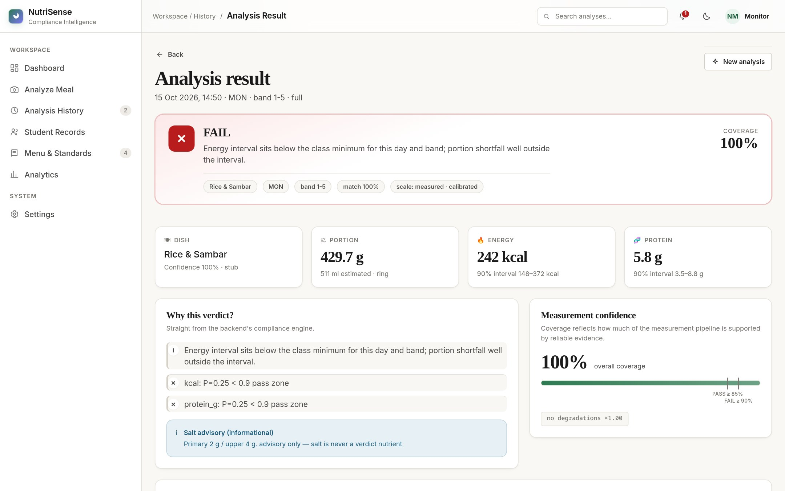

**Open gates (M1–M8, see `docs/final-report.md`):** prior-tier depth-scale validation, multi-vessel (thali) stability and meal-composition scope, nutrient-table validation, and independent holdout evaluation. A 23-image / six-plate weighed ArUco pilot is complete and documented as EVAL-ONLY; it found severe mask spill and overestimation on many views, so it is not evidence of field readiness and must not be used for tuning.

**Model-quality status:** the current WED DEV reference is 15.034 g MAE on 108 views / 21 plates. This carve is also used for epoch selection, so it is development evidence rather than an independent generalization claim. Five-fold plate-grouped WED TRAIN cross-validation measured 16.421 g pooled baseline MAE. A 10×-decay candidate reduced pooled CV MAE by 0.148 g, but regressed the boondi subgroup by 39.1% and was rejected under its preregistered guardrail; other loss, bias-correction, augmentation and ROI-feature changes were also not promoted. WED LOCKED measured 14.667 g after the model freeze and was not used for tuning. No candidate passed promotion, and current intervals under-cover. Dataset decisions, remaining release gates, and deployment limitations are recorded in [`docs/production-readiness.md`](docs/production-readiness.md) and [`docs/ledger/021-wed-weight-decay-cv.md`](docs/ledger/021-wed-weight-decay-cv.md).

---

## 🖼️ Screenshots

| | |
|---|---|
| 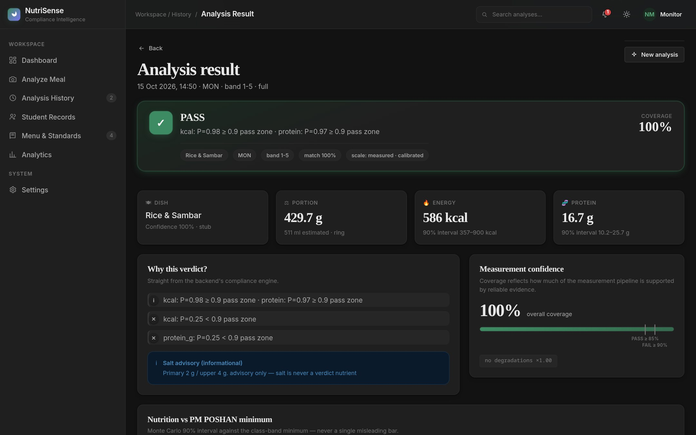 | 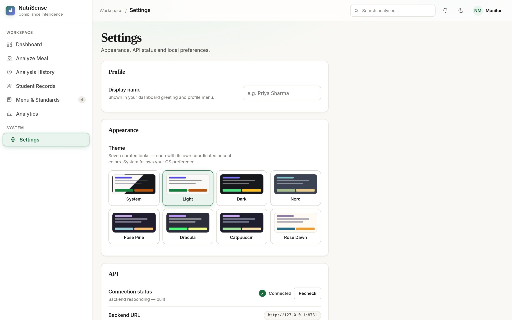 |
| *Result view — Dark theme* | *Settings — themes & palettes* |
|  | 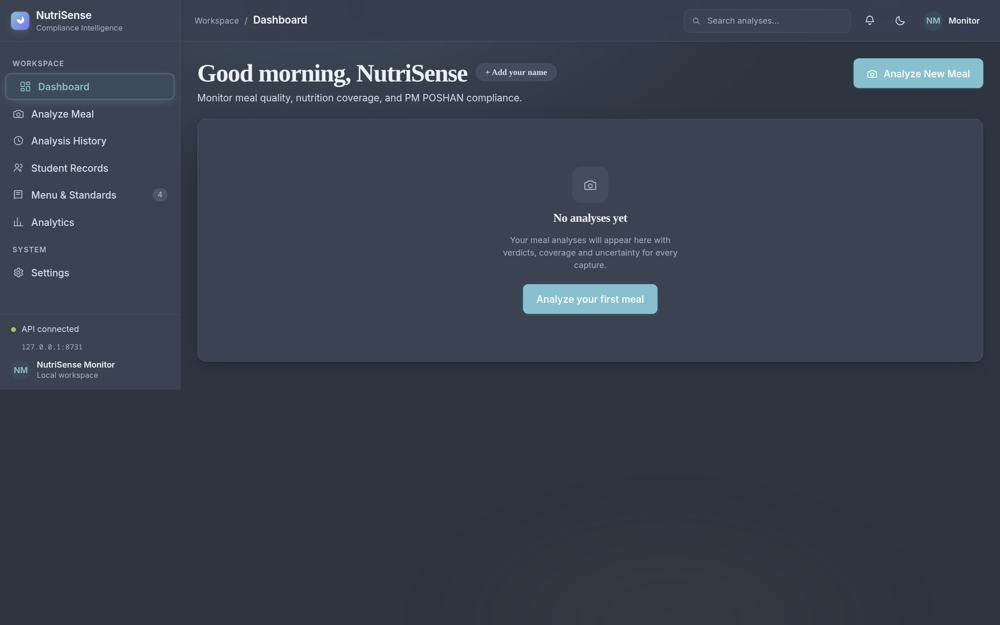 |
| *Dashboard — Rosé Dawn* | *Dashboard — Nord* |
|  |  |
| *Dashboard — Dark + Teal* | *Dashboard — Dark + Indigo* |
| 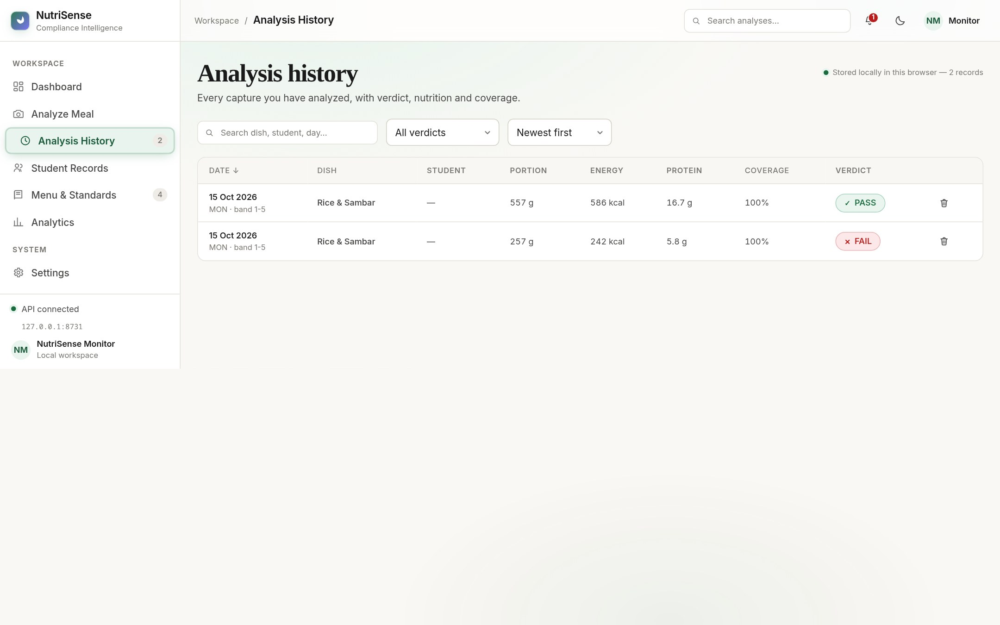 | 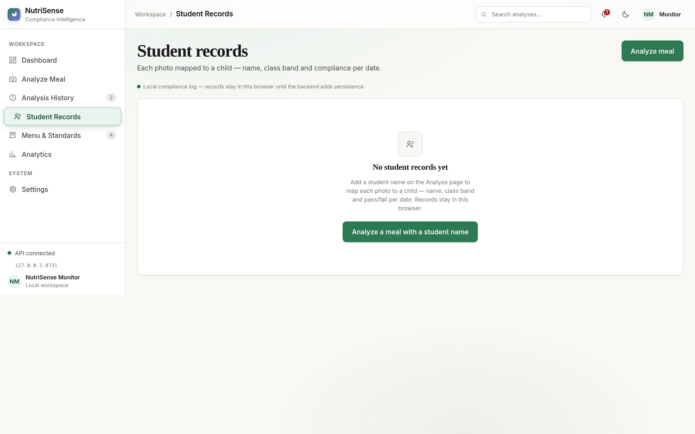 |
| *History with search* | *Student records* |
| 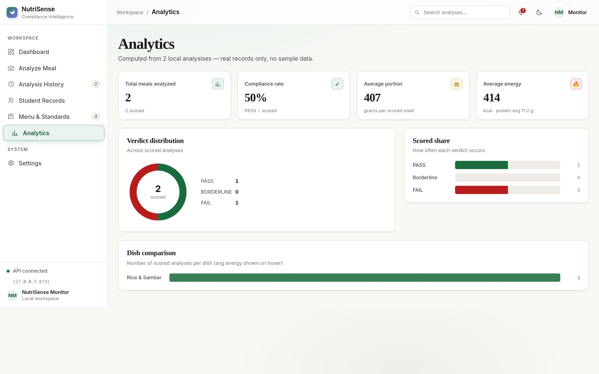 | 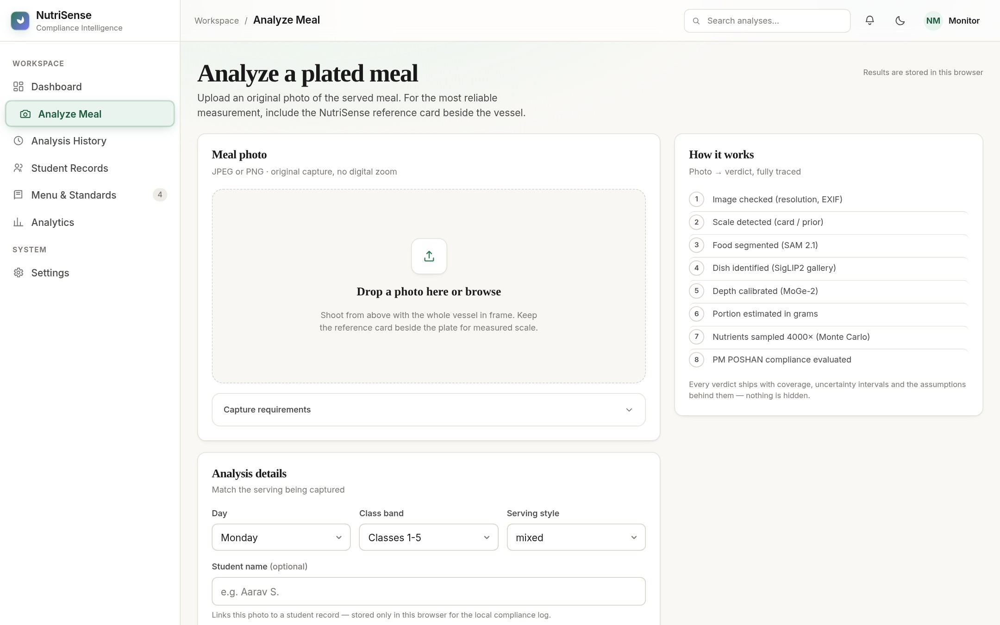 |
| *Analytics* | *Analyze — staged progress* |
| 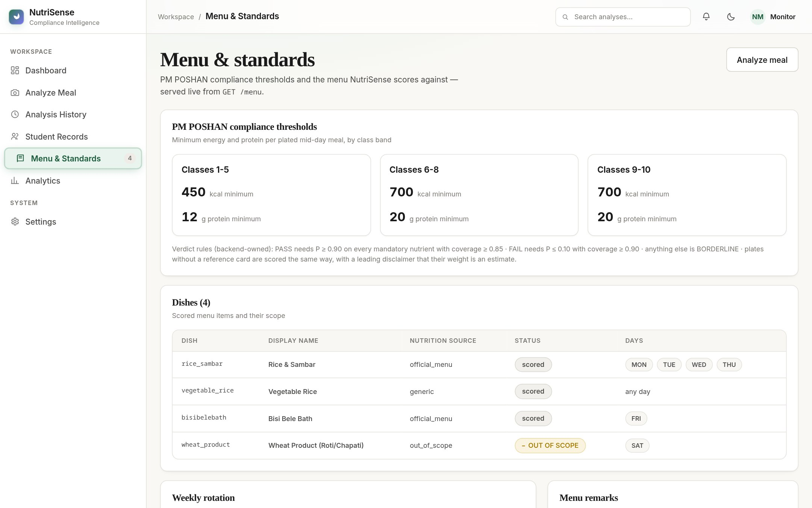| 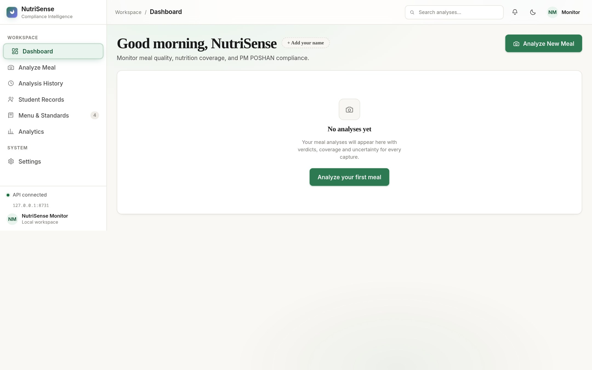 |
| *Menu & standards* | *Dashboard — Light theme* |

---

## 🗄️ Data & Sources

| Source | What it provides | Where |
|---|---|---|
| PM POSHAN menu + F&N guidelines (user-provided doc) | dishes, days, class bands, kcal/protein minimums | `data/menu.yaml`, `data/standards.yaml` |
| IFCT 2017 (NIN Hyderabad) | boiled-rice / curd nutrient values (literature rows) | `data/nutrients.yaml` |
| Recipe assumptions | sambar, vegetable_rice, bisi_belee_bath rows (marked `assumed`) | `data/nutrients.yaml`, `data/params_status.yaml` |
| WHO/FAO/UNU energy (2004) + protein (TRS 935, 2007) | General-mode Daily-goal values by age band, sex, activity level (per-entry status + provenance; research `docs/research/who-goals.md`) | `data/goals_who.yaml` |
| Canteen phone photos (46) | classifier gallery | `data/gallery.npz`, `../DATASET/` |
| Synthetic renderer | ground truth for the test suite | `tests/synth/` |
| Field scale marker (A4 PDF, ArUco id 7, 60 mm) | metric scale marker used during data collection | `docs/assets/reference_marker_A4_60mm.pdf` |

No USDA API, no external database, no network calls at runtime — all policy lives in versioned YAML.

---

## 🛠️ Tech Stack

| Component | Technology |
|---|---|
| Backend | FastAPI · Python 3.14 · uv-managed `.venv` |
| Vision | PyTorch 2.13 (CUDA) · SAM 2.1 · SigLIP2 · MoGe-2 via HuggingFace Transformers |
| Geometry | OpenCV 5 · NumPy 2 · custom `geo/` package |
| Uncertainty | NumPy Monte Carlo (seeded) |
| Frontend | React 18 · TypeScript · Vite 6 · hash router · pure-CSS charts (no chart runtime) |
| Tests | pytest — 178 tests (synthetic GT scenes + HTTP E2E + contract parity); 169 run without a GPU |

---

## 📁 Project Structure

```
NutriSense/
├── main.py                    # FastAPI: /health /menu /goals /analyze
├── geo/                       # camera pose, planes, quads, back-projection
├── models/
│   ├── scale_anchor.py        # S1: card / prior tiers
│   ├── dish_segmenter.py      # S2: SAM 2.1 food masking
│   ├── food_classifier.py     # S2: SigLIP2 gallery-first + text fallback
│   └── portion_estimator.py   # S3: area × height × density → grams
├── engine/
│   ├── pipeline.py            # S6: analyze() orchestration + gates
│   ├── depth.py               # MoGe-2 wrapper + marker calibration
│   ├── mc.py                  # S4: Monte Carlo (sole interval owner)
│   ├── nutrients.py           # nutrient table access
│   └── compliance.py          # S5: verdict + coverage rules
├── data/                      # single sources of truth (YAML + gallery.npz)
├── tests/                     # 160 tests incl. synth/ renderer with full GT
├── docs/                      # protocol, reports, flowchart, screenshots, card asset
├── tools/                     # reference-card generator, gallery builder
└── frontend/                  # React 18 + TypeScript UI (src/pages, src/result, src/layout)
```

---

## 🚀 Getting Started

### Prerequisites

- **uv** (Python package manager) — https://docs.astral.sh/uv/
- **Python 3.14**, **Node 20+**
- NVIDIA GPU + CUDA recommended (CPU works, slower)

### Installation

**1. Clone the repository**

```bash
git clone https://github.com/Lion4467cat/NutriSense.git
cd NutriSense
```

**2. Create the Python environment (uv)**

```bash
uv venv --python 3.14 .venv
uv sync --frozen --all-groups
```

**3. Run the backend (port 8731)**

```bash
.venv/bin/uvicorn main:app --port 8731
```

For a real deployment, run **one worker per GPU**; inference is serialized per
process so concurrent uploads cannot contend for VRAM, while `/health` remains
responsive. Put authentication and TLS in front of the API when it is not
strictly local. Uploads default to a 12 MiB limit
(`NUTRISENSE_CORS_ORIGINS` is a comma-separated allowlist and
`NUTRISENSE_MAX_UPLOAD_BYTES` overrides the byte cap).

**4. Run the frontend (separate terminal)**

```bash
cd frontend
npm install
npm run dev
```

**5. Run the tests**

### 🧪 Testing

```bash
.venv/bin/pytest -q                    # full backend: 243 passed (233 without a GPU)
.venv/bin/pytest -m "not gpu" -q       # CI subset, no GPU/weights: 233 passed, 10 deselected
.venv/bin/pytest -m gpu -q             # the 10 model tests (SAM2, SigLIP2, MoGe-2, weight head)
cd frontend && npm test                # 70 vitest tests (wire parity, selectors, wizard, PolicyNote)
```

Hermetic subset — exactly what CI runs, with empty model caches so nothing can download:

```bash
TORCH_HOME=$(mktemp -d) HF_HOME=$(mktemp -d) HF_HUB_OFFLINE=1 \
  .venv/bin/pytest -m "not gpu" -q     # 233 passed, 10 deselected, both dirs stay empty
```

`pytest.ini` declares the `gpu` marker; `tests/conftest.py` pins the weight head to `None`, so non-gpu runs never touch `data/weight_head.pt`.

### 🔍 Lint

Report-only first pass (STAGE 5). **No autofix, no repo-wide format was ever applied** — the `ignore` list in `ruff.toml` is exactly the set of rules the current code violates.

```bash
.venv/bin/ruff check .                  # the gate: 0 findings under ruff.toml
.venv/bin/ruff check . --isolated       # report-only baseline: 117 findings / 22 rules
```

Rules relaxed (ruff 0.17.0 defaults), with the report-only first-pass counts and why each one was left alone rather than fixed:

| Rule | n | Why relaxed |
|---|---|---|
| I001 | 26 | unsorted imports — would churn every touched file |
| F401 | 17 | real dead imports; cleanup deferred |
| RUF100 | 13 | stale `noqa`s left in place this pass |
| BLE001 | 9 | broad excepts are deliberate (registry, OOM guard) |
| RUF046 | 9 | unnecessary-cast-to-int |
| PLR0402 | 7 | manual-from-import (aliased submodule imports) |
| C408 | 7 | unnecessary-collection-call |
| RUF059 | 5 | unused-unpacked-variable |
| F811 | 4 | per-file `tests/test_oom_handling.py` — pytest fixtures imported for their side effect; still active elsewhere |
| RUF012 | 3 | mutable-class-default |
| F841 | 3 | unused-variable |
| UP035 | 2 | deprecated-import |
| SIM401 | 2 | if-else-block-instead-of-dict-get |
| S110 | 2 | try-except-pass is intentional (`registry.clear_cache`, anchor probe) |
| B008 | 1 | FastAPI `File()` idiom, `main.py:110` |
| B009 | 1 | get-attr-with-constant |
| G201 | 1 | `logging.exc_info=True` used on purpose |
| UP037 | 1 | quoted-annotation |
| FURB167 | 1 | regex-flag-alias |
| RUF022 | 1 | unsorted-`__all__` (`geo/__init__.py`) |
| F821 | 1 | per-file `models/food_classifier.py` — **known latent bug**: `_embed_texts()` uses torch with no import, but has no callers; still active elsewhere |
| EXE001 | 1 | per-file `tools/make_reference_card.py` — shebang on a non-executable file |

(The first pass counted 116 on 2026-10-12; the 117th is one PLR0402 in `tests/test_pipeline_seams.py` added by the STAGE 5 test-stub commit. `ruff.toml` carries the same counts.)

### 🧮 Typecheck

```bash
.venv/bin/python -m tools.pyright_gate   # 209 errors vs pyright.baseline 209 — fails only on NEW errors
```

`pyrightconfig.json` is minimal (`typeCheckingMode: "basic"`, Python 3.14, `.venv`). Existing findings do not block CI: the gate compares against `pyright.baseline` and only fails when the count rises. When errors are genuinely fixed, re-record the lower count with `--update`.

### 🔒 Lockfile

```bash
uv lock --check    # read-only: uv.lock matches pyproject.toml
uv sync --frozen   # install exactly what uv.lock pins (no upgrades) — CI does this
```

`uv.lock` pins the environment that was verified on this box (torch 2.13.0, transformers 5.16.1, opencv 5.0.0, pytest 9.1.1, ruff 0.17.0, pyright 1.1.414, …). `uv sync --frozen` installs exactly what uv.lock pins (no upgrades) and removes anything installed outside it — do not run it casually. Dev tools live in the `dev` dependency group, included by `--all-groups`.

`.github/workflows/ci.yml` runs all four gates (ruff, pyright, `pytest -m "not gpu"` with empty `TORCH_HOME`/`HF_HOME`, then `tsc --noEmit` + vitest + build). It needs no GPU, secrets, datasets or model downloads; written and verified locally on 2026-10-12, **never pushed and never run remotely**.

### Access the App

- **Frontend:** http://localhost:5173
- **Backend API Base:** http://127.0.0.1:8731
- **Interactive Docs:** `http://127.0.0.1:8731/docs`
- **Health Check:** `http://127.0.0.1:8731/health`

The frontend reads the API base from `VITE_API_BASE` (default `http://127.0.0.1:8731`). First run downloads HF model weights (~3 GB) — prefix with `HF_HUB_DISABLE_XET=1` if downloads stall. Full agent notes live in `AGENTS.md`.

---

## 📡 API Endpoints

| Method | Endpoint | Description |
|---|---|---|
| GET | `/` | Server status |
| GET | `/health` | Health check (`phase`) |
| GET | `/menu` | Dishes, days, class bands, capture fields (single source of truth) |
| GET | `/goals` | WHO Daily-goal values (General mode): energy kcal/day + protein g/day by age band × sex × activity level, status + provenance included |
| POST | `/analyze` | Multipart upload (`file`, `day`, `band`, `serving_style`) → full analysis |

### Example Response — `/analyze`

Every response uses the 19-key contract (`engine/contract.py`, Zod schema generated into `frontend/src/types/contract.gen.ts`): `verdict, reasons, failures, lint, anchor, segmentation, classification, dish, portion, nutrition, coverage, assumptions, advisory, compliance, model_versions, policy, path_used, degradations, items`. Reasons are `{kind, text}` objects; `failures` lists only hard stage/gate failures; `path_used` says which portion path produced the grams (`card_geometry` | `ingredient_head` | `learned_head` | `prior_geometry` | `multi_item`, null when no portion ran); `items` contains per-vessel blocks (or a one-item mirror for the single-serving path); `degradations` carries machine-readable substitution tags such as `gpu_oom_retried`; `policy` carries the whole rule set the UI renders under a 12-hex `policy_version` digest.

```json
{
  "verdict": "FAIL",
  "reasons": [{"kind": "below_min", "text": "mandatory nutrient below minimum with sufficient coverage"}, {"kind": "below_min", "text": "kcal: P=0.06 <= 0.1 fail zone"}],
  "failures": [],
  "policy": {"pass_p": 0.9, "fail_p": 0.1, "pass_min": 0.85, "fail_min": 0.9, "anchor_prior_cap": 0.6, "estimated_weight": 0.9, "base_table_prior": 0.85, "quality_degraded": 0.9, "depth_uncalibrated": 0.8, "lint_min_side_px": 1280, "policy_version": "7d3431caec4b"},
  "lint": {"digital_zoom": null, "focal_mm": 4.0, "min_side_px": 1100, "resolution_ok": false, "notes": ["min side 1100 < 1280px (marker tier may fall back to prior)"]},
  "anchor": {"method": "card_aruco", "tier": "measured", "cm_per_px": 0.0547, "tilt_deg": 39.0, "depth_scale_factor": 0.1417, "depth_scale_source": "card"},
  "classification": {"dish": "rice_sambar", "confidence": 0.9, "method": "gallery"},
  "dish": {"id": "rice_sambar", "display_name": "Rice & Sambar", "day": "mon", "band": "1-5"},
  "portion": {"grams": 298.5, "volume_ml": 354.8, "base_method": "ring", "scale_tier": "measured", "sigma_grams_rel": 0.37, "flags": []},
  "nutrition": {"kcal": {"mean": 271.0, "interval_90": [141.0, 466.0]}, "protein_g": {"mean": 7.3, "interval_90": [3.8, 12.5]}},
  "coverage": {"score": 1.0, "factors": {}, "pass_min": 0.85, "fail_min": 0.9},
  "compliance": {"day": "mon", "band": "1-5", "probs": {"kcal": 0.06, "protein_g": 0.06}, "nutrients": {"kcal": {"min": 450.0, "p_at_or_above_min": 0.06, "interval_90": [141.0, 466.0]}}},
  "assumptions": ["nutrient table row sambar (assumed)"],
  "advisory": {"note": "advisory only — salt is never a verdict nutrient"},
  "model_versions": {"segmenter": "facebook/sam2.1-hiera-large", "classifier": "google/siglip2-base-patch16-224", "depth": "Ruicheng/moge-2-vitl"}
}
```

---

## 📸 Data Capture Procedure (golden set)

**Full field manual: [`docs/data-collection-manual.md`](docs/data-collection-manual.md)** — camera settings, exact height/angle/distance, per-plate steps, metadata templates, on-site QA checklists, the 5-day schedule, and the post-collection tuning workflow. Quick version: [`docs/protocol.md`](docs/protocol.md).

Goal: **30 golden plates** — 4 pilot / 13 dev / 13 holdout — for calibration, tuning, and one sealed final evaluation.

Field essentials:

- Print `docs/assets/reference_marker_A4_60mm.pdf` on **A4 at 100% scale (fit-to-page OFF)**; ruler-check the ArUco's outer edge = **60.0 mm** before data collection; kitchen scale with 1 g resolution, tare first.
- Digital zoom **OFF** (hard gate → `cannot_verify`), min side ≥ 1280 px, marker ≥ 80 px (≈ ⅛ frame width), tilt **< 50°**, EXIF intact — **transfer originals by cable, never a chat app**.
- Golden plates live in `DATASET/golden/{pilot,dev,holdout}/plate_XX/{photo.jpg, meta.json, weights.json}` — never in gallery class folders.

### What the pipeline checks for you (capture lint)

| Check | Consequence if violated |
|---|---|
| digital zoom == 1.0 | hard gate → `cannot_verify` |
| min side ≥ 1280 px | note in response; marker tier may fall back |
| card marker ≥ 80 px | falls back to prior tier → coverage ×0.90 with learned grams / ×0.60 with size priors, and every verdict leads with the "weight is an estimate" disclaimer (geometry still can never PASS/FAIL) |
| plate weight inside `plate_sanity_g` band (`data/standards.yaml`, ±25%) | flagged only — never auto-rejects |
| day ∈ menu days, dish ∈ `data/menu.yaml` ids | `cannot_verify` |

---

## 🎯 Compliance Standards

Policy lives verbatim in `data/standards.yaml` (transcribed from the user's PM POSHAN Food & Nutrition guidelines):

| Class band | Energy (min) | Protein (min) |
|---|---|---|
| 1–5 | 450 kcal | 12 g |
| 6–8 | 700 kcal | 20 g |
| 9–10 | 700 kcal | 20 g *(identical rows in the source doc)* |

- **Verdicts**: PASS needs P ≥ 0.90 *and* coverage ≥ 0.85; FAIL needs P ≤ 0.10 *and* coverage ≥ 0.90; everything else is BORDERLINE — a plate with no reference card is scored by the same rules but always carries a `no_reference_card` reason first: "this weight is an estimate"
- **Coverage** multiplies ledger factors (anchor tier, base-plane method, capture quality) — a prior-tier anchor caps it at 0.60, so a guessed scale can never FAIL a plate
- **Salt** (2 g primary / 4 g upper) is reported as an advisory only — never a verdict nutrient
- Raw per-child/day gram allocations are surfaced as informational diagnostics, never compared against cooked plate weight

---

## 🌍 SDG Alignment

| SDG | Goal | Target | How NutriSense contributes |
|---|---|---|---|
| SDG 2 | Zero Hunger | **2.2** — end all forms of malnutrition by 2030 | Verifiable per-plate energy & protein adequacy against PM POSHAN minimums — turns *"a meal was served"* into *"the meal met the standard"*, with quantified uncertainty and honest coverage |
| SDG 3 | Good Health and Well-being | **3.4** — reduce premature mortality from non-communicable diseases | Childhood undernutrition tracks into lifelong health risks; per-plate checks make dietary deficits visible early, meal by meal, instead of at annual surveys |
| SDG 4 | Quality Education | **4.1** — ensure free, equitable and quality primary/secondary education | PM POSHAN explicitly aims to lift enrolment, attendance and learning levels; NutriSense protects the meal quality those outcomes depend on |

---

## 👥 Team

| Name | USN | Role |
|---|---|---|
| Aryan Kumar | 1BM23AI037 | System Architecture & Integration |
| Roshanth V | 1BM23AI155 | Food Detection & ML Pipeline |
| S S Gokula Swamy | 1BM23AI158 | Database & Backend |
| Somanath S D | 1BM23AI187 | Agentic AI & Compliance Engine |

**Guide:** Prof. Varsha R, Dept. of Machine Learning, BMSCE

---

## 🏫 Institution

**Department of Machine Learning**
B.M.S. College of Engineering, Bengaluru — 560 019
*(An Autonomous Institute, Affiliated to VTU)*

**Course:** Project Work 2 (24AM7PWPW2)
**Academic Year:** 2026–27

---

## ⚠️ Known Limitations

- **Multi-item estimates need validation**: the pipeline now portions detected vessels separately, decomposes combo dishes against their component vocabulary, and judges the aggregate meal (specs 003/004). In the six-photo diagnostic, component-restricted recognition reduced the multi-vessel estimates from 772–880 g to 202–535 g, but several frames assigned the same component to every vessel. There is no per-component ground truth, and near-duplicate views detected one vs. three vessels. Treat these as diagnostic estimates, not accuracy claims; see ledger 016 and spec 007.
- **Real-photo segmentation**: synthetic scenes are fully validated; on unposed canteen photos the degenerate-mask failure is fixed (ledger 014 — six-photo diagnostic, 2/6 previously returned 0.08%/0.18% slivers, now plate-sized via the box fallback). `grid9_box` finds multiple vessels but the result varies across views; quantify stability with card-bearing repeated captures before relying on item counts.
- **Ingredient head (07b)**: N5k transfer gate failed (ledger 012) — the off-menu route is wired but dormant until a checkpoint passes a re-registered gate.
- **Prior tier depth scale** is uncalibrated (`depth_scale_sigma_pct` open at M6).
- **Assumed nutrient rows**: sambar / vegetable_rice / bisi_belee_bath values are literature-plausible assumptions, flagged in every response (`assumptions`).

### How far off the predictions can be (deployable path, WED val carve, 108 views / 21 plates)

The following are WED DEV mass metrics on the deployable checkpoint (frozen DINOv2-S head, seed 42). Any kcal/protein values calculated from this mass use the app's composition-table density; they are arithmetic projections, not independently measured nutrition MAE against weighed nutrient ground truth. The separate Nutrition5k candidate evaluation is documented in `data/reports/nutrition5k_test_nutrients.json` and is not a serving claim.

| Metric | How far off it can be |
|---|---|
| **Portion grams** | **MAE ≈ 15 g** (95% CI [12.2, 18.9]) — about 18% MAPE. Typical dishes land at **≈ 3–15 g** mean error; the hardest blends sit at **≈ 28–41 g** (steamed-rice 28.1, non-spicy-curry 31.1, beans-curry 40.6). Lightest items are near-exact (papad ≈ 1.6 g, boondi ≈ 2.5 g, mango-pickle ≈ 3.0 g). |
| **Energy (kcal)** | Derived from estimated grams × the selected food's table density. Error also depends on food mapping and the accuracy of the density row; no compatible WED kcal ground truth is available for an energy MAE claim. |
| **Protein (g)** | Derived from estimated grams × the selected food's table density. This is not an independently validated protein MAE; food mapping and nutrient-table limitations also contribute. |
| **Intervals (calibration)** | The 90% prediction intervals covered **85.2%** of outcomes (CI [79.2%, 89.9%]) — slightly below nominal 90%; treat hits at the interval edge as borderline rather than certain. |
| **Capture robustness** | Under the frozen WED stress suite (*a lab stress test, not real-world field error*): perspective skew adds **≈ +2.9 g** MAE (17.9 g total); brightness/contrast, blur, JPEG, and half-resolution each add ≤ **0.2 g**. |
| **Verdict edge cases** | PASS/FAIL requires P ≥ 0.9 / ≤ 0.1 × coverage — at C = 0.90 the margins are tight, so a ~10% gram swing can flip a PASS to BORDERLINE; a compliance verdict is not a precise measurement claim. |

---

## 📚 References

**Models & methods**

1. Ravi et al. (2024). *SAM 2: Segment Anything in Images and Videos.* arXiv:2408.00714. — image segmentation (S2).
2. Tschannen et al. (2025). *SigLIP 2: Multilingual Vision-Language Encoders with Improved Semantic Understanding, Localization, and Dense Features.* arXiv:2502.14786. Google DeepMind. — dish gallery embeddings (S2).
3. Wang et al. (2025). *MoGe-2: Accurate Monocular Geometry with Metric Scale and Sharp Details.* arXiv:2507.02546 (NeurIPS 2025). Microsoft Research. — metric depth (S3).
4. Oquab et al. (2023). *DINOv2: Learning Robust Visual Features without Supervision.* arXiv:2304.07193. Meta AI. — frozen encoder for the learned weight head (no-card tier).
5. Garrido-Jurado et al. (2014). *Automatic generation and detection of highly reliable fiducial markers under occlusion.* Pattern Recognition 48(6), 2051–2061. — ArUco reference-card detection (S1 scale anchor).

**Nutrition & policy**

6. National Institute of Nutrition (2017). *Indian Food Composition Tables (IFCT 2017).* NIN, Hyderabad. — literature nutrient rows in `data/nutrients.yaml`.
7. Ministry of Education, Government of India. *PM POSHAN — Food & Nutrition Guidelines.* — band minimums & compliance rules, transcribed into `data/standards.yaml`.
8. Government of Karnataka. *Mid-Day Meal Scheme Guidelines.* Dept. of Public Instruction. — weekly menu in `data/menu.yaml`.

---

## 📄 License

[MIT](LICENSE) — © 2026 S S Gokula Swamy. Developed for Project Work 2 (2026–27) at B.M.S. College of Engineering. Model/dataset attributions: `docs/licenses.md`.
