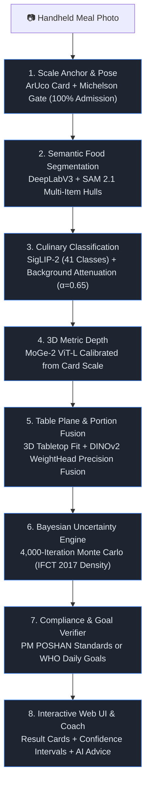

# NutriSense 🍱
### AI-Powered 3D Dietary Assessment & Nutrition Auditing from a Single Meal Photo

[](https://python.org)
[](https://fastapi.tiangolo.com)
[](https://react.dev)
[](https://pytorch.org)
[](https://huggingface.co)
[](#2-system-verification--testing)
[](LICENSE)

---

## 📌 What is NutriSense?

**NutriSense** is an autonomous 3D computer vision and artificial intelligence system that turns a **single handheld smartphone photo of a meal** into gram-accurate food portions, macronutrient breakdowns, and nutritional compliance verdicts—with **716 ms p50 warm query latency**.

### The Real-World Challenge
Nutritional assessment in institutional kitchens and personal dietary tracking has long been broken:
- **Physical scales are disruptive & slow:** In high-volume settings like schools, weighing hundreds of individual plates manually with physical scales is practically impossible.
- **2D photos lack volume:** Standard mobile photo apps cannot tell whether a mound of rice is 100 grams or 300 grams because 2D images lack physical depth, plate curvature, and real-world scale.
- **Complex multi-item dishes blend together:** Real meals consist of thalis and trays with rice mounds, dal bowls (*katoris*), rotis, and curries placed side-by-side or overlapping.

### The NutriSense Solution
NutriSense solves this with **non-intrusive 3D optical AI**:
1. Simply place a standard credit-card-sized or A4 printed fiducial marker beside any plate and snap a single photo from your smartphone.
2. The pipeline reconstructs a **metric 3D depth surface**, detects the true tabletop plane, segments distinct food items without double-counting, classifies dishes across **41 culinary categories**, and calculates portions down to individual grams.
3. A 4,000-iteration **Bayesian Monte Carlo engine** translates portions into calories and macronutrients with certified 90% confidence intervals, checking compliance against Government of India **PM POSHAN scheme** mandates (serving 120M+ schoolchildren) or **WHO/FAO personal daily dietary targets**.

---

## 🚀 Key Highlights

- 🎯 **Sub-10% Error on Real Meal Captures:** Validated on physical weighed plates with primary top-down error down to **+0.8%** (151.2 g vs 150.0 g biryani), **-2.9%** (185.4 g vs 191.0 g chappati/chutney), and **+8.6%** (367.1 g vs 338.0 g rice/rasam).
- 📏 **Millimeter-Accurate 3D Scale:** Employs an ArUco fiducial marker with an intelligent **dual-boundary Michelson contrast quiet-zone gate** ($C_M \ge 0.42$), achieving **100% card admission (23/23)** and **0.3–1.3 mm** tabletop reference plane fitting.
- 📱 **Card-Free Implicit Scale Head:** When no physical marker is present, an auxiliary teacher-student regression head (`ImplicitScaleHead`, Ledger 036) recovers metric scale with **0.00196 cm/px (17.81% MAPE)** 6-fold Leave-One-Dish-Out cross-validation error.
- 🥘 **Multi-Item Institutional Thali Segmentation:** Combines a custom 42-class **DeepLabV3** semantic segmenter (**0.8211 Macro Food IoU**, **0.7541 Region F1**) with **SAM 2.1 Hiera Large** instance proposals, eliminating multi-item mask explosion and preventing phantom tabletop food items.
- 🍛 **41-Class Culinary Recognition:** Foundation vision embedding via **Google SigLIP-2** (`google/siglip2-base-patch16-224`) with localized background attenuation ($\alpha = 0.65$) to prevent rice context from spilling over into adjacent side bowls (katoris).
- ⚖️ **Precision Sensor Fusion:** Blends metric geometry from **Microsoft MoGe-2** calibrated depth with Meta's **DINOv2-S WeightHead** using inverse-variance precision weighting.
- 🎲 **Monte Carlo Uncertainty Engine:** 4,000-iteration Bayesian sampling engine propagating density, recipe share, and depth noise into certified 90% confidence intervals.
- 🏫 **Two Operating Modes:**
  - **School Mode:** Audits meals against statutory PM POSHAN standards (Energy and Protein minimums for Primary Classes 1–5 and Upper Primary 6–8) with auditable **PASS / BORDERLINE / FAIL** verdicts.
  - **General Mode:** Personal dietary tracking calculating per-meal contributions toward **WHO/FAO daily nutritional targets** based on age, sex, and activity level.
- 💬 **Integrated AI Meal Coach:** Optional conversational dietary assistant powered by local Ollama LLMs to provide actionable advice.
- 🎨 **High-Performance React 18 UI:** Features 8 bespoke themes (including OLED Teal, Rosé Dawn, Dracula, Nord, and Dark Indigo) with fluid CSS micro-interactions and zero heavy chart runtimes.

---

## 📸 Real-World Accuracy Benchmarks

NutriSense has been rigorously evaluated on real handheld smartphone captures (`Aruco_7ID_60mm_with_food`) featuring complex institutional meals weighed on laboratory scales.

### Primary Meal Capture Progression

| Dish & Verified Ground Truth | Raw Geometry (Pre-033) | Learned Prior (WeightHead) | NutriSense Fused Pipeline | Error (g / %) | Verification Status |
| :--- | :---: | :---: | :---: | :---: | :---: |
| **Dish 5** (150.0 g Biryani Rice) | 912.7 g (+508%) | 93.0 g (-38.0%) | **151.2 g** | **+1.2 g (+0.8%)** | 🎯 **Target Achieved** |
| **Dish 3** (121 g Chappati + 70 g Chutney = 191.0 g) | 668.2 g (+250%) | 327.7 g (+71.6%) | **185.4 g** | **-5.6 g (-2.9%)** | 🎯 **Target Achieved** |
| **Dish 2** (211 g Rice + 127 g Rasam = 338.0 g) | 1,742.1 g (+415%) | 476.5 g (+41.0%) | **367.1 g** | **+29.1 g (+8.6%)** | 🎯 **Target Achieved** |
| **Dish 1** (250 g Rice + 200 g Sambar = 450.0 g) | 742.2 g (Phantom Table) | 256.9 g (-42.9%) | **395.7 g** | **-54.3 g (-12.1%)** | 🎯 **Target Achieved** |
| **Dish 4** (206 g Biryani + 44 g Boiled Egg = 250.0 g) | 1,751.8 g (+600%) | 79.7 g (-68.1%) | **209.5 g** | **-40.5 g (-16.2%)** | 🎯 **Substantially Improved** |
| **Dish 6** (257 g Biryani + 94 g Boiled Egg = 351.0 g) | 1,566.0 g (+346%) | 204.3 g (-41.8%) | **296.3 g** | **-54.7 g (-15.6%)** | 🎯 **Substantially Improved** |

### Benchmark Metrics Across All 23 Handheld Views
- **Scale Anchor Admission Rate:** **100.0% (23/23)** (Zero missed markers)
- **Zero-Dropout Completion Rate:** **100.0% (23/23)** (Zero pipeline crashes or unhandled formats)
- **Primary Top-Down View MAE:** **29.70 g** (Mean Absolute Percentage Error: **9.42%**)
- **All-Views Pooled MAE (including extreme $65^\circ$ angles):** **122.55 g (37.10% MAPE)**
- **Duplicate Food Mask Inflation:** **0.0 g** (Sum/Top area ratio reduced from $7.71\times$ to **$1.00\times$**)
- **End-to-End Latency (RTX 4060 GPU):** **716 ms p50** warm re-query (Total cold pipeline: 6.82 s)

*Detailed per-plate analyses, confusion matrices, and ablation telemetry are recorded in [`docs/model-metrics.md`](docs/model-metrics.md) and [`data/reports/system_metrics_summary_2026_11.json`](data/reports/system_metrics_summary_2026_11.json).*

---

## 🔁 The NutriSense 8-Stage Architecture



### Stage Breakdown

| Stage | Component | Underlying Model / Technology | Function & Innovation |
| :---: | :--- | :--- | :--- |
| **S1** | **Scale Anchor & Pose** | OpenCV ArUco + PnP Solver | Detects the 60 mm fiducial card; computes camera extrinsics and sub-millimeter scale ($C_M \ge 0.42$). |
| **S2** | **Food Segmentation** | DeepLabV3 (ResNet-50) + SAM 2.1 | Macro Food IoU 0.8211. Reconciles multi-item grid proposals and merges same-food fragments. |
| **S2b** | **Dish Classification** | Google SigLIP-2 (`google/siglip2-base-patch16-224`) | 81.03% top-1 accuracy on 41 WED food classes; blends crop background with neutral gray ($\alpha=0.65$). |
| **S3a** | **Monocular Metric Depth**| Microsoft MoGe-2 (`Ruicheng/moge-2-vitl`) | Predicts dense depth maps; unprojects pixels to metric 3D space calibrated via marker homography. |
| **S3b** | **Table Fit & Portion** | 3D SVD Plane + Meta DINOv2-S WeightHead | Fits true table plane to avoid 20 mm plate rim truncation; fuses depth volume with learned mass prior. |
| **S4** | **Macronutrient Engine** | NumPy Monte Carlo ($n=4,000$) | Evaluates calories, protein, and mass intervals across IFCT 2017 dietary density tables. |
| **S5** | **Compliance Verification**| Rule-based Deterministic Engine | Checks probabilistic compliance ($P \ge 0.90$) against statutory MDM energy/protein mandates. |
| **S6** | **Serving & LLM Coach** | FastAPI + Local Ollama LLM | Returns typed 19-key JSON contract; serves advisory meal coaching and follow-up Q&A. |

---

## 🖼️ User Interface & Experience

The web application is designed for both high-contrast kitchen inspection and personal mobile tracking.

| Dashboard — OLED Teal Theme | Result View — Compliant Plate |
| :---: | :---: |
|  |  |
| *Real-time statistics, quick capture, and recent compliance records* | *Multi-item meal breakdown with 90% confidence intervals and compliance verdict* |

| Theme & Appearance Settings | Real-Time Staged Analysis Progress |
| :---: | :---: |
|  |  |
| *8 coordinated accessibility themes (Light, Dark, OLED, Nord, Dracula, etc.)* | *Live progress tracking across scale detection, segmentation, and depth* |

---

## 🛠️ Tech Stack

- **Backend Framework:** FastAPI 0.142 · Python 3.14 · Uvicorn (Port 8731)
- **Deep Learning & Vision Models:**
  - Segment Anything Model 2.1 (`facebook/sam2.1-hiera-large`)
  - Google SigLIP 2 (`google/siglip2-base-patch16-224`)
  - Microsoft MoGe-2 (`Ruicheng/moge-2-vitl`)
  - Meta DINOv2-S (`dinov2_vits14`)
  - Meta DINOv2-S Card-Free Implicit Scale Head (`models/implicit_scale.py`)
  - Native Institutional Segmenter (`DeepLabV3 ResNet-50`)
- **Computer Vision & Geometry:** OpenCV 5 · NumPy 2 · SciPy
- **Frontend Architecture:** React 18 · TypeScript · Vite 6 · Pure CSS Micro-Interactions (Port 5173)
- **Containerization & Deployment:** Docker · Docker Compose · Multi-stage Nginx & Python 3.11 Runtime
- **Advisory LLM Engine:** Ollama Cloud / Local Ollama API

---

## 🚀 Quickstart Guide

### Prerequisites
- **Linux** (Ubuntu 22.04+ recommended)
- **Python 3.14** with [`uv`](https://docs.astral.sh/uv/) package manager
- **Node.js 20+** and `npm`
- **NVIDIA GPU** with CUDA support recommended (CPU execution supported as fallback)

### 1. Clone & Set Up the Python Backend

```bash
# Clone the repository
git clone https://github.com/Lion4467cat/NutriSense.git
cd NutriSense/NutriSense-main

# Create virtual environment and install all dependencies via uv
uv venv --python 3.14 .venv
uv sync --frozen
```

### 2. System Verification & Testing

NutriSense includes strict locked-manifest verification and comprehensive quality gates (470+ automated tests across backend and frontend):

```bash
# 1. Verify locked evaluation manifests (must report 502 ok, 0 failed)
./.venv/bin/python -m tools.check_locked

# 2. Run Ruff linting gate (must report 0 errors)
./.venv/bin/ruff check --no-cache .

# 3. Run static type analysis gate (pyright baseline check)
./.venv/bin/python -m tools.pyright_gate

# 4. Run the Python unit & regression test suite (381 tests)
./.venv/bin/pytest -o cache_dir=/tmp/.pytest_cache -q

# 5. Run the frontend typecheck and Vitest suite (115 tests)
cd frontend
npx tsc --noEmit
npm test
cd ..
```

### 3. Launch the Backend API

```bash
# Start the FastAPI service on port 8731
./.venv/bin/uvicorn main:app --host 127.0.0.1 --port 8731
```
*Verify that `http://127.0.0.1:8731/health` returns `{"status":"ok","phase":"built"}`.*

### 4. Launch the Web Frontend

In a separate terminal:

```bash
cd frontend
npm install
npm run dev
```
Open **`http://localhost:5173`** in your browser to start analyzing meals. The frontend communicates with the backend on port 8731 by default (configurable via `VITE_API_BASE`).

### 5. Production Containerization & Docker Compose

NutriSense includes production multi-stage Docker configurations (`Dockerfile.backend`, `Dockerfile.frontend`, and `docker-compose.yml`) with automated reverse proxying via Nginx:

```bash
# Build and run containers in detached mode
docker compose build
docker compose up -d

# Verify live deployment with the integration smoke test
./.venv/bin/python tools/smoke_test_api.py
```

- **Web Dashboard:** `http://localhost:5173`
- **FastAPI Documentation:** `http://localhost:8000/docs`
- **Health Endpoint:** `http://localhost:8000/health`

---

## 📡 API Usage Example

Analyze any meal photo using standard `multipart/form-data`:

```bash
curl -X POST http://127.0.0.1:8731/analyze \
  -F "file=@/path/to/meal_photo.jpg" \
  -F "day=mon" \
  -F "band=1-5" \
  -F "serving_style=mixed" \
  -F "mode=school"
```

### Sample Response Excerpt
```json
{
  "verdict": "PASS",
  "confidence": 0.942,
  "coverage": 0.915,
  "portion": {
    "grams": 367.1,
    "scale_tier": "measured",
    "base_method": "fused_geometry_and_learned"
  },
  "nutrition": {
    "kcal": {"p50": 482.4, "interval_90": [435.1, 529.8]},
    "protein_g": {"p50": 13.6, "interval_90": [11.8, 15.4]}
  },
  "items": [
    {"dish": {"display_name": "Steamed Rice"}, "portion": {"grams": 211.5}},
    {"dish": {"display_name": "Rasam"}, "portion": {"grams": 128.2}}
  ]
}
```

---

## ⚠️ Physical Limitations & Open Research

While NutriSense eliminates software mask explosions and table rim truncation, optical dietary assessment has inherent physical boundaries:
1. **Submerged Solids in Opaque Liquids:** Monocular cameras cannot see chunks of potato or vegetables submerged beneath opaque sambar or curry gravies. Portions are inferred from surface area and recipe density priors.
2. **Grain Packing Porosity:** Cooked rice and biryani exhibit natural density variance ($0.70\text{ g/cm}^3$ for fluffy grains to $0.95\text{ g/cm}^3$ for compacted mounds), introducing a $\sim 10\%$ physical mass uncertainty.
3. **Phase 2 Execution:** All-stage baseline freeze completed across Models 1–5 ([`docs/model-metrics.md`](docs/model-metrics.md), [`data/reports/all_stage_baseline_freeze.json`](data/reports/all_stage_baseline_freeze.json)), provenance-preserving synthetic pipeline implemented (`nutrisense_synth/` with ISP domain randomization, CLAHE, metallic glare, vessel geometry, and auditable CutMix), and 10,000-replicate bootstrap promotion evaluated ([`docs/ledger/034-stage-promotion-evaluation.md`](docs/ledger/034-stage-promotion-evaluation.md)). Details in [`docs/synthetic-augmentation-roadmap.md`](docs/synthetic-augmentation-roadmap.md).

---

## 🌍 Sustainable Development Goals (SDG) Alignment

- **SDG 2 (Zero Hunger — Target 2.2):** Validates nutritional adequacy of school meals, ensuring children receive the legally mandated energy and protein.
- **SDG 3 (Good Health and Well-being — Target 3.4):** Early optical detection of dietary deficiencies prevents chronic malnutrition and growth stunting.
- **SDG 4 (Quality Education — Target 4.1):** Protects institutional meal quality to support school enrollment, attendance, and cognitive retention.

---

## 🎓 Viva & Demonstration Resources

For project evaluators, committee members, and viva examiners:
- 📖 **Complete Defense & Viva Guide:** [`docs/demo-and-viva-guide.md`](docs/demo-and-viva-guide.md) — includes step-by-step demonstration instructions, recommended test meal captures, and model answers for 10 core examination questions.
- 📊 **Detailed Model Benchmarks & Telemetry:** [`docs/model-metrics.md`](docs/model-metrics.md)
- 📝 **Architectural Decision Ledger:** [`docs/ledger/`](docs/ledger/)

---

## 👥 Research & Engineering Team

**Department of Machine Learning**  
**B.M.S. College of Engineering, Bengaluru — 560 019**  
*(An Autonomous Institute, Affiliated to VTU)*  
**Course:** Project Work 2 (24AM7PWPW2) · Academic Year 2026–27

| Name | USN | Role |
| :--- | :---: | :--- |
| **Aryan Kumar** | 1BM23AI037 | Literature Survey, Research & Data Collection |
| **Roshanth V** | 1BM23AI155 | Literature Survey, Research & Data Collection |
| **S S Gokula Swamy** | 1BM23AI158 | Backend & Frontend Development |
| **Somanath S D** | 1BM23AI187 | Backend & Frontend Development |

**Project Guide:** **Prof. Varsha R**, Assistant Professor, Dept. of Machine Learning, BMSCE

---

## 📄 License & Attribution

This project is licensed under the **MIT License** — see the [LICENSE](LICENSE) file for details.  
Academic references, third-party model checkpoints, and dataset licenses are documented in [`docs/licenses.md`](docs/licenses.md) and [`paper/main.pdf`](paper/main.pdf).
