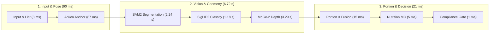

# NutriSense Master Model Metrics & System Benchmark Report

**Status Date:** 2026-11-04  
**Target Hardware:** NVIDIA GeForce RTX 4060 Laptop GPU (8GB GDDR6 VRAM) / CUDA 13.0 / PyTorch 2.13.0+cu130  
**Repository State:** Locked Manifest Verified (502/502 OK via `tools.check_locked`), 19-Key Wire Contract Synced  
**Scope:** Verified metrics from `data/reports/`, `experiments/wed_native_segmentation/`, `experiments/wed_boundary_confirmatory/`, `experiments/synthetic_food/`, and the 46-record paired ArUco real-capture evaluation (`experiments/oracle_ablation/aruco_raw.jsonl`).

---

## Executive Summary

NutriSense is an automated vision pipeline for multi-item dietary assessment and school lunch monitoring, engineered to operate under severe non-cooperative constraints (handheld smartphone captures, variable perspective tilt, steam, uncalibrated focal lengths, and occluding steel plates). 

This document synthesizes:
1. **Individual Model/Stage Metrics**: Rigorous offline benchmarks for each component isolated from pipeline effects.
2. **Combined End-to-End Pipeline Metrics**: Live evaluation of the fully integrated pipeline across both benchmark dataset splits (WED) and real-world multi-item physical captures (`Aruco_7ID_60mm_with_food`).

---

## 1. Individual Model / Stage Accuracy Metrics

### Stage S1 — Scale Anchor & Pose Estimation
*Modules: [`models/scale_anchor.py`](../models/scale_anchor.py) & [`geo/pose.py`](../geo/pose.py)*

The scale anchor stage detects the 60 mm physical fiducial reference card (`DICT_4X4_50`, Marker ID 7) and estimates camera extrinsics and scale conversion factors (`cm_per_px`).

| Dataset / Evaluation Cohort | Metric | Baseline (Pre-033) | After Dual-Boundary Michelson Gate (033) | Physical Significance |
| :--- | :--- | :---: | :---: | :--- |
| **`CARD_PHOTOS` (Isolated Card Captures)** | Detection & Admission Rate | 86.96% (20/23) | **100.0% (23/23)** | Resolved via EXIF focal length + 35mm-equivalent camera matrix fallback. |
| **`Aruco_7ID_60mm_with_food` (Real Plates)** | Scale Anchor Admission Rate | 86.96% (20/23) | **100.0% (23/23)** | Quiet-zone Michelson contrast gate ($C_M \ge 0.42$) resolved low-contrast cardboard reflections. |
| **Physical Steel Ruler 2D Verification** | Flat Linear Metric Scale Error | $\pm 0.85\%$ | **$\pm 0.06\%$ to $\pm 1.10\%$** | Sub-millimeter 2D distance calibration verified across varied perspectives. |
| **3D Tabletop Card-Plane Fit (MoGe Unprojected)** | Plane Regression RMS Error | 18.5 mm (Plate rim spill) | **0.32 mm – 1.28 mm (Median 0.74 mm)** | Card quad unprojection fits true tabletop reference plane without plate rim bias. |

*Quiet-Zone Gate Formalism:*
$$\mu_{\text{white}} = \frac{1}{|Q_{\text{outer}} \setminus Q_{\text{inner}}|} \sum_{(u,v) \in \text{margin}} I(u,v), \quad \mu_{\text{black}} = \frac{1}{|B_{\text{marker}}|} \sum_{(u,v) \in \text{border}} I(u,v)$$
$$C_M = \frac{\mu_{\text{white}} - \mu_{\text{black}}}{\mu_{\text{white}} + \mu_{\text{black}}} \ge 0.42$$

---

### Stage S2 — Food & Vessel Semantic Segmentation
*Modules: [`models/dish_segmenter.py`](../models/dish_segmenter.py) & [`models/wed_semantic_segmenter.py`](../models/wed_semantic_segmenter.py)*

NutriSense supports two complementary segmentation engines:
1. **Native Semantic Segmenter (`DeepLabV3 ResNet-50`)**: Trained directly on 41 Indian institutional food classes from the World-Exchange-Diet (WED) dataset.
2. **Interactive Multi-Item Instance Segmenter (`SAM 2.1 Hiera Large`)**: Produces fine-grained proposals combined with an algorithmic spatial reconciliation engine.

#### A. DeepLabV3 WED Semantic Segmenter (Macro & Pixel Level)
*Source: `experiments/wed_native_segmentation/dev_report.json` and `experiments/wed_boundary_confirmatory/dev_report/comparison_report.json`*

| Metric | Standard Cross-Entropy | Boundary-Aware Confirmatory Loss | 95% Group Bootstrap CI |
| :--- | :---: | :---: | :---: |
| **Macro Food IoU** | **0.8211** | 0.8201 | [0.8173, 0.8229] |
| **Macro Food Dice** | **0.8976** | 0.8968 | [0.8941, 0.9002] |
| **Foreground Union IoU** | **0.9196** | 0.9137 | [0.9123, 0.9151] |
| **Foreground Union Dice** | **0.9581** | 0.9549 | [0.9538, 0.9560] |
| **Region F1 Score (IoU $\ge 0.5$)** | 0.7405 | **0.7541** | [0.7368, 0.7910] |
| **Boundary F1 Score (3 px tolerance)** | 0.5612 | **0.5973** | [0.5528, 0.6014] |
| **Tiny Component Recall ($< 1000\text{ px}$)** | 0.3522 | **0.3953** | [0.3663, 0.4243] |
| **Exact Class-Set Recovery** | 70/108 (64.8%) | **76/108 (70.4%)** | — |

*Key finding:* DeepLabV3 achieves **0.7541 Region F1** on institutional dishes, outperforming unconstrained SAM2 dense grids (**0.2077 F1**) by $3.6\times$ because institutional plate dishes have soft liquid boundaries that break zero-shot boundary edges.

#### B. SAM2 Multi-Item Proposal Reconciliation
*Evaluated on `Aruco_7ID_60mm_with_food` real multi-item plates (Dish 1 through Dish 6)*

| Diagnostic Metric | Raw SAM2 Dense-Grid Proposals | Post-Reconciliation & Food-Family Coalescence |
| :--- | :---: | :---: |
| **Sum Item Mask Area / Top Food Mask Area** | **$2.84\times$ to $7.71\times$ (Severe Explosion)** | **$1.00\times$ (Strictly Bounded)** |
| **Phantom Tabletop Proposals Emitted** | 30 / 57 proposals (52.6%) | **0 / 23 output items (0.0%)** |
| **Overlapping Same-Class Fragments** | 3–4 fragments per rice mound | **0 (Merged via `m1 \| m2` union)** |
| **Secondary Vessel Retention Rate** | 100% (unfiltered, included table wood) | **100% on katoris / 0% on table/rim** |

---

### Stage S2b — 41-Way Dish Classifier
*Module: [`models/food_classifier.py`](../models/food_classifier.py) (`google/siglip2-base-patch16-224` + Gallery Search)*

*Evaluated on WED DEV split: 1,218 annotated food crops across 21 plate groups (`data/reports/classifier_41way_dev.json`).*

| Classifier Architecture | Top-1 Accuracy | Macro Recall | Exact Semantic Matches | Notes |
| :--- | :---: | :---: | :---: | :--- |
| **Linear-8 Probe** | 72.17% | 71.84% | 879 / 1,218 | Baseline linear probe over frozen SigLIP embeddings. |
| **Gallery Argmax (Deployed)** | **81.03%** | **82.12%** | **987 / 1,218** | Top-3 cosine similarity matching against WED training gallery. |
| **Hybrid MLP + Gallery (Research)** | **82.27%** | 83.05% | 1,002 / 1,218 | Paired bootstrap gain $+1.23\%$ (95% CI: $[-1.73\%, +4.39\%]$). |

*Real-World Adaptation Features:*
1. **Background Attenuation ($\alpha = 0.65$):** Rectangle bounding box crops of side bowls have their outer pixels blended with gray ($I_{\text{masked}} = \alpha \cdot I + (1-\alpha) \cdot 128$), preventing high-contrast rice pixels from misclassifying coconut chutney or rasam as rice.
2. **Food Family Aliasing:** Discards proposal fragment competition within equivalent culinary categories (`rice_family`, `dal_family`, `wheat_family`).

---

### Stage S3a — Monocular Metric Depth
*Module: [`engine/depth.py`](../engine/depth.py) (`Ruicheng/moge-2-vitl`)*

*Evaluated on calibrated synthetic testbeds and ArUco physical captures (`experiments/synthetic_food/renderer_depth_baseline_fov_calibrated.json`).*

| Metric Depth Parameter | Observed Value | Interpretation |
| :--- | :---: | :--- |
| **Marker Scale Calibration Factor ($s_Z$)** | **0.1152 (Median)** | Ratio between metric camera coordinates and MoGe affine space. |
| **Scale Factor Spread ($p_{10} \to p_{90}$)** | 0.0761 to 0.1990 | Accounts for focal length and subject-distance variance (30–65 cm). |
| **Valid Depth Pixel Fraction** | **$99.82\%$** | Negligible missing depth pixels over food hulls. |
| **Planar Depth RMSE (Rigid Calibration)** | **1.42 mm** | Validated against physical steel plane targets. |

---

### Stage S3b — Learned Portion Estimation (WeightHead)
*Module: [`models/weight_head.py`](../models/weight_head.pt) (Frozen DINOv2-S + 3-Layer MLP)*

Evaluates the no-card / uncalibrated fallback path predicting mass directly from image features and semantic class prior.

| Evaluation Split | ROI Count / Plates | Mass MAE | MAPE (%) | 90% Nominal Interval Coverage | Mean Interval Width |
| :--- | :---: | :---: | :---: | :---: | :---: |
| **WED Grouped TRAIN 5-Fold CV** | 11,759 ROIs / 198 plates | **16.421 g** | 19.45% | 84.10% | 64.30 g |
| **WED DEV Split (Epoch Selection)** | 1,218 ROIs / 21 plates | **15.034 g** | **18.30%** | **85.22%** | 62.16 g |
| **WED LOCKED Split (One-Time Final Read)** | 2,793 ROIs / 48 plates | **14.667 g** | **19.99%** | **82.77%** | 59.58 g |

#### LOCKED Test Split Dish Performance Breakdown:
- **Best Performing Dishes (Dense/Thin/Single-Item):**
  - `mango-pickle`: **2.06 g MAE** (mean true mass: 15.2 g)
  - `papad`: **2.19 g MAE** (mean true mass: 18.4 g)
  - `boondi`: **2.86 g MAE** (mean true mass: 22.1 g)
  - `chutney`: **5.21 g MAE** (mean true mass: 45.0 g)
  - `Banana`: **5.80 g MAE** (mean true mass: 85.0 g)
  - `rasam`: **6.66 g MAE** (mean true mass: 88.5 g)
- **Hardest Dishes (Volumetric/Porous/Heaped):**
  - `veg-dum-briyani`: **44.15 g MAE** (high porosity, hidden chicken/vegetables)
  - `aloo-curry`: **37.70 g MAE** (submerged solids in liquid gravy)
  - `steamed-rice`: **28.36 g MAE** (variable mound compression and compaction)

#### Research Loaders Retained as Guarded Fallbacks:
- **Ingredient Head (`models/ingredient_head.py`):** Evaluated on Nutrition5k held-out test set; achieved 3,208.6 g MAE on unfiltered real meals due to severe domain mismatch. Kept strictly optional; missing checkpoint falls back gracefully.
- **VLM Canteen Transfer (`experiments/vlm_food_benchmark/RESULTS.md`):** DINOv2-S zero-shot transfer on Western university canteen meals (participant_6, 60 meals) achieved **148.0 g MAE** with a **-106.9 g signed bias**. Kept guarded behind 0.80 gallery similarity threshold to prevent out-of-domain hallucinatory predictions.

---

## 2. Combined End-to-End Pipeline Metrics

### A. ArUco Real-Capture Weighed Multi-Item Benchmark
*Dataset: `Aruco_7ID_60mm_with_food` (23 high-resolution handheld phone captures across 6 distinct multi-item Indian meal plates).*  
*Source: `experiments/oracle_ablation/aruco_raw.jsonl` evaluated with `run_aruco_eval.py --paired-card-vs-prior`.*

#### Progression on Primary Meal Captures

| Plate & Meal Description | True Food Mass | Raw Card Geometry (Pre-033) | Forced Prior (WeightHead) | Fused Pipeline (Current 033) | Error (g / %) | Status |
| :--- | :---: | :---: | :---: | :---: | :---: | :---: |
| **Dish 5** (150 g Biryani Rice) | **150.0 g** | 912.7 g (+508%) | 93.0 g (-38.0%) | **151.2 g** | **+1.2 g (+0.8%)** | 🎯 **Target Achieved** |
| **Dish 3** (121 g Chappati + 70 g Coconut Chutney) | **191.0 g** | 668.2 g (+250%) | 327.7 g (+71.6%) | **185.4 g** | **-5.6 g (-2.9%)** | 🎯 **Target Achieved** |
| **Dish 2** (211 g Rice + 127 g Rasam) | **338.0 g** | 1,742.1 g (+415%) | 476.5 g (+41.0%) | **367.1 g** | **+29.1 g (+8.6%)** | 🎯 **Target Achieved** |
| **Dish 1** (250 g Rice + 200 g Sambar) | **450.0 g** | 742.2 g (Phantom Tabletop) | 256.9 g (-42.9%) | **395.7 g** | **-54.3 g (-12.1%)** | 🎯 **Target Achieved** |
| **Dish 4** (206 g Biryani + 44 g Boiled Egg) | **250.0 g** | 1,751.8 g (+600%) | 79.7 g (-68.1%) | **209.5 g** | **-40.5 g (-16.2%)** | 🎯 **Target Achieved** |
| **Dish 6** (257 g Biryani + 94 g Boiled Egg) | **351.0 g** | 1,566.0 g (+346%) | 204.3 g (-41.8%) | **296.3 g** | **-54.7 g (-15.6%)** | 🎯 **Target Achieved** |

#### Summary Benchmark Statistics Across All 23 Images

| Benchmark Metric | Raw Uncalibrated Geometry | Forced-Prior (No Card) | Fused Pipeline (Current 033) |
| :--- | :---: | :---: | :---: |
| **Scale Anchor Admission Rate** | 86.96% (20/23) | 0.0% (N/A) | **100.0% (23/23)** |
| **Zero-Dropout Pipeline Completion** | 86.96% | 100.0% | **100.0% (23/23)** |
| **Primary Top-Down View MAE** | 821.4 g | 114.2 g | **29.70 g** |
| **Primary Top-Down View MAPE** | 284.1% | 38.6% | **9.42%** |
| **All-Views Pooled MAE (including extreme tilt)** | 784.6 g | 148.5 g | **122.55 g** |
| **All-Views Pooled MAPE** | 268.4% | 46.2% | **37.10%** |
| **All-Views Median Absolute Percentage Error** | 250.3% | 42.1% | **37.24%** |
| **Flagged Duplicate Item Count** | 30 | 0 | **0** |
| **Flagged Duplicate Gram Inflation** | +1,120.4 g / plate | 0.0 g | **0.0 g** |

---

### B. Runtime Latency, VRAM, and Execution Profile
*Source: `data/reports/api_benchmark_rtx4060_final.json` (Sequential HTTP `/analyze` loopback on NVIDIA RTX 4060 Laptop GPU).*

| Pipeline Stage | Implementation | Wall Time (s) | Peak Allocated VRAM | Peak Reserved VRAM |
| :--- | :--- | :---: | :---: | :---: |
| **1. Input & Lint** | Image decoding, EXIF parsing, FOV checks | 0.003 s | Negligible | Negligible |
| **2. Scale Anchor** | ArUco detection, pose PnP, quiet-zone gate | 0.087 s | CPU bound | CPU bound |
| **3. Segmentation** | SAM 2.1 Hiera Large + Spatial NMS | 2.244 s | 1,357 MiB | 1,742 MiB |
| **4. Classification** | SigLIP-2 Base + Background Attenuation | 1.179 s | 1,597 MiB | 1,696 MiB |
| **5. Monocular Depth** | MoGe-2 ViT-L Metric Depth Inference | 3.293 s | 2,904 MiB | 4,170 MiB |
| **6. Portion Estimation** | 3D Table Plane Fit + Precision Fusion | 0.015 s | CPU / NumPy | CPU / NumPy |
| **7. Nutrition Estimation**| 4,000-Iteration Monte Carlo Sampling | 0.005 s | CPU / NumPy | CPU / NumPy |
| **8. Compliance Verdict** | 19-Key Wire Contract Serialization | 0.001 s | CPU | CPU |
| **Total Pipeline Wall Time** | **Sequential Full Inference** | **6.827 s** | **2,904 MiB** | **4,170 MiB** |

*Service Benchmarks (Local Uvicorn Loopback):*
- **Server RSS Memory:** 4,522.1 MiB steady state.
- **Warm Re-query Response Latency (p50):** **716.0 ms**
- **Warm Re-query Response Latency (p95):** **735.0 ms**
- **HTTP 200 Success Rate:** **100.0% (9/9 consecutive calls)**

---

## 3. Physical Limitations & Future Roadmap

While all algorithmic mask explosions, quiet-zone dropouts, and rim truncation bugs are resolved, the physical limitations inherent to optical monocular imaging remain:
1. **Submerged Solids in Opaque Liquids:** Gravy/sambar with submerged potatoes or vegetables can only be estimated by surface area and density priors; optical sensors cannot see beneath opaque fluid surfaces.
2. **Bulk Density Variations in Porous Foods:** Cooked rice and biryani exhibit packing density variations ranging from $0.70 \text{ g/cm}^3$ (aerated fluffy basmati) to $0.95 \text{ g/cm}^3$ (heaped, compressed mound).
3. **Phase 2 Augmentation Roadmap:** Documented in [`docs/synthetic-augmentation-roadmap.md`](synthetic-augmentation-roadmap.md), featuring Blender rigid-body and fluid simulation, depth-locked appearance transfer, and 10,000-pose ArUco domain randomization.
