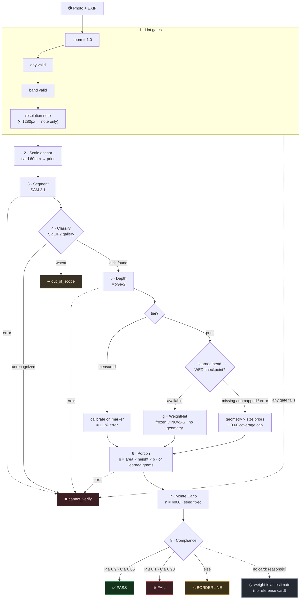
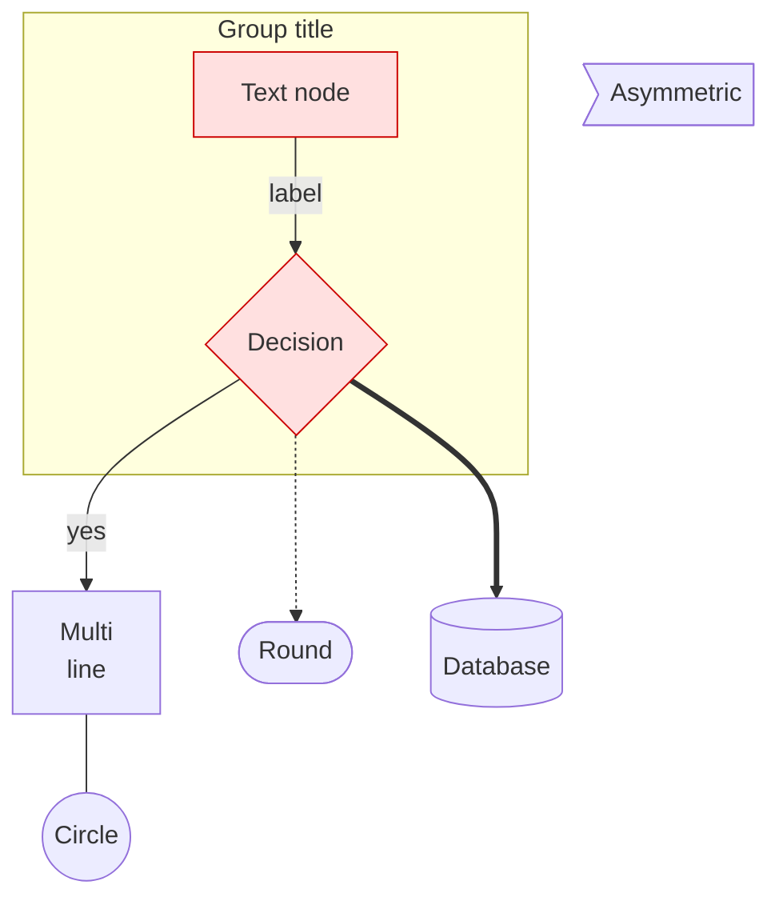

# NutriSense Pipeline — TDD Test Report

**Date:** 2026-10-08
**Method:** TDD skill (confirmed seams → vertical slices → red→green loop)
**Suite (historical S6 TDD run):** `89 passed in ~88s`. The counts below are the S6-time snapshot (58 pre-existing + 12 seam tests + 19 contract/guard tests added 2026-10-10; the compliance-block test was added after this TDD run; +6 for the learned-weight feature and its same-day graduation, 2026-10-11, see §2b). Current counts are maintained in `README.md` and `AGENTS.md`.

## 1. Seam inventory (confirmed with user)

Per the TDD skill, no test was written at an unconfirmed seam. Seven gap seams were proposed after mapping `analyze()` + the HTTP surface against existing coverage, and the user confirmed **all 7**.

| # | Seam | Public boundary | Pre-existing coverage | This run |
|---|---|---|---|---|
| 1 | Lint resolution-note branch | `analyze()` → `lint` block | zoom/day/band gates covered; note branch never asserted | 2 tests |
| 2 | Segment-failure branch | `analyze(deps={"segment"})` → `cannot_verify` | none | 1 test |
| 3 | Classify-unrecognized branch | `analyze(deps={"classify"})` → `cannot_verify` | out-of-scope covered only | 1 test |
| 4 | Depth-calibration wiring | `analyze(deps={"depth"})` → `anchor.depth_scale_*` | anchor tier covered in isolation | 2 tests |
| 5 | Portion-failure branch | `analyze(deps={"depth"})` → `cannot_verify` | none | 1 test |
| 6 | Result-assembly contract | `analyze()` return dict (API spec) | happy-path E2E asserted a few fields | 3 tests (incl. compliance block) |
| 7 | HTTP contract | `POST /analyze` validation + echo | /health, /menu, unreadable, bad band covered | 2 tests |

**Already covered before this run** (left untouched): scale anchor tiers, portion ring/prior/table paths, MC engine, compliance verdict rules, happy-path E2E, zoom/day/band gates, out-of-scope dish.

## 2. Red→green log (one slice at a time)

| Slice | Test | First run | Notes |
|---|---|---|---|
| 1 | `test_lint_resolution_note_is_non_blocking` | 🟢 green | Default scene min side 1100 < 1280 — note branch was live but unasserted |
| 1 | `test_lint_resolution_ok_large_image` | 🟢 green | Complement branch (≥1280 → no notes, non-blocking) |
| 2 | `test_segment_failure_cannot_verify` | 🟢 green | Confirms anchor runs before segment; failure surfaces reason verbatim |
| 3 | `test_classify_unrecognized_cannot_verify` | 🟢 green | Classification summary + segmentation retained on early exit |
| 4 | `test_depth_scale_calibrated_and_recorded` | 🟢 green | Card → `depth_scale_source == "card"`, factor ∈ (0.5, 2.0) vs metric GT |
| 4 | `test_depth_scale_none_on_prior_tier` | 🟢 then tightened → 🟢 | First assertion allowed PASS/FAIL — plan forbids it; tightened to `== "BORDERLINE"` and re-ran |
| 5 | `test_depth_failure_cannot_verify` | 🟢 green | stage split (2026-10-10): reason is now `stage_failed` / "depth failed: …"; dish info retained |
| 6 | `test_result_contract_keys_and_types` | ⚠️ vacuous → fixed → 🟢 | Flag-vocabulary subset guessed wrong (`size_prior/low_area` don't exist) and passed vacuously; corrected to the real vocabulary (`depth_partial, vessel_shape_uncertain, base_sign_flip, thin_layer, size_prior_scale`) |
| 6 | `test_result_contract_flags_populated_on_ring_path` | 🟢 green | Card + healthy area → `base_method == "ring"`, no flags |
| 7 | `test_http_missing_required_field_422` | 🟢 green | FastAPI 422 with `loc` naming `band` |
| 7 | `test_http_serving_style_echo` | 🟢 green | Full GPU E2E (real anchor + SAM + MoGe); stub classifier only |

**Red events:** none from production code — every branch already behaved per spec (all tests pass first run). The loop still earned its keep: two of *my own* expectations were wrong and were corrected under red-ish conditions (tightened prior-verdict rule, replaced a vacuous assertion). A genuine red here would have meant a pipeline bug.

**Anti-patterns avoided (per skill):**
- No internal mocking — all tests drive `analyze()` via its public `deps` seam and the HTTP API; only the classifier is stubbed (deterministic gallery abstain on synthetic renders, same pattern as existing E2E).
- No tautologies — expected values are spec literals (response key set, flag vocabulary, plan verdict rules, metric GT depth), not recomputed the way the code computes them.

**Response key-set spec (as of 2026-10-10):** exactly 16 keys — `verdict, reasons, failures, lint, anchor, segmentation, classification, dish, portion, nutrition, coverage, assumptions, advisory, compliance, model_versions, policy`. `reasons` are `{kind, text}` objects (`ReasonKind`: zoom, unknown_day, unknown_band, out_of_scope, unrecognized, unreadable, stage_failed, in_zone, below_min, coverage_gate); `failures` is `[]` for graceful exits (gates carry their own entry, open-set abstain carries none); `policy` carries the whole rule set (`data/standards.yaml` thresholds/gates/mandatory set/band minima + `data/params_status.yaml` factors/lint) under a 12-hex `policy_version` digest, mutation-tested. `tests/test_contract_gen.py` regenerates `frontend/src/types/contract.gen.ts` (analysis + menu + health schemas) and diffs it; vitest validates all three parity fixtures (happy, unreadable, menu) against the schemas.
- Vertical slices — each test was written, run, and settled before the next began.

## 2b. Learned-weight feature slice (2026-10-11, ADR 0002 + amendment)

Same method, one vertical slice at a time; the implementation was built
alongside (P0–P4), tests written against the confirmed seams. The feature
first shipped with an `ESTIMATED` cap; the user graduated it the same day
(disclaimer instead of cap — ADR 0002 amendment), and the assertions below
are the final, post-graduation forms (re-run green, full suite 110).

| Slice | Test | Result | Notes |
|---|---|---|---|
| compliance | `test_geometry_prior_still_capped_with_disclaimer` | 🟢 | geometry grams: C=0.60 → verdict can only be BORDERLINE; `no_reference_card` is reasons[0] (both zones) |
| compliance | `test_learned_prior_is_scored_with_no_card_disclaimer` | 🟢 | learned grams: C=0.90 → PASS **and** FAIL reachable; disclaimer leads reasons |
| compliance | `test_estimated_reason_names_learned_source` | 🟢 | reason/assumption text names the grams source (learned model vs size-prior geometry) |
| compliance | `test_coverage_function_factors` (extended) | 🟢 | learned prior → `{estimated_weight: 0.90}`; geometry prior → `{anchor_prior: 0.60}` |
| seam 12 | `test_learned_head_replaces_prior_geometry` | 🟢 | fake head via `deps["weight_head"]`: slots [33,32] on rice_sambar, null depth aux, scored verdict + `estimated_weight` factor + disclaimer, model_versions entry |
| seam 13 | `test_learned_head_failure_falls_back_to_geometry` | 🟢 | head raising → silent geometry degrade, no failure entry, BORDERLINE (0.60 cap), disclaimer |
| seam 14 | `test_weight_head_none_disables_learned_path` | 🟢 | `weight_head: None` → geometry, BORDERLINE |
| seam 15 | `test_learned_head_not_used_when_card_measured` | 🟢 | measured tier: head never called, verdict still PASS/BORDERLINE/FAIL |

Frontend counterparts: `verdictMeta` exhaustiveness test 5 → 6 keys (pill
kept for legacy records); policy literals (FALLBACK_POLICY + 3 test
fixtures) gained `estimated_weight`; `verdictMeta`/parity fixtures
regenerated (`CONTRACT_FIXTURE_WRITE=1`); vitest 43/43, `tsc --noEmit`
clean, `npm run build` clean. Digest mutation test covers the new factor
(`coverage_estimated_weight` in the hardcoded move-list); pinned digest
`8e75c97be3e0` → **`7d3431caec4b`**.

## 3. Final suite

```
89 passed in ~88s
```

| File | Tests | Phase |
|---|---|---|
| tests/test_geo.py | 5 | S0 |
| tests/test_card.py | 4 | S1 |
| tests/test_scale_anchor.py | 6 | S1 |
| tests/test_renderer.py | 7 | S0/S1 |
| tests/test_s2.py | 5 | S2 |
| tests/test_portion.py | 7 | S3 |
| tests/test_mc.py | 7 | S4 |
| tests/test_compliance.py | 9 | S5 |
| tests/test_api.py | 7 | S6 |
| **tests/test_pipeline_seams.py** | **12** | **S6 seams** |
| tests/test_contract.py | 11 | wire contract |
| tests/test_contract_gen.py | 3 | generated-schema + fixture parity |
| tests/test_stage_guards.py | 5 | per-stage failure guards (HTTP) |

## 4. Historical S6 pipeline flowchart

This records the S6 chain at the time of the TDD report and predates the
current multi-item branch. The current serving flow is summarized in
`README.md`.



## 5. Mermaid syntax reference

Minimal syntax needed for the flowchart above (and the common extensions):

````

````

What each line shows: `flowchart TD` = type + direction; `%%` = comment (own line only — inline `#` comments are a parse error); node shapes in declaration order = rectangle `["…"]`, rhombus `{"…"}`, line break `<br/>`, stadium `(["…"])`, cylinder `[(…)]`, circle `((…))`, flag `>…]`; links = arrow `-->`, labeled `-->|"…"|`, dotted `-.->`, thick `==>`, open `---`; `subgraph … end` = group; `classDef` + `class` = styling.

Key rules:

- **Front fence:** the code must be fenced as ` ```mermaid ` for renderers (GitHub, opencode preview, mermaid.live) to draw it.
- **First line** declares the diagram type: `flowchart` (or `graph`), followed by direction: `TB`/`TD` (top→down), `LR` (left→right), `BT`, `RL`.
- **Nodes:** declared implicitly by first reference (`A --> B`), labeled explicitly with `id["label"]`. Shape delimiters: `["…"]` rect, `{"…"}` rhombus, `("…")` round, `(["…"])` stadium, `(("…"))` circle, `["…"]:::class`.
- **Links:** `-->` arrow, `-.->` dotted, `==>` thick, `---` open; labels go in pipes: `-->|"text"|`.
- **Line breaks** inside labels: `<br/>` (quotes required when the label contains spaces or punctuation).
- **subgraph/end** groups nodes; `subgraph ID["Title"]`.
- **Styling:** `classDef name fill:#hex,stroke:#hex,color:#hex` then `class nodeId1,nodeId2 name`, or `style nodeId fill:…`.
- **Comments:** `%%` at line start. **Escapes:** wrap any label containing `(){}[]#,;` in double quotes.

Other diagram types available with the same fence: `sequenceDiagram`, `gantt`, `pie`, `stateDiagram-v2`, `classDiagram`, `erDiagram`.
