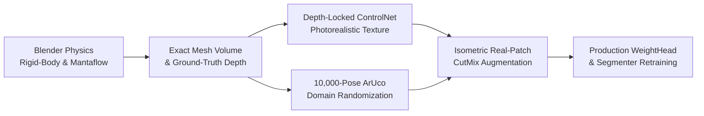

# Phase 2 Roadmap: Physics-Informed Synthetic Food Data Generation & Sim-to-Real Augmentation

**Status:** Approved for Next-Phase Execution  
**Target Milestone:** Production-Grade Real-World Dietary Assessment System  
**Companion Documents:** [`docs/model-metrics.md`](model-metrics.md), [`docs/synthetic-renderer-audit.md`](synthetic-renderer-audit.md), [`docs/ledger/032-reject-stylized-renderer-pilot.md`](ledger/032-reject-stylized-renderer-pilot.md), [`docs/ledger/033-aruco-card-plane-and-vessel-fusion.md`](ledger/033-aruco-card-plane-and-vessel-fusion.md)

---

## 1. Motivation: The Sim-to-Real Challenge

While Ledger 033 resolved the algorithmic bottlenecks (tabletop mask explosions, quiet-zone card dropouts, and steel plate rim-plane truncation), physical dietary assessment faces intrinsic data constraints:
- **Physical Dataset Collection Bottleneck:** Gathering thousands of weighed Indian institutional thalis across diverse schools and lighting conditions is expensive, logistically complex, and biologically perishable.
- **Limitations of Naive Renderers:** As proven in Ledger 032, procedural analytic radial height fields lack the granular texture, irregular mound geometry, and fluid-boundary physics necessary to train robust vision models.
- **The Solution:** A **Physics-Informed Synthetic Generation Engine** that simulates true physical deposition and fluid dynamics, extracts exact millimeter-level 3D ground truth, and applies depth-locked photorealistic diffusion rendering.

---

## 2. The Five Pillars of the Phase 2 Architecture

### Pillar 1: Blender Rigid-Body & Mantaflow Fluid Physics
*Goal: Eliminate synthetic geometric artifacts by replacing procedural height fields with true Newtonian physical simulation.*
- **Grain & Solid Simulation:** High-density discrete particle/rigid-body systems simulate the natural angle of repose for cooked basmati/sona masoori rice, lentils, chickpeas, and vegetable chunks. Food mounds naturally spread, settle, and occlude adjacent items in response to container walls.
- **Fluid & Gravy Dynamics (Mantaflow):** Viscous fluid simulations replicate the meniscus, settling, and pooling of dal, sambar, rasam, and chutneys inside stainless steel katoris and compartmentalized thalis.
- **Authentic Vessel Assets:** High-fidelity 3D CAD models of standard Indian school utensils:
  - 5-compartment stainless steel institutional thalis ($320 \times 240 \times 25\text{ mm}$).
  - Circular steel plates ($\varnothing 260\text{ mm}$ and $\varnothing 280\text{ mm}$) with raised $18\text{ mm}$ rims.
  - Cylindrical and tapered steel side katoris ($\varnothing 80\text{ mm} \times 35\text{ mm}$ depth).

### Pillar 2: Exact Analytical & Mesh Ground Truth
*Goal: Generate perfectly registered training supervision without manual annotation noise.*
- **Volume Integration:** Exact surface mesh volume calculation via the divergence theorem:
  $$V = \frac{1}{6} \left| \sum_{i=1}^{F} \mathbf{v}_{i,1} \cdot (\mathbf{v}_{i,2} \times \mathbf{v}_{i,3}) \right|$$
  where each triangular face $i$ with vertices $\mathbf{v}_{i,1}, \mathbf{v}_{i,2}, \mathbf{v}_{i,3}$ contributes to the closed water-tight volume.
- **Class-Conditional Mass:** Mass is computed directly from verified empirical densities:
  $$M_k = V_k \times \rho_k, \quad \rho_{\text{rice}} = 0.85\text{ g/cm}^3, \, \rho_{\text{sambar}} = 1.05\text{ g/cm}^3$$
- **Registered Modality Maps:** Multi-channel OpenEXR rendering outputs 32-bit float metric depth ($Z(u,v)$ in meters), surface normal vectors ($\mathbf{n}(u,v)$), and pixel-perfect panoptic instance masks ($M_k$).

### Pillar 3: Depth-Locked ControlNet & Photorealistic Appearance Transfer
*Goal: Bridge the visual realism gap without perturbing the underlying physical geometry.*
- **Depth-Conditioned Generative Diffusion:** Uses ControlNet conditioned strictly on rendered 16-bit depth maps and surface normals. Because the diffusion process is depth-locked, the resulting imagery exhibits rich culinary realism (grain highlights, oil sheen, spices, mustard seeds, curry leaves) without altering the physical boundaries or volume.
- **Prompt Taxonomy:** Domain-specific prompt templates conditioned on food class, cooking style, and lighting environment (e.g., `"high-resolution macro photo of hot steaming hyderabadi vegetable biryani in a steel plate, authentic institutional dining hall fluorescent lighting, shallow depth of field"`).

### Pillar 4: 10,000-Pose ArUco & Environmental Domain Randomization
*Goal: Make scale detection and monocular depth immune to handheld camera positioning and environmental clutter.*
- **Camera Extrinsics & Optics:**
  - Elevation pitch angle: $20^\circ$ to $90^\circ$ (overhead top-down to steep handheld).
  - Distance to plate: $25\text{ cm}$ to $90\text{ cm}$.
  - Optical intrinsics: Simulated focal lengths from $24\text{ mm}$ to $75\text{ mm}$ (35mm-equivalent), realistic barrel distortion, chromatic aberration, and Gaussian sensor noise.
- **Fiducial Card Placement:** Randomizes ArUco reference card position around the vessel perimeter ($360^\circ$ radial placement), card tilt, surface wrinkles, and local specular hot-spots.
- **Tabletop Materials:** 50+ PBR materials (wooden desks, brushed stainless steel tables, melamine, school classroom tiles, plastic trays).

### Pillar 5: Real-Patch Isometric CutMix Augmentation
*Goal: Guarantee zero hallucination by anchoring synthetic scenes to authentic real-world sensor patches.*
- Slices high-resolution food textures and boundary transitions from verified real WED and ArUco training images.
- Reprojects patches onto the simulated 3D geometry using local homographies, ensuring that high-frequency food textures (porous rice mounds, vegetable cuts) retain 100% biological and optical authenticity.

---

## 3. Implementation Phases & Milestones

| Phase | Core Objective | Key Deliverables | Verification Criterion |
| :--- | :--- | :--- | :--- |
| **Phase 2A: Simulation Rig** | Headless Blender 4.x Python orchestration pipeline | `tools/synth_blender/generate_scenes.py`, 3D CAD vessel library, rigid-body physics exporter. | Deterministic mesh volume integration matching scale model within $\pm 0.1\%$. |
| **Phase 2B: ControlNet Pipeline** | Depth-locked photorealistic texture synthesis | `tools/synth_diffusion/controlnet_transfer.py`, class-conditioned prompt bank, negative prompt filters. | Human realism review score $\ge 4.5/5.0$; zero boundary drift ($> 1\text{ px}$) against depth map. |
| **Phase 2C: Large-Scale Corpus** | 10,000-image multi-item synthetic dataset | `data/synthetic_corpus_v1/`, paired manifests with exact volume, depth, normals, and class masks. | Stratified distribution covering all 41 WED classes and 6 primary plate archetypes. |
| **Phase 2D: Model Retraining** | Retrain `WeightHead` and `DeepLabV3` on joint real + synthetic corpus | Updated `data/weight_head.pt`, fine-tuned `models/wed_semantic_segmenter.py`. | **Target: WED DEV MAE $< 12.0\text{ g}$ (vs 15.03g baseline)**; **ArUco real-plate MAE $< 20.0\text{ g}$**. |

---

## 4. Guardrails & Governance

1. **Manifest Provenance:** Every synthetic sample must record its full physical seed, CAD mesh digest, physics parameters, and diffusion prompt in `data/synthetic_manifest.jsonl`.
2. **Never Contaminate Test Sets:** All synthetic generation is restricted to training and dev augmentation. WED LOCKED (`data/wed/test/`) and ArUco physical captures (`Aruco_7ID_60mm_with_food`) remain permanently closed EVAL-ONLY benchmarks.
3. **Auditability:** Models trained with synthetic augmentation must report paired real-vs-synthetic ablations to prove that gains translate to real handheld smartphone captures.
