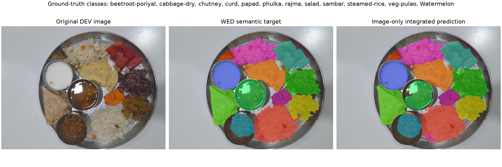
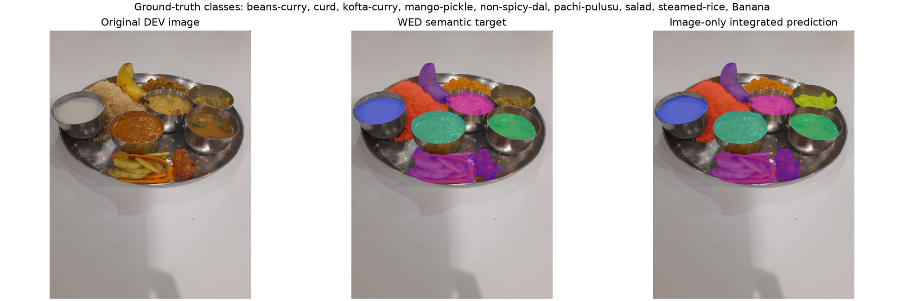
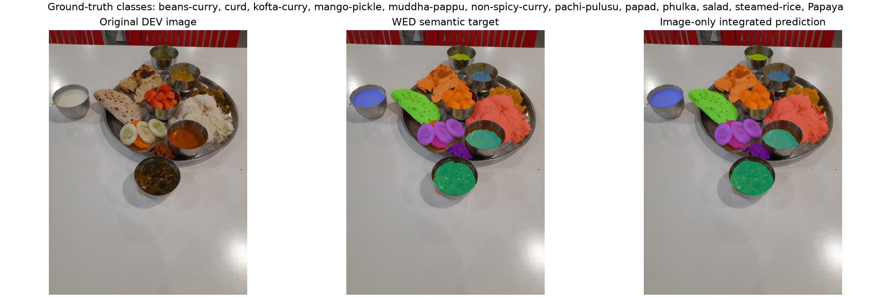

# Integrated NutriSense real-data prototype — WED DEV

- Fixed DEV carve: 108 views / 21 physical groups.
- Device: cpu; no GPU available.
- Frozen segmenter checkpoint SHA-256: `946a8adc50b131465da421c14caee19f03e4471ed883c8d77bdce119cb0ae963`.
- LOCKED / ArUco evaluation / WED test accessed: **false / false / false**.
- Ground-truth masks/classes passed to inference: **false**.

## Pipeline routes

The API uses the frozen 41-class WED DeepLabV3, then derives 8-connected class regions. Because WED has no instance IDs and weight labels are per class, disconnected predicted regions of one class are unioned for the learned mass head. The UI receives one bbox and estimate per predicted class; these are class-level estimates, not verified serving instances.

No-card WED-mapped predictions use the existing learned weight head. MoGe is loaded only for a valid measured ID 7 / 60 mm marker; uncalibrated relative depth is never converted to absolute geometry. Renderer-grounded depth/geometry validation is reported separately.

## DEV results

| Metric | Result |
|---|---:|
| Macro food IoU | 0.8211 |
| Foreground IoU | 0.9196 |
| Region precision / recall / F1 | 0.7372 / 0.7353 / 0.7362 |
| Exact semantic class-set meals | 76/108 |
| Individual class-total mass MAE / bias | 53.56 g / 4.13 g |
| Total meal mass MAE / bias | 133.81 g / 53.62 g |
| Numeric total predictions / abstentions | 108 / 0 |
| Complete weighted class-coverage meals | 2/108 |
| Total 90% interval coverage | 0.630 |
| Mean latency / p95 | 5.42 s / 5.91 s |
| Peak process RSS | 2513 MB |

Individual mass is evaluated at WED's class-total granularity, not per connected component. Class false positives and misses contribute zero-vs-label errors. Total meal weight is scored only when the API returns numeric grams; abstentions remain visible in the denominator.

## Per-class segmentation

| Class | IoU | Pixel precision | Pixel recall | GT pixels |
|---|---:|---:|---:|---:|
| Bottle-gourd-curry | 0.0000 | 0.0000 | 0.0000 | 0 |
| aloo-capsicum | 0.8013 | 0.8913 | 0.8881 | 282568 |
| aloo-curry | 0.8346 | 0.9259 | 0.8943 | 262851 |
| aloo-fry | 0.6464 | 0.9098 | 0.6906 | 390659 |
| beans-curry | 0.8700 | 0.9096 | 0.9523 | 1162163 |
| beetroot-kobari | 0.7637 | 0.7826 | 0.9694 | 567872 |
| beetroot-poriyal | 0.8806 | 0.8924 | 0.9852 | 371575 |
| bisi-bele-bath | 0.8964 | 0.9079 | 0.9860 | 271043 |
| boondi | 0.8100 | 0.8456 | 0.9507 | 197656 |
| cabbage-dry | 0.8931 | 0.9345 | 0.9528 | 832799 |
| channa-brinjal | 0.8359 | 0.9266 | 0.8952 | 428634 |
| chicken-dum-biryani | 0.8409 | 0.8812 | 0.9484 | 385657 |
| chutney | 0.8306 | 0.9138 | 0.9012 | 450980 |
| curd | 0.9086 | 0.9366 | 0.9682 | 2695874 |
| dondakaya-fry | 0.7753 | 0.8378 | 0.9123 | 235434 |
| kakarakaya-fry | 0.7625 | 0.9273 | 0.8110 | 208049 |
| kofta-curry | 0.8614 | 0.8935 | 0.9600 | 700684 |
| leaf-dal | 0.4715 | 0.5015 | 0.8873 | 149884 |
| mango-pickle | 0.7958 | 0.8577 | 0.9169 | 238194 |
| masoor-dal | 0.0000 | 0.0000 | 0.0000 | 0 |
| mirchi-ka-salan | 0.9132 | 0.9278 | 0.9830 | 215207 |
| muddha-pappu | 0.8157 | 0.9047 | 0.8923 | 114390 |
| non-spicy-curry | 0.8256 | 0.8671 | 0.9453 | 528147 |
| non-spicy-dal | 0.6956 | 0.8675 | 0.7783 | 1443644 |
| pachi-pulusu | 0.8586 | 0.9301 | 0.9179 | 667741 |
| papad | 0.8739 | 0.9445 | 0.9212 | 2194398 |
| payasam | 0.8936 | 0.9217 | 0.9671 | 253473 |
| phulka | 0.9341 | 0.9665 | 0.9654 | 2592655 |
| raita | 0.9117 | 0.9209 | 0.9892 | 269456 |
| rajma | 0.9133 | 0.9435 | 0.9661 | 459259 |
| rasam | 0.0000 | 0.0000 | 0.0000 | 0 |
| salad | 0.8663 | 0.9189 | 0.9381 | 2023418 |
| sambar | 0.8756 | 0.9092 | 0.9596 | 1147991 |
| steamed-rice | 0.8864 | 0.9403 | 0.9392 | 6633435 |
| tomato-pappu | 0.5601 | 0.7539 | 0.6855 | 489167 |
| veg-dum-briyani | 0.8373 | 0.8701 | 0.9569 | 361499 |
| veg-pulao | 0.8731 | 0.9287 | 0.9358 | 1093037 |
| Watermelon | 0.8410 | 0.8603 | 0.9740 | 921612 |
| Papaya | 0.8770 | 0.9142 | 0.9557 | 503018 |
| Banana | 0.9269 | 0.9544 | 0.9698 | 1106964 |
| Muskmelon | 0.5453 | 0.5544 | 0.9705 | 225860 |

## Representative image-only predictions

## Limits and interpretation

Connected regions are semantic proxies, not instances. Same-class portions may merge and annotation breaks may fragment a class. The learned WED weight head is trained/evaluated in its existing WED setting and may not generalize to canteen captures; its output is an estimate with a broad model uncertainty, not a scale measurement. With no marker the prototype does not claim metric depth or geometry-derived mass. Six manually weighed ArUco groups and all other protected evaluation data remain unused here.

Existing renderer-grounded calibration/geometry results are in `renderer_depth_geometry_report.md`; the frozen segmentation component results are in `../wed_native_segmentation/dev_report.md`.
