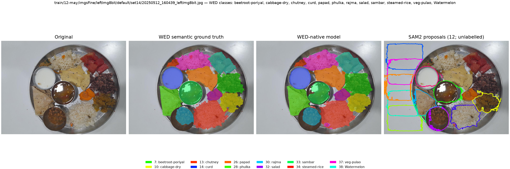
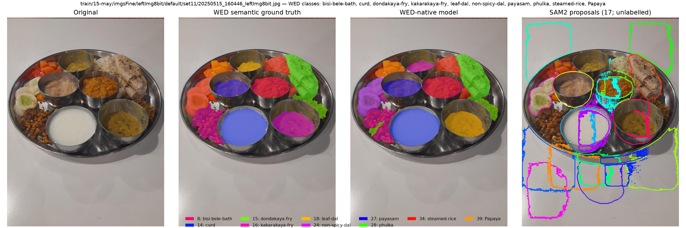
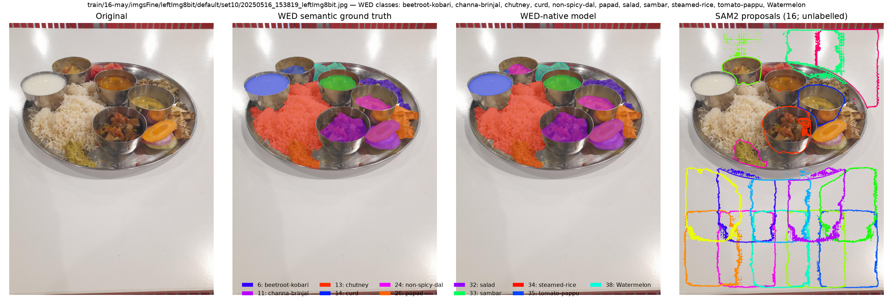

# WED-native semantic segmentation DEV baseline

The model predicts WED semantic classes directly. WED does not supply instance IDs; region counts below use derived 8-connected class components.

- Views / groups: 108 / 21
- Architecture: `deeplabv3_resnet50_imagenet_wed42` (42 labels)
- Model checkpoint SHA-256: `946a8adc50b131465da421c14caee19f03e4471ed883c8d77bdce119cb0ae963`
- LOCKED / ArUco / WED test accessed: `False` / `False` / `False`

## Pixel segmentation

| Metric | WED model |
|---|---:|
| Macro food IoU | 0.8211 |
| Macro food Dice | 0.8976 |
| Foreground union IoU | 0.9196 |
| Foreground union Dice | 0.9581 |

## Region detection

For a direct detector comparison, both methods use class-agnostic one-to-one IoU matching at 0.5 over the same DEV views.

| Metric | WED model regions | SAM2 dense-grid |
|---|---:|---:|
| Precision (95% group CI) | 0.7548 [0.7451, 0.8045] | 0.2081 [0.1864, 0.2420] |
| Recall (95% group CI) | 0.7534 [0.7372, 0.8077] | 0.2054 [0.1820, 0.2322] |
| F1 (95% group CI) | 0.7541 [0.7368, 0.7910] | 0.2067 [0.1822, 0.2325] |
| Duplicate overlapping predictions | 331 | 395 |
| Spurious non-overlapping predictions | 61 | 857 |
| Missed semantic regions | 395 | 1273 |
| Complete region recovery views | 0/108 | 0/108 |

The WED model also has class-aware region scores:

- Class-aware region precision / recall / F1: 0.7367 / 0.7353 / 0.7360.
- Exact WED class-set meals: 76/108.

The SAM2 comparison uses the same DEV images and class-agnostic region matching. SAM2 has no semantic class output, so per-class pixel metrics and class-set accuracy do not apply. The model's class-agnostic region comparison is also recorded in `dev_report.json`.

## Per-class metrics

Macro food IoU averages over 38 classes present in DEV; three taxonomy classes have no DEV examples.

| WED class | Pixel precision | Pixel recall | IoU (95% group CI) | Dice | DEV views present |
|---|---:|---:|---:|---:|---:|
| Bottle-gourd-curry | 0.0000 | 0.0000 | 0.0000 n/a | 0.0000 | 0 |
| aloo-capsicum | 0.8913 | 0.8881 | 0.8013 [0.7750, 0.8330] | 0.8897 | 15 |
| aloo-curry | 0.9260 | 0.8944 | 0.8347 [0.7365, 0.8481] | 0.9099 | 15 |
| aloo-fry | 0.9100 | 0.6906 | 0.6464 [0.6798, 0.8286] | 0.7853 | 9 |
| beans-curry | 0.9096 | 0.9523 | 0.8700 [0.7966, 0.8823] | 0.9305 | 35 |
| beetroot-kobari | 0.7826 | 0.9694 | 0.7638 [0.8056, 0.8570] | 0.8661 | 23 |
| beetroot-poriyal | 0.8925 | 0.9852 | 0.8807 [0.8697, 0.8852] | 0.9366 | 13 |
| bisi-bele-bath | 0.9079 | 0.9860 | 0.8963 [0.8894, 0.9020] | 0.9453 | 10 |
| boondi | 0.8457 | 0.9506 | 0.8101 [0.7907, 0.8593] | 0.8951 | 7 |
| cabbage-dry | 0.9345 | 0.9528 | 0.8931 [0.8562, 0.8888] | 0.9435 | 23 |
| channa-brinjal | 0.9265 | 0.8950 | 0.8357 [0.7812, 0.8493] | 0.9105 | 25 |
| chicken-dum-biryani | 0.8813 | 0.9484 | 0.8410 [0.8202, 0.8677] | 0.9136 | 15 |
| chutney | 0.9138 | 0.9012 | 0.8306 [0.6304, 0.8347] | 0.9075 | 54 |
| curd | 0.9366 | 0.9682 | 0.9086 [0.9026, 0.9315] | 0.9521 | 106 |
| dondakaya-fry | 0.8374 | 0.9119 | 0.7748 [0.6001, 0.8397] | 0.8731 | 10 |
| kakarakaya-fry | 0.9274 | 0.8103 | 0.7619 [0.5129, 0.8752] | 0.8649 | 10 |
| kofta-curry | 0.8936 | 0.9599 | 0.8614 [0.8111, 0.8800] | 0.9256 | 34 |
| leaf-dal | 0.5014 | 0.8869 | 0.4713 [0.4754, 0.8070] | 0.6406 | 9 |
| mango-pickle | 0.8578 | 0.9168 | 0.7958 [0.6957, 0.7934] | 0.8863 | 33 |
| masoor-dal | 0.0000 | 0.0000 | 0.0000 n/a | 0.0000 | 0 |
| mirchi-ka-salan | 0.9279 | 0.9830 | 0.9132 [0.9032, 0.9132] | 0.9547 | 15 |
| muddha-pappu | 0.9046 | 0.8915 | 0.8149 [0.8047, 0.8719] | 0.8980 | 10 |
| non-spicy-curry | 0.8671 | 0.9452 | 0.8256 [0.7896, 0.8652] | 0.9045 | 33 |
| non-spicy-dal | 0.8674 | 0.7783 | 0.6955 [0.6457, 0.8171] | 0.8204 | 75 |
| pachi-pulusu | 0.9301 | 0.9178 | 0.8586 [0.7965, 0.8896] | 0.9239 | 35 |
| papad | 0.9445 | 0.9212 | 0.8739 [0.8195, 0.9043] | 0.9327 | 62 |
| payasam | 0.9216 | 0.9671 | 0.8937 [0.8742, 0.8814] | 0.9438 | 10 |
| phulka | 0.9665 | 0.9654 | 0.9341 [0.8759, 0.9394] | 0.9659 | 67 |
| raita | 0.9208 | 0.9892 | 0.9117 [0.8950, 0.9178] | 0.9538 | 15 |
| rajma | 0.9436 | 0.9660 | 0.9133 [0.8918, 0.9245] | 0.9547 | 23 |
| rasam | 0.0000 | 0.0000 | 0.0000 n/a | 0.0000 | 0 |
| salad | 0.9189 | 0.9381 | 0.8663 [0.8269, 0.8702] | 0.9284 | 104 |
| sambar | 0.9092 | 0.9595 | 0.8756 [0.7701, 0.9332] | 0.9337 | 48 |
| steamed-rice | 0.9403 | 0.9392 | 0.8864 [0.8506, 0.9020] | 0.9398 | 108 |
| tomato-pappu | 0.7538 | 0.6855 | 0.5601 [0.2834, 0.7687] | 0.7180 | 25 |
| veg-dum-briyani | 0.8700 | 0.9570 | 0.8373 [0.7941, 0.8680] | 0.9114 | 15 |
| veg-pulao | 0.9287 | 0.9358 | 0.8731 [0.6059, 0.8868] | 0.9323 | 23 |
| Watermelon | 0.8603 | 0.9740 | 0.8410 [0.8796, 0.9280] | 0.9137 | 36 |
| Papaya | 0.9142 | 0.9557 | 0.8770 [0.7761, 0.9006] | 0.9345 | 20 |
| Banana | 0.9545 | 0.9698 | 0.9269 [0.9188, 0.9306] | 0.9621 | 40 |
| Muskmelon | 0.5544 | 0.9705 | 0.5453 [0.7684, 0.8894] | 0.7057 | 8 |

## Representative multi-item views

## Limitations

Connected components are semantic-region proxies, not authoritative physical instances. Same-class portions that touch can merge in WED labels; annotation gaps can split one food region. Exact class-set and complete-region results should be interpreted with this annotation contract in mind. This report is a segmentation baseline only and makes no depth or weight-estimation claim.
