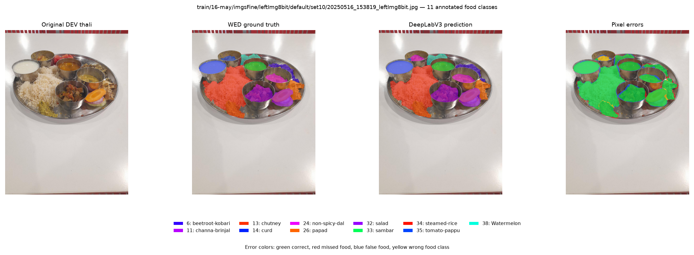
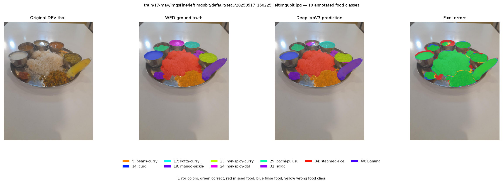
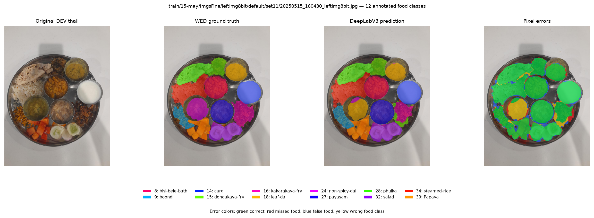

# WED semantic segmentation error analysis

Checkpoint SHA-256: `946a8adc50b131465da421c14caee19f03e4471ed883c8d77bdce119cb0ae963`

DEV scope: 108 views from 21 physical groups. LOCKED / ArUco / WED test accessed: `False` / `False` / `False`.

## Error types against semantic connected-region proxies

| Measure | Count | Interpretation |
|---|---:|---|
| WED GT semantic regions | 1602 | 8-connected components per class |
| Predicted semantic regions | 1599 | 8-connected components per predicted class |
| One-to-one matches at IoU ≥ 0.5 | 1178 | class-consistent |
| GT components with no same-class overlap | 290 | fully disappeared at component level |
| GT components touched by multiple predicted components | 42 | fragmentation proxy |
| Predicted components overlapping multiple GT components of the same class | 79 | merge proxy |
| Unmatched predictions overlapping a GT component | 85 | duplicate/fragment candidates |
| Unmatched predictions with no GT overlap | 336 | spurious components |
| Same-class region recall at IoU ≥ 0.5 | 0.7353 | component matching recall |
| Exact class-set meals | 76/108 (70.4%) | all WED classes present in the image predicted, with no extra classes |

## Small-item and region-size analysis

Area bins use each WED ground-truth component's share of the full image.

| GT component area | GT regions | No-overlap misses | IoU≥0.5 recall | Pixel recall | Fragmented GT regions |
|---|---:|---:|---:|---:|---:|
| tiny_lt_0.10pct | 370 | 269 | 0.005 | 0.340 | 1 |
| small_0.10_to_0.25pct | 37 | 4 | 0.703 | 0.714 | 0 |
| medium_0.25_to_0.50pct | 91 | 3 | 0.879 | 0.836 | 4 |
| large_ge_0.50pct | 1104 | 14 | 0.969 | 0.934 | 37 |

## Per-class pixel and component errors

| Class | Pixel precision | Pixel recall | Pixel IoU | GT regions | Predicted regions | Missed | Fragmented | Merged |
|---|---:|---:|---:|---:|---:|---:|---:|---:|
| Bottle-gourd-curry | 0.000 | 0.000 | 0.000 | 0 | 1 | 0 | 0 | 0 |
| aloo-capsicum | 0.891 | 0.888 | 0.801 | 18 | 17 | 2 | 0 | 1 |
| aloo-curry | 0.926 | 0.894 | 0.835 | 15 | 15 | 0 | 0 | 0 |
| aloo-fry | 0.910 | 0.691 | 0.646 | 11 | 11 | 2 | 1 | 0 |
| beans-curry | 0.910 | 0.952 | 0.870 | 48 | 43 | 11 | 1 | 1 |
| beetroot-kobari | 0.783 | 0.969 | 0.764 | 33 | 28 | 8 | 1 | 2 |
| beetroot-poriyal | 0.892 | 0.985 | 0.881 | 19 | 14 | 2 | 0 | 3 |
| bisi-bele-bath | 0.908 | 0.986 | 0.896 | 12 | 11 | 0 | 0 | 2 |
| boondi | 0.846 | 0.951 | 0.810 | 15 | 9 | 5 | 0 | 1 |
| cabbage-dry | 0.934 | 0.953 | 0.893 | 29 | 36 | 3 | 1 | 2 |
| channa-brinjal | 0.927 | 0.895 | 0.836 | 32 | 26 | 4 | 1 | 3 |
| chicken-dum-biryani | 0.881 | 0.948 | 0.841 | 24 | 25 | 4 | 1 | 5 |
| chutney | 0.914 | 0.901 | 0.831 | 61 | 56 | 9 | 0 | 1 |
| curd | 0.937 | 0.968 | 0.909 | 113 | 117 | 6 | 0 | 1 |
| dondakaya-fry | 0.837 | 0.912 | 0.775 | 12 | 27 | 1 | 0 | 1 |
| kakarakaya-fry | 0.927 | 0.810 | 0.762 | 19 | 11 | 8 | 2 | 1 |
| kofta-curry | 0.894 | 0.960 | 0.861 | 39 | 43 | 3 | 0 | 2 |
| leaf-dal | 0.501 | 0.887 | 0.471 | 11 | 13 | 3 | 0 | 0 |
| mango-pickle | 0.858 | 0.917 | 0.796 | 36 | 33 | 1 | 0 | 2 |
| mirchi-ka-salan | 0.928 | 0.983 | 0.913 | 19 | 18 | 3 | 0 | 1 |
| muddha-pappu | 0.905 | 0.892 | 0.815 | 10 | 14 | 0 | 1 | 0 |
| non-spicy-curry | 0.867 | 0.945 | 0.826 | 41 | 42 | 4 | 2 | 3 |
| non-spicy-dal | 0.867 | 0.778 | 0.696 | 85 | 117 | 7 | 7 | 2 |
| pachi-pulusu | 0.930 | 0.918 | 0.859 | 38 | 35 | 1 | 0 | 2 |
| papad | 0.945 | 0.921 | 0.874 | 94 | 78 | 32 | 2 | 0 |
| payasam | 0.922 | 0.967 | 0.894 | 15 | 10 | 2 | 0 | 3 |
| phulka | 0.966 | 0.965 | 0.934 | 89 | 82 | 19 | 0 | 2 |
| raita | 0.921 | 0.989 | 0.912 | 16 | 15 | 1 | 0 | 0 |
| rajma | 0.944 | 0.966 | 0.913 | 25 | 24 | 1 | 0 | 1 |
| salad | 0.919 | 0.938 | 0.866 | 137 | 132 | 29 | 4 | 3 |
| sambar | 0.909 | 0.960 | 0.876 | 51 | 56 | 2 | 2 | 1 |
| steamed-rice | 0.940 | 0.939 | 0.886 | 212 | 239 | 69 | 12 | 20 |
| tomato-pappu | 0.754 | 0.685 | 0.560 | 30 | 34 | 9 | 1 | 1 |
| veg-dum-briyani | 0.870 | 0.957 | 0.837 | 23 | 24 | 4 | 1 | 2 |
| veg-pulao | 0.929 | 0.936 | 0.873 | 33 | 32 | 11 | 1 | 1 |
| Watermelon | 0.860 | 0.974 | 0.841 | 48 | 39 | 8 | 0 | 4 |
| Papaya | 0.914 | 0.956 | 0.877 | 24 | 22 | 3 | 1 | 1 |
| Banana | 0.954 | 0.970 | 0.927 | 54 | 40 | 11 | 0 | 3 |
| Muskmelon | 0.554 | 0.971 | 0.545 | 11 | 10 | 2 | 0 | 1 |

## Representative DEV error views

### Small Item Misses

### Fragmentation

### Merge Proxy

## Connected-component limitations

WED contains semantic class rasters, not per-serving IDs. Connected components split same-class pixels that are disconnected in the raster and merge same-class pixels that touch. They can also split one serving because of annotation gaps or prediction holes. A predicted region overlapping multiple GT components is therefore a merge only relative to the connected-component proxy. It cannot prove that multiple physical servings merged, nor can the absence of multiple GT components prove distinct servings were recovered. The same restriction applies to fragmentation and complete-region counts.

Small-item disappearance is assessed by GT pixel-area bins and whether any same-class prediction overlaps the component. A component can be absent from the predicted mask even when its class appears elsewhere in the meal; class-set accuracy does not imply every serving was localized.

No synthetic data, LOCKED images, ArUco images, depth model, or geometry/weight pipeline was used or changed.
